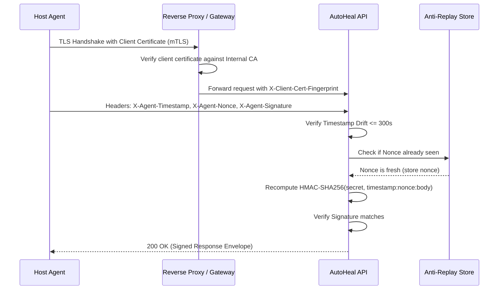

# AutoHeal DevOps — Agent Security & Mutual TLS (mTLS) Specification

## 1. Security Architecture & Threat Vectors

Communication between the AutoHeal control plane and distributed infrastructure agents occurs across internal VPCs or public internet transit. To ensure zero-trust compliance, the communication channel incorporates:

1. **Mutual Authentication**: The control plane verifies agent identity via mTLS x509 certificates and HMAC signing.
2. **Replay Protection**: Cryptographic nonces are tracked with an anti-replay cache.
3. **Clock Skew Enforcement**: Requests with timestamps diverging more than 300 seconds are dropped.
4. **Immediate Revocation**: Compromised or decommissioned nodes can be revoked in real-time, instantly invalidating cryptographic credentials.



---

## 2. Cryptographic Attestation Envelope

Every request sent by an infrastructure agent includes cryptographic authentication headers:

| Header | Format | Purpose | Validation Rule |
| :--- | :--- | :--- | :--- |
| `X-Agent-Timestamp` | Integer (Epoch seconds) | Prevents delayed capture and replay | Rejected if `abs(now - timestamp) > 300` |
| `X-Agent-Nonce` | UUIDv4 / 32-char hex | Guarantees message uniqueness | Rejected if nonce present in replay cache |
| `X-Agent-Signature` | Hex-encoded HMAC-SHA256 | Validates message integrity & sender authenticity | Computed as `HMAC-SHA256(agent_secret, f"{timestamp}:{nonce}:{body}")` |

### HMAC Signature Generation (Python Reference)
```python
import hashlib
import hmac
import time
import uuid

def sign_agent_request(secret_key: str, body: str = "") -> dict:
    timestamp = str(int(time.time()))
    nonce = str(uuid.uuid4())
    message = f"{timestamp}:{nonce}:{body}"
    signature = hmac.new(
        secret_key.encode("utf-8"),
        message.encode("utf-8"),
        hashlib.sha256,
    ).hexdigest()

    return {
        "X-Agent-Timestamp": timestamp,
        "X-Agent-Nonce": nonce,
        "X-Agent-Signature": signature,
    }
```

---

## 3. Mutual TLS (mTLS) Gateway Configuration

For enterprise deployments requiring transport-layer client certificate verification, reverse proxies (Nginx or Envoy) terminate mTLS:

### Nginx Configuration Example
```nginx
server {
    listen 8443 ssl;
    server_name agent-gateway.internal.autoheal.io;

    ssl_certificate /etc/ssl/certs/server.crt;
    ssl_certificate_key /etc/ssl/private/server.key;

    # Client Certificate Verification
    ssl_client_certificate /etc/ssl/certs/autoheal_internal_ca.crt;
    ssl_verify_client on;
    ssl_verify_depth 2;

    ssl_protocols TLSv1.3;
    ssl_prefer_server_ciphers on;

    location /api/v1/agents/ {
        proxy_pass http://backend:8000;
        proxy_set_header X-Forwarded-For $proxy_add_x_forwarded_for;
        proxy_set_header X-Client-Cert-Fingerprint $ssl_client_fingerprint;
        proxy_set_header X-Client-Cert-DN $ssl_client_s_dn;
    }
}
```

---

## 4. Anti-Replay Defense Mechanism

1. The backend maintains an in-memory set / Redis key cache with a sliding 300-second expiration.
2. When a nonce is received:
   - If the nonce already exists in the cache, the request is immediately terminated with `401 Unauthorized` (`"Cryptographic nonce already used (replay attack detected)"`).
   - If the nonce is new, it is inserted into the cache with a 300-second TTL.
3. Memory cleanup occurs automatically when the in-memory window rolls over.

---

## 5. Revocation Security Boundary

Agent revocation is synchronous and permanent:
- Executing `POST /api/v1/agents/{agent_id}/revoke` sets `agent.status = "revoked"` and nullifies `secret_key_hash`.
- Any subsequent request bearing that agent ID is intercepted at the controller boundary and returned `403 Forbidden` (`"Infrastructure agent has been revoked. Access denied."`).
- Revoked credentials cannot be re-activated; a newly registered agent with fresh keys must be provisioned.
