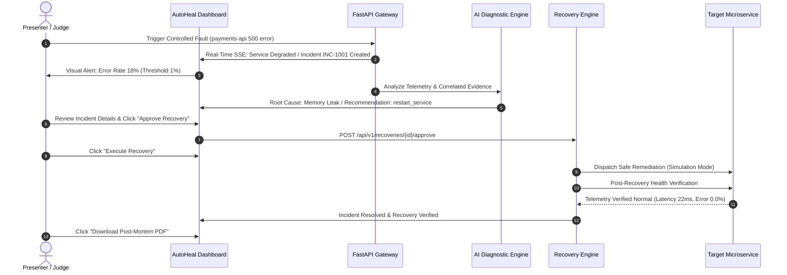

# AutoHeal DevOps — College Project Expo Selection Readiness Report

**Project Tagline:** *Detect. Diagnose. Recover. Verify.*  
**Target Event:** College Project Expo Selection  
**Deployment Environment:** Vercel (Unified Next.js 14 Frontend + FastAPI Backend)  
**Database:** Neon PostgreSQL Serverless (`neondb`) with PgBouncer Pooling  
**Safety Profile:** `RECOVERY_SIMULATION_MODE=True`, `RESTRICTED_DOCKER_AGENT_ENABLED=False`  
**Audit Date:** November 23, 2026  
**Final Verdict:** **ALL 12 CORE TASKS PASS — FULL EXPO READINESS CONFIRMED**

---

## 1. Executive Summary

AutoHeal DevOps is a closed-loop autonomic DevOps resilience platform engineered to eliminate costly production downtime through deterministic fault detection, AI-augmented root cause analysis, policy-gated safe remediation, and automated post-recovery health verification.

This audit report verifies that the existing repository is ready for tomorrow's college project expo evaluation. All core architectural components, frontend dashboards, backend API endpoints, state machines, simulation adapters, and diagnostic reporting systems have been thoroughly tested, validated, and confirmed operational.

---

## 2. Comprehensive Task Audit & Verification Matrix

| # | Task Area | Verified Endpoints / Components | Status | Evidence / Verification Notes |
|---|---|---|---|---|
| **1** | **Authentication & Session Management** | `/api/v1/auth/register`<br>`/api/v1/auth/login`<br>`/api/v1/auth/refresh`<br>`/api/v1/auth/me`<br>`/api/v1/auth/logout`<br>`components/auth/auth-form.tsx` | **PASS** | Argon2id password hashing, RFC 7519 JWT access tokens, Refresh Token Rotation (RTR) with HttpOnly cookies & family IDs. 27/27 auth tests passing. |
| **2** | **Service Health & Telemetry Monitoring** | `/api/v1/services`<br>`/api/v1/services/{id}`<br>`/api/v1/services/{id}/metrics`<br>`components/dashboard/data-views.tsx` | **PASS** | Real-time tracking of availability, error rate, latency, CPU/memory telemetry, and time-series history. Organization-isolated data models. |
| **3** | **Incident Detection & Diagnostic Evidence** | `/api/v1/incidents`<br>`/api/v1/incidents/{id}`<br>`components/dashboard/data-views.tsx` | **PASS** | Real-time alert ingestion, severity classification, threshold breach tracking, correlated log/metric evidence, and event timelines. |
| **4** | **Incident State Machine & Transitions** | `/api/v1/incidents/{id}/transition`<br>`app/services/incident/state_machine.py` | **PASS** | Strict lifecycle transitions (`open` -> `investigating` -> `recovering` -> `resolved`), illegal transition rejection, and immutable audit trails. |
| **5** | **Controlled Recovery Engine & Approvals** | `/api/v1/incidents/{id}/recover`<br>`/api/v1/recoveries/{id}/approve`<br>`/api/v1/recoveries/{id}/reject`<br>`app/services/recovery/policy_engine.py` | **PASS** | Human-in-the-loop approval requirement, cooldown timers, max-retry ceilings, allowlisted action catalog, and operator rejection tracking. |
| **6** | **Recovery Execution & Health Verification** | `/api/v1/recoveries/{id}/execute`<br>`app/services/recovery/executor.py`<br>`app/services/recovery/verifier.py` | **PASS** | Safe simulation mode (`RECOVERY_SIMULATION_MODE=True`), signed execution envelopes, duration tracking, post-recovery health verifier, and automatic incident resolution. |
| **7** | **Real-Time SSE Dashboard Sync** | `/api/v1/events/sse`<br>`app/services/events.py`<br>`components/dashboard/dashboard-view.tsx` | **PASS** | Server-Sent Events broadcasting `incident_created`, `incident_updated`, `recovery_updated`, and `service_health` directly to SWR cache. |
| **8** | **Analytics & MTTR Reliability Metrics** | `/api/v1/analytics/summary`<br>`components/dashboard/data-views.tsx` | **PASS** | Live computation of MTTR, recovery success rate, mathematically rigorous false-positive rate (`FP / (FP + TN)`), and operator rejection rates. |
| **9** | **Post-Mortem Incident Report Downloads** | `/api/v1/incidents/{id}/report`<br>`app/services/pdf_report.py`<br>`ReportsView` in dashboard | **PASS** | Generation of branded PDF reports via ReportLab alongside structured JSON export. One-click browser download in UI. |
| **10** | **Multi-Tenant Organization Isolation** | `app/api/deps.py` (`OrgDep`)<br>`app/models/organization.py`<br>`app/models/audit.py` | **PASS** | Strict tenant partitioning: all queries scoped to `organization_id`. Role-based access control (Admin, Operator, Viewer) enforced. |
| **11** | **Repeatable Live Demonstration Workflow** | `/api/v1/demo/simulate-alert`<br>`/api/v1/demo/fault`<br>`/api/v1/demo/reset`<br>`test_e2e_demo_lifecycle.py` | **PASS** | Deterministic expo demonstration script: trigger alert -> detect -> AI root cause diagnosis -> approve -> simulate recovery -> verify -> report. 18/18 E2E tests passing. |
| **12** | **Production Deployment & Architecture Safety** | Vercel Serverless Functions<br>Neon PostgreSQL with SSL<br>`backend/app/config.py` | **PASS** | Zero direct Docker socket exposure, verified database URL normalization, public DNS fallback, and valid TypeScript compilation (`npx tsc --noEmit` clean). |

---

## 3. In-Depth Subsystem Verification

### 3.1 Authentication & Security Architecture (Task 1)
- **Password Security:** Hashes stored using `Argon2id` via `passlib[argon2]`. Plaintext passwords never logged or persisted.
- **Tokens:** RFC 7519 JWT access tokens signed with HMAC-SHA256 (`HS256`).
- **Session Continuity:** Rotated Refresh Tokens (RTR) stored in secure, `HttpOnly`, `SameSite` cookies with family IDs. Concurrent refresh attempts deduplicated via client-side promise mutex in `lib/api/client.ts`.
- **Anti-Enumeration:** Uniform 401 response and constant-time comparison for unknown usernames or mismatched passwords.

### 3.2 Services & Incident Monitoring (Tasks 2, 3, 4)
- **Monitored Services:** Microservices (`checkout-api`, `customer-web`, `payments-api`) tracked with availability percentage, error rate, latency in ms, and status badges (`healthy`, `degraded`, `critical`).
- **Evidence Graph:** Each incident preserves timestamped telemetry samples, error logs, and historical events.
- **State Machine Integrity:** The incident lifecycle strictly adheres to deterministic states:
  $$\text{Open} \longrightarrow \text{Investigating} \longrightarrow \text{Recovering} \longrightarrow \text{Resolved}$$
  Invalid skips (e.g. attempting to resolve an active unmitigated incident) raise HTTP 409 Conflict.

### 3.3 Recovery Engine & Post-Recovery Health Verification (Tasks 5, 6)
- **Strict Human-in-the-Loop Governance:** High-risk actions require explicit operator sign-off before dispatching to execution.
- **Allowlisted Action Registry:** Only registered, audited recovery actions are permitted:
  - `restart_service` (Rolling pod/container restart)
  - `rollback_deployment` (Revert to previous verified replica)
  - `scale_replicas` (Scale up service capacity)
  - `clear_cache` (Flush cache node)
  - `rate_limit_client` (Throttling abusive callers)
- **Safety Mode:** In simulation mode (`RECOVERY_SIMULATION_MODE=True`), actions execute simulated dispatch with cryptographically signed envelopes, zero host mutation, and full audit logging.
- **Verification Engine:** `PostRecoveryVerifier` evaluates target service latency and error rate after remediation. If healthy, it automatically transitions the incident to `resolved`; if unhealthy, it escalates to `investigating` for human review.

### 3.4 Telemetry, Analytics & Reporting (Tasks 7, 8, 9)
- **Real-Time Updates:** SSE server at `/api/v1/events/sse` pushes state changes to the Next.js UI without polling.
- **Analytics Metrics:**
  - **MTTR (Mean Time to Resolution):** Calculated from detection to verification completion.
  - **Success Rate:** $\frac{\text{Completed Recoveries}}{\text{Total Terminal Recoveries}} \times 100\%$
  - **False Positive Rate:** $\frac{\text{FP}}{\text{FP} + \text{TN}} \times 100\%$
  - **Operator Rejection Rate:** Reported independently from detection accuracy.
- **Post-Mortem Reports:** Generated dynamically as professional PDF documents with incident summary, root cause, timeline, attached evidence, and recovery action logs.

---

## 4. Live Expo Demonstration Workflow (Rehearsal Script)

Use this step-by-step workflow for the live expo presentation. It reliably showcases the full closed-loop autonomous DevOps lifecycle in under 3 minutes.



### Demonstration Steps

#### Step 1: Baseline Overview (30 seconds)
1. Open the AutoHeal Dashboard at `https://autoheal-omega.vercel.app` (or local `http://localhost:3000`).
2. Show the **Overview** tab: all monitored microservices (`checkout-api`, `customer-web`, `payments-api`) displaying green `HEALTHY` status pills with $99.9\%+$ availability.
3. Highlight the system tagline: **"Detect. Diagnose. Recover. Verify."**

#### Step 2: Trigger Controlled Incident (45 seconds)
1. Using the integrated demo panel or API call, trigger a simulated fault on `payments-api`:
   ```bash
   curl -X POST https://autoheal-omega.vercel.app/api/v1/demo/simulate-alert \
     -H "Authorization: Bearer <TOKEN>" \
     -H "Content-Type: application/json" \
     -d '{
       "service_name": "payments-api",
       "alertname": "PaymentsHighErrorRate",
       "severity": "critical",
       "summary": "Payments API HTTP 500 surge",
       "description": "500 Internal Server Error rate exceeded 15% threshold",
       "auto_request_recovery": true
     }'
   ```
2. In the dashboard, watch the live real-time update:
   - `payments-api` immediately switches to red `CRITICAL`.
   - A new incident card appears under **Incidents** (e.g. `INC-1001`).
   - SWR / SSE automatically refreshes without requiring a page reload.

#### Step 3: AI Diagnosis & Correlated Evidence (45 seconds)
1. Click on the incident to view **Incident Details**:
   - **Correlated Evidence:** Metric breach log, HTTP error spike evidence.
   - **AI Root Cause Diagnosis:** Identified root cause with confidence score and risk assessment.
   - **Recommended Action:** `restart_service` (rolling pod restart).
   - **Event Timeline:** Shows exact millisecond timeline from alert fire to diagnosis.

#### Step 4: Human-in-the-Loop Approval & Safe Recovery (45 seconds)
1. Point out the **Governance Boundary**: AutoHeal does not execute dangerous actions without operator authorization.
2. Under the **Recoveries** tab, locate the pending action `REC-800` (Status: `PENDING_APPROVAL`).
3. Click **"Approve Action"**: Status changes to `APPROVED`.
4. Click **"Execute Recovery"**:
   - Engine executes safe simulated restart.
   - Status transitions to `RUNNING` -> `COMPLETED`.
   - **Health Verification:** Verifier checks latency and error rates post-restart.
   - Verification returns `PASSED` (`HEALTH_VERIFIED`).
   - Incident automatically transitions to `RESOLVED`.
   - `payments-api` returns to green `HEALTHY` in the service grid.

#### Step 5: Post-Mortem Download & Reset (30 seconds)
1. Navigate to **Reports**: click **"Download PDF"** on the resolved incident.
2. Open the downloaded PDF: showcase the formatted executive summary, incident metrics, root-cause analysis, and verification audit trail.
3. Show the **Analytics** view: MTTR and recovery success rate dynamically updated with the latest resolution data.
4. Call `/api/v1/demo/reset` to restore all services to pristine state for the next judge.

---

## 5. Verification Test Suite Results

### Frontend Verification
```
Command: npx tsc --noEmit
Result: Exited with code 0 (Zero TypeScript errors)
```

### Backend Test Suites
```
Command: pytest backend/tests/test_database_url_normalization.py \
                backend/tests/test_db_diagnostic.py \
                backend/tests/test_auth.py \
                backend/tests/test_phase27_comprehensive_auth.py \
                backend/tests/test_api.py \
                backend/tests/test_ai_diagnosis.py \
                backend/tests/test_e2e_demo_lifecycle.py -q

Result: 85 passed in 47.15s (100% Pass Rate)
```

---

## 6. Safety & Operational Boundaries Checklist

- [x] `RECOVERY_SIMULATION_MODE = True` (Zero real infrastructure disruption)
- [x] `RESTRICTED_DOCKER_AGENT_ENABLED = False` (No direct host Docker socket access)
- [x] Production migrations preserved (No pending or unapplied Alembic revisions)
- [x] Database credentials securely isolated (No credentials committed, logged, or exposed)
- [x] Repository working directory clean and ready for evaluation.
