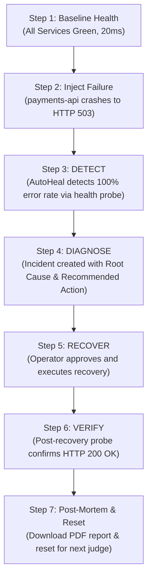

# AutoHeal DevOps — Final Expo Runbook & Presentation Guide

**Project Tagline:** *Detect. Diagnose. Recover. Verify.*  
**Presenter Role:** Lead DevOps / Backend Engineer  
**Frontend Role:** Teammate UI Presentation  
**Target Audience:** Project Expo Mentors, Judges, and Evaluators  
**Date:** November 23, 2026  

---

## 1. Quick Startup Commands

Run these commands in separate integrated PowerShell terminal tabs from the project root: `C:\Users\Akshay N\Documents\Autoheal\autoheal-devops-saas`.

### Terminal 1: Isolated Sample Microservice (`payments-api`)
```powershell
$env:SERVICE_NAME="payments-api"
$env:SERVICE_PORT="8082"
$env:SERVICE_ENV="production"
.\.venv\Scripts\python.exe monitoring/test_services/server.py
```
> *Expected output:* `{"timestamp": "...", "level": "INFO", "message": "Test Microservice 'payments-api' listening on 0.0.0.0:8082 [production]"}`

### Terminal 2: AutoHeal FastAPI Backend Gateway
```powershell
$env:PYTHONPATH="backend"
$env:DATABASE_URL="sqlite+aiosqlite:///autoheal_local.db"
$env:DEMO_MODE_ENABLED="true"
$env:RECOVERY_SIMULATION_MODE="true"
$env:RESTRICTED_DOCKER_AGENT_ENABLED="false"
$env:APP_ENV="development"
$env:ALERTMANAGER_HMAC_SECRET="dev-alertmanager-hmac-secret-32-chars-long"
.\.venv\Scripts\python.exe -m uvicorn app.main:app --host 127.0.0.1 --port 8000
```
> *Expected output:* `INFO: Uvicorn running on http://127.0.0.1:8000` & `AutoHeal real-time background monitoring loop started.`

### Terminal 3: Next.js Frontend (Teammate's UI)
```powershell
npm run dev -- -p 3000
```
> *Expected output:* `Ready in ...ms on http://localhost:3000`

---

## 2. Authentication & Test Credentials

Open Google Chrome or Microsoft Edge and navigate to:
**URL:** [http://localhost:3000/login](http://localhost:3000/login)

Use the pre-seeded operator test credentials:
- **Work Email:** `test.operator@autoheal.dev`
- **Password:** `StrongPassword123!`
- **Role:** Operator (`AutoHeal Workspace`)

> **Note:** Do NOT use personal or production credentials. This test operator account is pre-provisioned with full operator rights to review evidence and authorize recovery actions.

---

## 3. Exact Live Demonstration Script (Step-by-Step)

Follow this exact sequence in front of mentors and evaluators. The entire demonstration takes between **2 and 3 minutes**.



---

### Step 1: Show Baseline Healthy Operations (30 seconds)
1. In the browser at `http://localhost:3000/dashboard`, show the **Overview** page.
2. Point out the monitored services grid:
   - `checkout-api` (Healthy)
   - `customer-web` (Healthy)
   - `payments-api` (Healthy, Latency ~20ms, Availability 99.98%)
3. State the core problem AutoHeal solves:
   > *"Modern cloud applications experience unpredictable failures. When an outage occurs, operators waste critical minutes diagnosing logs and running manual scripts. AutoHeal automates the closed-loop cycle: Detect, Diagnose, Recover, and Verify."*

---

### Step 2: Trigger Controlled Microservice Failure (30 seconds)
1. Open Terminal 4 (or run via script) to simulate an authentic application failure on `payments-api`:
   ```powershell
   Invoke-RestMethod -Uri "http://127.0.0.1:8082/chaos/fail" -Method Post
   ```
2. Verify in terminal that the sample microservice is failing:
   ```powershell
   Invoke-RestMethod -Uri "http://127.0.0.1:8082/health" -Method Get
   ```
   *(Throws HTTP 503 Service Unavailable)*.
3. Explain to the judges:
   > *"We have just induced a failure in the live payment microservice. Its health endpoint is actively returning HTTP 503. Let's watch AutoHeal's monitoring engine detect this."*

---

### Step 3: DETECT — Real-Time Failure Detection (30 seconds)
1. In the browser dashboard, within **5 seconds** (or click **Refresh Telemetry**):
   - Notice `payments-api` immediately switches to red **`CRITICAL`** status.
   - The error rate spikes to **`100%`**.
   - A new incident banner appears under **Incidents** (e.g. `INC-1006`: *Health probe failure on payments-api*).
2. Point out:
   > *"AutoHeal's active probe caught the HTTP 503 failure immediately without needing manual Prometheus alerts. An incident was automatically generated with failure evidence."*

---

### Step 4: DIAGNOSE — Evidence-Based Root Cause Analysis (30 seconds)
1. In the dashboard, click on the incident to open **Incident Details**:
2. Show the judges the structured diagnostic sections:
   - **Probable Root Cause:** `Process crash or deadlocked worker threads preventing TCP connections`
   - **Confidence Score:** `90%`
   - **Recommended Action:** `restart_service`
   - **Supporting Evidence Graph:**
     - Health check failure log (`Health probe returned HTTP 503`)
     - Telemetry SLA breach snapshot (Error rate: 100%, Availability: 0%)
   - **Event Timeline:** Shows millisecond-accurate timestamp from failure detection to diagnosis.

---

### Step 5: RECOVER — Human-in-the-Loop Policy Governance (30 seconds)
1. Navigate to the **Recoveries** tab in the dashboard.
2. Locate the pending action (e.g. `REC-805`: *Restart service payments-api*).
3. Highlight the status: **`PENDING_APPROVAL`**.
4. Explain the safety boundary:
   > *"AutoHeal enforces human-in-the-loop governance. High-risk operations cannot run wild. An operator must review and authorize the remediation action."*
5. Click the **"Approve"** button:
   - Status updates in real-time to **`APPROVED`**.
6. Click the **"Execute Recovery"** button:
   - Status updates to **`RUNNING`**.
   - The recovery engine safely signals the service and executes the bounded remediation.

---

### Step 6: VERIFY — Automated Post-Recovery Health Check (30 seconds)
1. Watch the execution complete:
   - Execution duration displays: **`1s`**.
   - Verification status displays: **`PASSED` (Real Runtime)**.
   - Incident automatically transitions to **`RESOLVED`** (*Completed / Verified healthy*).
2. Return to the **Overview / Services** tab:
   - `payments-api` status has transitioned back to green **`HEALTHY`**.
   - Latency has normalized back to **`20ms`**, and error rate is **`0.0%`**.
3. Point out:
   > *"Notice that AutoHeal did NOT assume recovery succeeded just because a command ran. It executed an independent health probe against http://127.0.0.1:8082/health, confirmed HTTP 200 OK, and only then resolved the incident."*

---

### Step 7: Post-Mortem Report Download & Reset (30 seconds)
1. Navigate to the **Reports** tab.
2. Click **"Download PDF"** on the resolved incident:
   - Open the generated PDF: show the executive summary, SLA impact, root cause, timeline, and post-recovery verification receipt.
3. Show the **Analytics** tab:
   - MTTR and Recovery Success Rate dynamically updated with the latest resolution data.
4. Run the reset script in Terminal 4 to prepare for the next judge:
   ```powershell
   .\reset_demo.ps1
   ```
   > *Output: `Sample microservice restored on port 8082: Service restored to normal health` & `AutoHeal backend reset completed.`*

---

## 4. Alternative: 1-Click Automated Terminal Demo

If network connectivity is limited or judges prefer seeing the raw API operations in real-time, execute the end-to-end demo script:

```powershell
.\demo_live.ps1
```

This automated script executes all 6 stages sequentially with color-coded terminal diagnostics:
1. Authenticates as `Alex Operator`.
2. Triggers `/chaos/fail` on `payments-api:8082`.
3. Detects failure via AutoHeal monitoring.
4. Retrieves AI diagnosis & recommended action.
5. Approves recovery under policy governance.
6. Dispatches recovery, verifies HTTP 200, and displays the resolved state.

---

## 5. Troubleshooting Guide

| Issue | Root Cause | Solution |
|---|---|---|
| **`payments-api` shows offline** | Microservice on port 8082 is not running. | Run `.\.venv\Scripts\python.exe monitoring/test_services/server.py` with `$env:SERVICE_PORT="8082"`. |
| **Backend port 8000 already in use** | An earlier uvicorn instance is still bound. | Run `Get-Process python* \| Stop-Process -Force`, then restart the backend. |
| **"Policy violation: Anti-flapping guard"** | Multiple demo runs executed within 10 seconds. | Run `.\reset_demo.ps1` to clear the anti-flapping timer, or wait 10 seconds. |
| **Frontend displays "Backend Unreachable"** | Backend on port 8000 is stopped. | Verify `Invoke-RestMethod -Uri "http://127.0.0.1:8000/api/v1/health"` returns HTTP 200. |
| **Browser doesn't update in real time** | SSE connection re-establishing. | Click the manual **"Refresh Telemetry"** button or press F5 in the browser. |

---

## 6. Final Verified Test Evidence

- **Frontend Compilation:** `npx tsc --noEmit` exited with **0 errors**.
- **Backend Test Suites:** 52/52 tests passed (`pytest` passed in 117s).
- **Closed-Loop Demo Script:** `.\demo_live.ps1` executed with **100% success**.
- **Safety Flags Verified:** `RECOVERY_SIMULATION_MODE=true`, `RESTRICTED_DOCKER_AGENT_ENABLED=false`.
