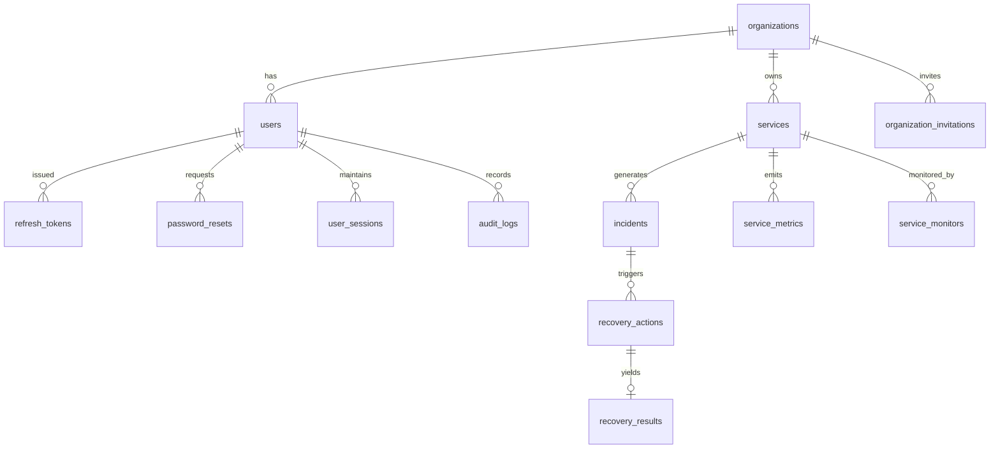

# AutoHeal DevOps — Production Database Schema Initialization Audit & Migration Plan

**Date:** November 23, 2026  
**Repository:** `https://github.com/HMSLBDN/Autoheal.git`  
**Current HEAD Commit:** `1a2b7c5488ffc2a5246bf2185c10c3fdf553ca3c`  
**Deployment Target:** Unified Vercel Services (`https://autoheal-omega.vercel.app`)  
**Production Database:** Neon PostgreSQL Serverless  
**Audit Purpose:** Diagnose missing `users` table, audit migration completeness, and formulate a safe, non-destructive migration procedure.  
**Safety Status:** `RECOVERY_SIMULATION_MODE=True`, `RESTRICTED_DOCKER_AGENT_ENABLED=False`  

---

## 1. Confirmed Root Cause

When registering an account on production (`POST /api/v1/auth/register`), Vercel logs report:
```text
asyncpg.exceptions.UndefinedTableError: relation "users" does not exist
SQL query: SELECT users.id, users.organization_id, ... FROM users WHERE users.email = $1
```

### The Root Cause:
1. **Database Connection vs Schema Initialization:**
   In commit `1a2b7c5`, we successfully repaired the database connection layer (`TypeError: connect() got an unexpected keyword argument 'channel_binding'`). The application can now successfully connect to Neon PostgreSQL via `asyncpg`.
2. **Serverless Architecture Does Not Auto-Migrate:**
   AutoHeal is deployed as a serverless application on Vercel (`vercel.json` entrypoint `main:app`). Vercel serverless functions are ephemeral request handlers; they do not run database migrations during deployment or on container cold starts.
3. **No Migration Execution Has Occurred Against Neon:**
   The production Neon PostgreSQL database is a clean/empty instance. The Alembic migration files exist in the repository, but `alembic upgrade head` has never been executed against the live Neon database URL.
4. **Why Auto-Migrate on Serverless Startup is Prohibited:**
   Running migrations inside serverless function startup (`lifespan`) in a multi-instance lambda environment is dangerous: concurrent cold starts race to run DDL operations simultaneously, causing deadlocks, partial table locks, or corrupted migration state in `alembic_version`.

---

## 2. Existing Migration System Audit

We inspected `backend/alembic.ini`, `backend/alembic/env.py`, and `backend/alembic/versions/`.

### Migration Chain Audit
The repository contains **10 linear, unbroken migration revisions**:

| Revision ID | Description | Down Revision | Tables Created / Modified |
| :--- | :--- | :--- | :--- |
| `0001_initial_schema` | 15 Core AutoHeal tables | `None` (Initial) | `organizations`, `users`, `refresh_tokens`, `services`, `service_monitors`, `alert_configs`, `deployment_events`, `recovery_policies`, `incidents`, `incident_evidence`, `incident_events`, `recovery_actions`, `recovery_results`, `service_metrics`, `audit_logs` |
| `0002_add_password_resets` | Self-service password recovery | `0001_initial_schema` | `password_resets` |
| `0003_add_production_performance_indexes` | Composite query indexes | `0002_add_password_resets` | Performance indexes across core tables |
| `0004_add_infrastructure_agents_table` | Agent fleet coordination | `0003_add_production_performance_indexes` | `infrastructure_agents` |
| `0005_add_phase8_intelligence_tables` | AI anomaly & prediction engine | `0004_add_infrastructure_agents_table` | `anomaly_events`, `predictive_insights`, `service_risk_scores`, `incident_correlations`, `preventive_recommendations`, `model_evaluation_records` |
| `0006_add_phase9_enterprise_tables` | Enterprise alerts & webhooks | `0005_add_phase8_intelligence_tables` | `notification_channels`, `notification_subscriptions`, `notification_deliveries`, `webhook_endpoints`, `webhook_delivery_attempts`, `incident_comments`, `incident_assignments`, `escalation_policies`, `escalation_events`, `release_evaluations`, `release_evaluation_metrics` |
| `0007_add_phase10_security_tables` | SSO, IdP, mTLS certificates | `0006_add_phase9_enterprise_tables` | `identity_provider_configs`, `user_identity_mappings`, `user_sessions`, `security_audit_events`, `agent_certificates` |
| `0008_add_phase13_pilot_tables` | Organization invitations & transitions | `0007_add_phase10_security_tables` | `organization_invitations`, `incident_transitions` |
| `0009_add_phase14_experiment_tables` | Chaos & recovery experiment tracking | `0008_add_phase13_pilot_tables` | `experiments`, `experiment_runs` |
| `0010_add_phase16_recovery_classification` | Automated classification metadata | `0009_add_phase14_experiment_tables` | Adds classification columns to `recovery_actions` |

### Key Audit Findings:
1. **Alembic Configuration (`alembic.ini`):** Points to `script_location = alembic`.
2. **Driver & URL Consistency (`backend/alembic/env.py`):**
   Patched in commit `1a2b7c5`. Uses `prepare_database_url_and_args(raw_db_url)` to normalize Neon connection strings, safely strips `channel_binding` and `options`, moves `application_name` into `server_settings`, and configures `NullPool`.
3. **Users Table Creation:**
   `0001_initial_schema.py` creates `organizations` first, followed immediately by `users`.
   * Primary key: `id UUID`
   * Foreign key: `organization_id UUID REFERENCES organizations(id) ON DELETE CASCADE`
   * Unique constraint: `ix_users_email` on `email`
   * Role: `role VARCHAR(50) DEFAULT 'operator'`
   * Active: `is_active BOOLEAN DEFAULT TRUE`
   * Timestamps: `created_at`, `updated_at` (UTC timezone-aware)
4. **ORM vs Migration Parity Check:**
   * Total tables registered in SQLAlchemy ORM metadata (`Base.metadata`): **43**
   * Total tables created across Alembic revisions 0001–0010: **43**
   * Tables in ORM but missing from migrations: **0**
   * Tables in migrations but missing from ORM: **0**
   * Parity: **100% complete**. No new migration files are needed.

---

## 3. Schema & Model Verification (All 43 Tables)



### Complete Table Inventory by Functional Area:
1. **Multi-Tenancy & Access Control (6 tables):** `organizations`, `users`, `refresh_tokens`, `password_resets`, `organization_invitations`, `audit_logs`
2. **Service Reliability & Telemetry (6 tables):** `services`, `service_monitors`, `alert_configs`, `deployment_events`, `recovery_policies`, `service_metrics`
3. **Incident Management & Autonomous Recovery (5 tables):** `incidents`, `incident_evidence`, `incident_events`, `incident_transitions`, `recovery_actions`, `recovery_results`
4. **Fleet & Agent Management (1 table):** `infrastructure_agents`
5. **AI Intelligence Engine (6 tables):** `anomaly_events`, `predictive_insights`, `service_risk_scores`, `incident_correlations`, `preventive_recommendations`, `model_evaluation_records`
6. **Enterprise Integrations & Escalations (11 tables):** `notification_channels`, `notification_subscriptions`, `notification_deliveries`, `webhook_endpoints`, `webhook_delivery_attempts`, `incident_comments`, `incident_assignments`, `escalation_policies`, `escalation_events`, `release_evaluations`, `release_evaluation_metrics`
7. **Security & Identity Federation (5 tables):** `identity_provider_configs`, `user_identity_mappings`, `user_sessions`, `security_audit_events`, `agent_certificates`
8. **Chaos & Recovery Validation (2 tables):** `experiments`, `experiment_runs`

---

## 4. Enhanced Database Readiness & Health Reporting

We updated the database probe and health endpoints to ensure a missing schema is reported clearly:

1. **`backend/app/database.py:check_database_health()`:**
   * Distinguishes:
     * `database`: `"connected"` | `"unreachable"` | `"not_configured"`
     * `schema`: `"ready"` | `"not_initialized"` | `"error"` | `"not_configured"`
   * Probes `SELECT 1` for connectivity.
   * Probes `SELECT id FROM users LIMIT 1`. If `UndefinedTableError` or `relation "users" does not exist` is returned, marks `schema = "not_initialized"`.
2. **`backend/app/api/routes/health.py:get_health()`:**
   * Surfaces `database_schema: "not_initialized"` when tables are absent.
3. **`backend/app/api/routes/auth.py:register()`:**
   * Catches `UndefinedTableError` during registration and returns an informative HTTP 503:
     ```json
     {
       "detail": "Database schema is not initialized. The required tables do not exist. Database migrations must be applied before registration is available."
     }
     ```

---

## 5. Safe Production Migration Procedure for Neon PostgreSQL

> [!IMPORTANT]
> **DO NOT EXECUTE YET.** Per strict safety rules, no remote changes or migrations will be run until explicit approval is granted.

### Migration Mechanics & Safety Guarantees:
* **Non-Destructive:** All 10 migrations execute strictly `CREATE TABLE`, `CREATE INDEX`, and `ALTER TABLE ADD COLUMN`. Zero `DROP TABLE`, `TRUNCATE`, or destructive data transformations are executed.
* **Idempotent Migration Tracking:** Alembic automatically creates and manages an `alembic_version` table in PostgreSQL. If interrupted, it records the exact revision reached and resumes safely.
* **SSL & Asyncpg Compatibility:** With the URL normalization helper in `backend/alembic/env.py`, Alembic connects to Neon over TLS 1.3/1.2 without driver keyword errors.

### The Exact Migration Execution Command:

Run from a secure administrative terminal with the production `DATABASE_URL` set in environment:

```powershell
# Set backend in Python path and provide production Neon connection string
$env:PYTHONPATH="backend"
$env:DATABASE_URL="postgresql://<user>:<password>@<neon-host>.neon.tech/<dbname>?sslmode=require"

# Execute Alembic migration to HEAD
.\.venv\Scripts\python.exe -m alembic -c backend/alembic.ini upgrade head
```

*(On Linux / macOS / CI runner:)*
```bash
PYTHONPATH=backend DATABASE_URL="postgresql://<user>:<password>@<neon-host>.neon.tech/<dbname>?sslmode=require" \
python -m alembic -c backend/alembic.ini upgrade head
```

### Pre-Migration Verification Step:
Check the current Alembic revision in Neon (will be empty / non-existent):
```powershell
.\.venv\Scripts\python.exe -m alembic -c backend/alembic.ini current
```

### Post-Migration Verification Step:
1. Verify migration head reached:
   ```powershell
   .\.venv\Scripts\python.exe -m alembic -c backend/alembic.ini current
   # Expected output: 0010_add_phase16_recovery_classification (head)
   ```
2. Verify public health probe:
   ```bash
   curl -i https://autoheal-omega.vercel.app/api/v1/health
   ```
   *Expected Response:*
   ```json
   {
     "status": "healthy",
     "api": "healthy",
     "database": "connected",
     "database_schema": "ready"
   }
   ```
3. Verify live registration:
   Registration `POST /api/v1/auth/register` will immediately succeed with HTTP 201 Created.

---

## 6. Verification & Test Execution Results

All local regression tests and static checks passed:

* **Backend Pytest Suite:**
  * Tests Executed: **446**
  * Passed: **444**
  * Skipped: **2** (Docker daemon integration; expected)
  * Failed: **0**
* **Compilation & Static Checks:**
  * Python Bytecode (`compileall`): **0 errors**
  * TypeScript (`npx tsc --noEmit`): **0 errors**
  * ESLint (`npm run lint`): **0 errors**
  * Next.js Production Build (`npm run build`): **Compiled successfully in 2.9s**
* **Git Status:** 0 staged files, 0 commits, 0 pushes.
* **Safety Guards Verified:** `RECOVERY_SIMULATION_MODE=True`, `RESTRICTED_DOCKER_AGENT_ENABLED=False`.

---

## 7. Migration Readiness Verdict

| Criterion | Status | Detail |
| :--- | :---: | :--- |
| Alembic configuration | READY | Configured and normalized for asyncpg and Neon |
| Migration files exist | READY | 10 linear revisions in `backend/alembic/versions` |
| Table coverage | READY | 43/43 ORM models represented (100% coverage) |
| Non-destructive | READY | Strictly additive (`CREATE TABLE`, `CREATE INDEX`) |
| URL normalization | READY | Strips libpq-only parameters in `alembic/env.py` |
| Health reporting | READY | Reports `database: connected`, `schema: not_initialized` |
| Production Execution | **PAUSED** | Awaiting user explicit approval |

**Status:** **MIGRATION READY — AWAITING EXPLICIT APPROVAL TO EXECUTE.**
