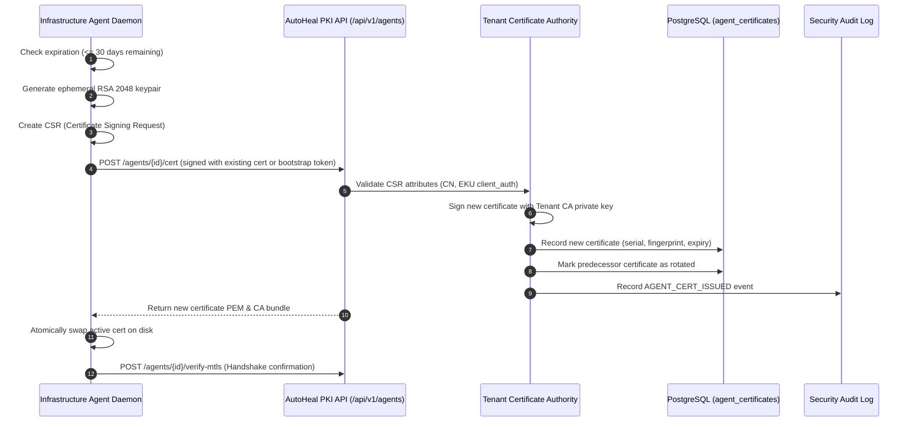

# AutoHeal DevOps — Certificate Lifecycle Management & PKI Governance

## 1. Overview & Policy Statement

Phase 10 implements strict Public Key Infrastructure (PKI) governance for all components within the AutoHeal ecosystem. This policy governs:
- Root Certificate Authorities (Tenant CAs)
- Intermediate Issuing CAs
- Infrastructure Agent Client Certificates
- Internal Service-to-Service mTLS Certificates

All certificates adhere to **NIST SP 800-57** guidelines and **RFC 5280** standards.

---

## 2. Certificate Validity & Renewal Schedule

| Certificate Class | Key Algorithm | Signature | Validity Period | Renewal Window | Max Lifetime |
|:---|:---|:---|:---|:---|:---|
| **Tenant Root CA** | RSA 4096-bit | SHA-384 / SHA-256 | 5 Years | 6 Months prior | 10 Years |
| **Intermediate CA** | RSA 4096-bit | SHA-256 | 2 Years | 3 Months prior | 3 Years |
| **Agent Client Cert** | RSA 2048-bit | SHA-256 | 90 Days | 30 Days prior | 90 Days |
| **Service TLS Cert** | RSA 2048-bit | SHA-256 | 90 Days | 21 Days prior | 90 Days |

---

## 3. Automated Certificate Issuance & Renewal Flow



---

## 4. Emergency Revocation Workflow

When an infrastructure agent node is suspected of compromise, hardware decommission, or network isolation:

1. **Trigger Revocation via API or UI**:
   - `POST /api/v1/agents/{id}/revoke-cert`
   - Required parameters: `reason` (e.g., `key_compromise`, `superseded`, `cessation_of_operation`).
2. **Immediate Database Invalidation**:
   - The certificate record in `agent_certificates` is updated:
     ```sql
     UPDATE agent_certificates 
     SET is_revoked = TRUE, revoked_at = NOW(), revocation_reason = :reason
     WHERE agent_id = :agent_id AND is_revoked = FALSE;
     ```
3. **mTLS Handshake Interception**:
   - The TLS handshake verifier checks the database certificate table during client hello processing. Any certificate marked `is_revoked = True` is immediately terminated with TLS alert `certificate_revoked (44)`.
4. **Security Audit Incident Creation**:
   - High-severity security event `AGENT_CERT_REVOKED` logged and dispatched to Slack/PagerDuty notification channels.

---

## 5. Key Storage & Protection Best Practices

- **Root CA Private Keys**: In production deployments, Root CA private keys must be stored in AWS CloudHSM, Google Cloud KMS, or HashiCorp Vault. Under no circumstances are plaintext Root CA private keys committed to source control or container images.
- **Agent Private Keys**: Local agent private keys are created on-node with POSIX permissions `0600` owned by the unprivileged `autoheal-agent` daemon user.
- **Strict Prohibition**: Phase 10 automated test suites utilize transient, in-memory generated cryptographic keys. No production private keys are stored on disk.
