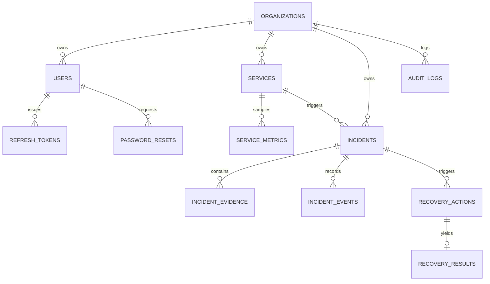

# AutoHeal DevOps — Database Operations & Engineering Guide

## 1. Relational Schema Architecture & Data Model

AutoHeal DevOps employs PostgreSQL 16 as its system of record. Every persistent entity is strictly isolated by `organization_id` (UUIDv4) to guarantee zero cross-tenant data contamination.



### Table Definitions & Primary Keys
- **`organizations`**: Master tenant record (`id: UUID`, `slug: VARCHAR(64) UNIQUE`, `name`, `plan`, `is_active`).
- **`users`**: Tenant user accounts (`id: UUID`, `organization_id: FK`, `email: VARCHAR(255)`, `hashed_password: Argon2id`, `role: admin|operator|viewer`).
- **`services`**: Monitored microservices (`id: VARCHAR(64)`, `organization_id: FK`, `name`, `environment: production|staging`, `availability`, `error_rate`, `latency_ms`).
- **`service_metrics`**: High-frequency metric telemetry (`id: UUID`, `service_id: FK`, `sampled_at`, `error_rate`, `latency_ms`, `cpu_usage`, `memory_usage`).
- **`incidents`**: Correlated failure events (`id: VARCHAR(32)`, `organization_id: FK`, `service_id: FK`, `status: open|investigating|recovering|resolved`, `severity: critical|high|medium|low`, `detected_at: TIMESTAMPTZ`).
- **`recovery_actions`**: Policy-gated remediation actions (`id: VARCHAR(32)`, `incident_id: FK`, `action`, `status: pending_approval|approved|running|completed|rejected|failed`, `requested_at`).
- **`recovery_results`**: Verification telemetry (`id: UUID`, `recovery_action_id: FK UNIQUE`, `verified: BOOL`, `summary`).
- **`refresh_tokens`**: Rotating session tokens (`id: UUID`, `user_id: FK`, `family_id: UUID`, `token_hash: SHA-256`, `is_revoked: BOOL`, `expires_at`).
- **`audit_logs`**: Immutable audit trails (`id: UUID`, `organization_id: FK`, `user_id: FK`, `action`, `resource_type`, `resource_id`, `details`, `created_at`).

---

## 2. Connection Pool Sizing & Resource Calculation

AutoHeal DevOps utilizes the SQLAlchemy `AsyncAdaptedQueuePool` backed by `asyncpg`.

### Formula for Sizing:
$$\text{Pool Size} = \frac{\text{Concurrent Web Workers} \times \text{Average Active Queries per Request}}{\text{P95 Query Latency / Target Response Time}} + \text{Headroom}$$

In production:
- **`DB_POOL_SIZE = 20`**: Base dedicated connections kept open to eliminate TLS and handshake overhead.
- **`DB_MAX_OVERFLOW = 10`**: Burst capacity during alert storms (total max 30 connections per API instance).
- **`DB_POOL_TIMEOUT = 30`**: Fail-fast timeout (seconds) preventing thread pool starvation under database lock saturation.
- **`DB_POOL_RECYCLE = 1800`**: Connections recycled every 30 minutes to clean up stale TCP state across stateful firewalls.

### PostgreSQL Server-Side Configuration (`postgresql.conf`)
Ensure PostgreSQL can accommodate all backend replicas and worker pools:
```ini
max_connections = 100
shared_buffers = 2GB
effective_cache_size = 6GB
work_mem = 32MB
maintenance_work_mem = 512MB
min_wal_size = 1GB
max_wal_size = 4GB
checkpoint_completion_target = 0.9
wal_buffers = 16MB
default_statistics_target = 100
random_page_cost = 1.1
```

---

## 3. Alembic Migration Architecture & Revisions

Database schema evolutions are managed strictly through versioned Alembic revisions in `backend/alembic/versions/`.

### Revision Catalog
| Revision ID | Description | Operations Executed |
| :--- | :--- | :--- |
| `0001_initial` | Initial multi-tenant schema | Created organizations, users, services, incidents, evidence, events, recoveries, results |
| `0002_add_audit_and_refresh_tokens` | Security & session hardening | Added `refresh_tokens` (RTR family lineage), `password_resets`, and `audit_logs` |
| `0003_add_production_performance_indexes` | High-concurrency indexing | Created composite indexes for tenant filtering, time-series sorting, and session lookups |

### Standard Migration Workflows

#### 1. Applying Migrations (Production Staging)
```bash
# Verify current applied revision
alembic current

# Upgrade to latest revision head
alembic upgrade head
```

#### 2. Generating a New Non-Destructive Migration
```bash
# Auto-generate migration from SQLAlchemy model changes
alembic revision --autogenerate -m "add_table_or_column_name"

# Inspect the generated script in backend/alembic/versions/
# ALWAYS verify that downgrades are fully implemented!
```

#### 3. Rolling Back a Migration
```bash
# Roll back single revision
alembic downgrade -1

# Roll back to specific revision ID
alembic downgrade 0002
```

---

## 4. Production Indexing Strategy & Query Optimization

Multi-tenant queries that filter on `organization_id` combined with timestamp sorting or status filtering can cause expensive full-table sequential scans if indexed only by single columns.

In revision `0003`, composite indexes were created directly matching the access patterns in `backend/app/api/routes/`:

1. **`ix_incidents_org_detected_at`** on `incidents (organization_id, detected_at DESC)`:
   - Eliminates sort overhead for the primary incident log dashboard (`GET /api/v1/incidents`).
2. **`ix_incidents_org_status`** on `incidents (organization_id, status)`:
   - Optimizes count aggregations and active incident filters in `GET /api/v1/analytics/summary`.
3. **`ix_services_org_env`** on `services (organization_id, environment)`:
   - Speeds up service catalog queries filtered by production vs staging.
4. **`ix_service_metrics_svc_sampled`** on `service_metrics (service_id, sampled_at DESC)`:
   - Accelerates high-frequency latency and error rate chart rendering.
5. **`ix_audit_logs_org_created`** on `audit_logs (organization_id, created_at DESC)`:
   - Powers the compliance and security audit log views without cross-tenant table scans.
6. **`ix_refresh_tokens_user_revoked`** on `refresh_tokens (user_id, is_revoked)`:
   - Ensures sub-millisecond token lookup during rapid API authentication calls.

---

## 5. Routine Maintenance & Vacuuming Schedule

Schedule automated maintenance via cron on the database host or Celery beat:

```bash
# Nightly VACUUM ANALYZE to refresh query planner statistics
0 2 * * * psql -U autoheal_user -d autoheal_production -c "VACUUM ANALYZE;"

# Weekly REINDEX to prevent index bloat on high-turnover tables
0 3 * * 0 psql -U autoheal_user -d autoheal_production -c "REINDEX TABLE CONCURRENTLY service_metrics; REINDEX TABLE CONCURRENTLY incidents;"
```
