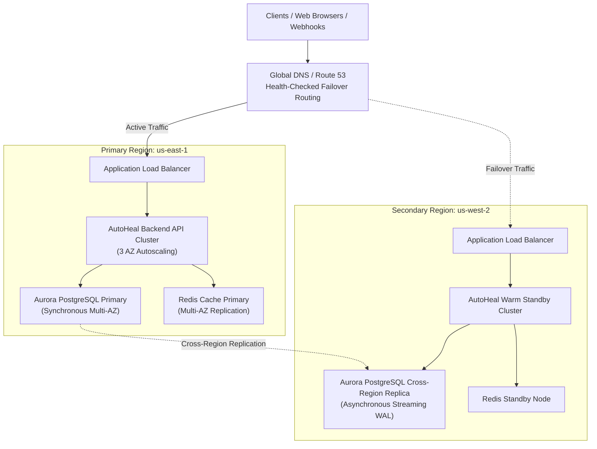

# AutoHeal DevOps — Disaster Recovery & Business Continuity Plan (BCP)

## 1. Purpose & Scope

This Disaster Recovery (DR) and Business Continuity Plan (BCP) establishes the technical and operational protocols required to maintain continuous availability and rapid recovery of the AutoHeal DevOps SaaS platform in the event of hardware failures, network outages, availability zone failures, or catastrophic regional disasters.

---

## 2. Recovery Objectives & SLAs

| Recovery Tier | Failure Scope | Recovery Time Objective (RTO) | Recovery Point Objective (RPO) | Mechanism |
|:---|:---|:---|:---|:---|
| **Tier 1** | Single Pod / Container Fault | **< 10 seconds** | **0 seconds** | Kubernetes Pod restart & liveness probes |
| **Tier 2** | Availability Zone Outage | **< 60 seconds** | **< 1 second** | Multi-AZ RDS failover & redundant pod replica routing |
| **Tier 3** | Regional Cloud Outage | **< 15 minutes** (900s) | **< 5 minutes** (300s) | Cross-region backup re-inflation & DNS traffic steering |
| **Tier 4** | Data Corruption / Ransomware | **< 30 minutes** (1800s) | **< 5 minutes** (300s) | Point-in-Time Recovery (PITR) & AES-256 backup restore |

---

## 3. High Availability Architecture Topology



---

## 4. Regional Failover Procedure

In the event of an unrecoverable total regional outage in the primary cloud region:

### Step 1: Outage Declaration & Incident Commander Designation
- The On-Call Incident Commander declares a **SEV-1 Disruption** after confirming persistent (> 3 consecutive checks) regional health check failures.

### Step 2: Database Promotion
- Promote the asynchronous read replica in the secondary region to Primary:
  ```bash
  aws rds promote-read-replica --db-instance-identifier autoheal-secondary-rds
  ```

### Step 3: Compute Cluster Autoscaling
- Scale up secondary application node pools:
  ```bash
  kubectl scale deployment autoheal-api --replicas=10 -n autoheal-prod
  ```

### Step 4: DNS Failover Cutover
- Update Route 53 DNS latency routing records to direct 100% of production traffic to `autoheal-secondary-alb`.
- Invalidate public edge caches via Cloudflare / CloudFront API.

### Step 5: Post-Failover Health Verification
- Verify platform health checks (`GET /health/ready` returns HTTP 200).
- Confirm active user sessions and infrastructure agent mTLS connections re-establish within 120 seconds.
- Update status page and communicate with enterprise stakeholders.

---

## 5. Routine Disaster Recovery Exercises

To validate that recovery procedures remain operational and effective:
- **Bi-Weekly Automated Restore Tests**: Executed automatically by `scripts/validate_postgres_backup.py`, verifying cryptographic integrity and timing RTO/RPO.
- **Quarterly Tabletop Simulation**: The engineering and operations teams conduct a simulated AZ/region failure drill.
- **Annual Live Traffic Failover**: Controlled cutover of live production traffic to secondary region during a scheduled maintenance window.
