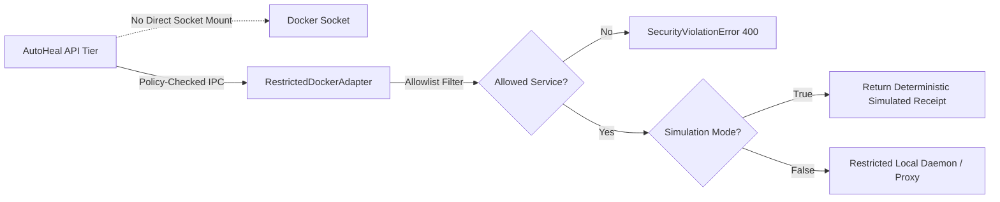

# AutoHeal DevOps — Restricted Docker Integration Guide

## 1. Security Architecture & Threat Model

Direct access to the Docker daemon (`/var/run/docker.sock`) grants root-equivalent control over the host operating system. A vulnerability in the web application or backend API could lead to container escapes, host volume corruption, or denial-of-service.

To neutralize this attack vector, AutoHeal implements the **Restricted Docker Adapter** pattern:



### Safety Principles
1. **No Docker Socket in Application Pods**: Neither `frontend` nor `backend` Docker containers have volume mounts to `/var/run/docker.sock`.
2. **Strict Regex Validation**: Container names are strictly validated against `^[a-zA-Z0-9][a-zA-Z0-9_.-]{1,63}$`. Prohibited characters (`;`, `&`, `|`, `` ` ``, `$`, `\`, `/`, `..`) raise `SecurityViolationError` immediately before any execution attempt.
3. **Allowlisted Target Services**: Remediation operations are restricted to registered services:
   - `customer-web`
   - `checkout-api`
   - `inventory-api`
   - `auth-api`
   - `payments-api`

---

## 2. Supported Operations

The `RestrictedDockerAdapter` provides safe, deterministic implementations:

### `restart_service(service_name: str, grace_period_seconds: int = 15) -> Dict[str, Any]`
Gracefully cycles containers by emitting a SIGTERM signal, waiting for the configured grace period (bounded between 1s and 60s), and starting a fresh container instance.
- **Simulation Mode**: Generates a cryptographically tracked receipt (`rcpt-docker-{uuid}`), returns exit code 0, and records duration.
- **Parameters**: `grace_period_seconds` defaults to 15s. Out-of-bound inputs are clamped to `[1, 60]`.

### `inspect_service_health(service_name: str) -> Dict[str, Any]`
Queries container running state and health check probe status (`healthy`, `unhealthy`, `starting`).

### `get_container_logs(service_name: str, tail: int = 100) -> str`
Fetches bounded tail logs (clamped between 1 and 500 lines) without permitting arbitrary file access or streaming leaks.

### `verify_service_health(service_name: str, port: int = 8080, health_path: str = "/health") -> bool`
Executes an HTTP GET probe against the local service health endpoint. Rejects path traversal or special characters in `health_path`.

---

## 3. Command Injection Defense Verification

The adapter defends against injection attempts through multi-layer verification:

| Attack Vector | Example Payload | Adapter Defense | Result |
| :--- | :--- | :--- | :--- |
| Command Chaining | `customer-web; rm -rf /` | `CONTAINER_NAME_REGEX` reject | `SecurityViolationError` |
| Pipe Redirection | `web \| cat /etc/passwd` | Character filter `\|` | `SecurityViolationError` |
| Command Substitution | `web$(whoami)` or `web\`id\`` | Character filter `$`, `` ` `` | `SecurityViolationError` |
| Directory Traversal | `../../etc/shadow` | Character filter `/`, `..` | `SecurityViolationError` |
| Flag Injection | `--privileged web` | Space disallowance, regex fail | `SecurityViolationError` |

---

## 4. Configuration & Runtime Flags

```bash
# Production .env settings
RECOVERY_SIMULATION_MODE=true           # Default: true (safe simulation)
DOCKER_API_VERSION=1.44                # Targeted Docker API version
DOCKER_DEFAULT_GRACE_PERIOD=15         # Default timeout before SIGKILL
```
