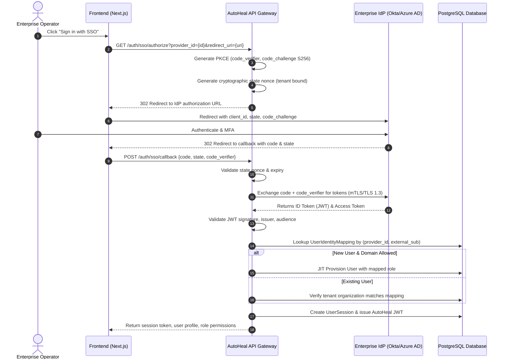

# AutoHeal DevOps — Enterprise SSO & Identity Federation Architecture

## Executive Summary

AutoHeal DevOps SaaS Phase 10 introduces enterprise Single Sign-On (SSO) and Identity Federation engineered for mission-critical enterprise environments. The architecture supports OpenID Connect (OIDC), OAuth 2.0 with RFC 7636 Proof Key for Code Exchange (PKCE), and SAML 2.0 identity federation bridges. 

The identity federation layer provides:
- **Zero-Trust PKCE Flows**: Mandatory `S256` PKCE code challenge and verifier cycles preventing authorization code injection and interception attacks.
- **Cross-Tenant Account Takeover Defense**: Strict tenant scoping preventing external IdP identity mapping collisions across multi-tenant boundaries.
- **Just-In-Time (JIT) Provisioning**: Automatic role-mapped provisioning on first authentication with email domain restriction enforcement.
- **Client Secret Encryption at Rest**: Client credentials stored in database using AES-256-GCM symmetric encryption with PBKDF2-derived keys, masked upon egress (`sec_************3a9f`).

---

## 1. Authentication Flow & PKCE (RFC 7636)



### 1.1 PKCE Implementation Details

RFC 7636 Proof Key for Code Exchange is enforced for all OIDC flows. The code verifier is generated as a 64-character URL-safe string with 256 bits of cryptographic entropy:

```python
code_verifier = base64.urlsafe_b64encode(os.urandom(48)).decode("utf-8").rstrip("=")
code_challenge = base64.urlsafe_b64encode(
    hashlib.sha256(code_verifier.encode("utf-8")).digest()
).decode("utf-8").rstrip("=")
```

Upon token exchange, the authorization server verifies that `SHA256(code_verifier) == code_challenge`. This ensures that even if an authorization code is intercepted in transit, it cannot be exchanged without the client's transient verifier.

---

## 2. Cross-Tenant Account Takeover Defense

Multi-tenant SaaS architectures face high vulnerability to account takeover when external IdP subjects share identical email addresses across distinct organizations. AutoHeal enforces strict 3-tier boundary verification:

1. **Organization-Scoped Provider Registration**: Identity Providers are bound directly to `organization_id` via foreign key with CASCADE deletion. An IdP configured in Organization A cannot process callbacks for Organization B.
2. **Subject-to-Tenant Immutability**: The `user_identity_mappings` table binds `(organization_id, provider_id, external_subject_id)` with a unique constraint. If an external identity attempts to authenticate against an organization where the mapping does not belong, the request is immediately rejected with HTTP 403 `CROSS_TENANT_IDENTITY_COLLISION`.
3. **Domain Whitelist Enforcement**: Providers define `allowed_domains` (e.g., `["corp.enterprise.com"]`). Any ID token claim whose email domain falls outside this list is rejected before account provisioning or session initiation.

---

## 3. Just-In-Time (JIT) Provisioning & RBAC Mapping

When an enterprise user signs in via SSO for the first time, AutoHeal checks whether the user exists:
- If unmapped, a new user record is provisioned under the IdP's organization.
- Roles are evaluated using IdP group claims mapped against enterprise role definitions:

| IdP Group Claim | AutoHeal Role | Permissions Granted |
|:---|:---|:---|
| `DevOps-Admins` | `admin` | Full tenant management, IdP config, PKI CA authority, audit logs |
| `SRE-Engineers` | `engineer` | Action plan approval, recovery execution, alert rules, integrations |
| `NOC-Operators` | `operator` | Simulated remediation trigger, incident triage, manual ack |
| `Observers-Read` | `viewer` | Read-only access to dashboards, traces, metrics, post-mortems |

---

## 4. Secret Encryption at Rest & Masking

Enterprise IdP configurations require storing client secrets securely:
- Secrets are encrypted prior to database insertion using AES-256-GCM authenticated encryption.
- Encryption keys are derived using PBKDF2 HMAC-SHA256 with 100,000 iterations bound to the application master secret.
- Every API endpoint, audit log, and frontend interface masks secrets on retrieval:
  ```json
  {
    "id": "3fa85f64-5717-4562-b3fc-2c963f66afa6",
    "name": "Corporate Okta",
    "client_id": "0oa1234567890abcdef",
    "client_secret": "sec_************3a9f",
    "is_active": true
  }
  ```

---

## 5. Audit Logging & Compliance

All SSO lifecycle operations generate tamper-evident security audit events in `security_audit_events`:
- `sso_provider_created`: Captured with administrator ID, masked credentials, and allowed domains.
- `sso_login_success`: Captured with IdP issuer, external subject ID, tenant ID, and IP address.
- `sso_login_failed`: Captured with failure reason (`invalid_state`, `domain_mismatch`, `pkce_verification_failed`).
- `user_jit_provisioned`: Records user creation and assigned role.
