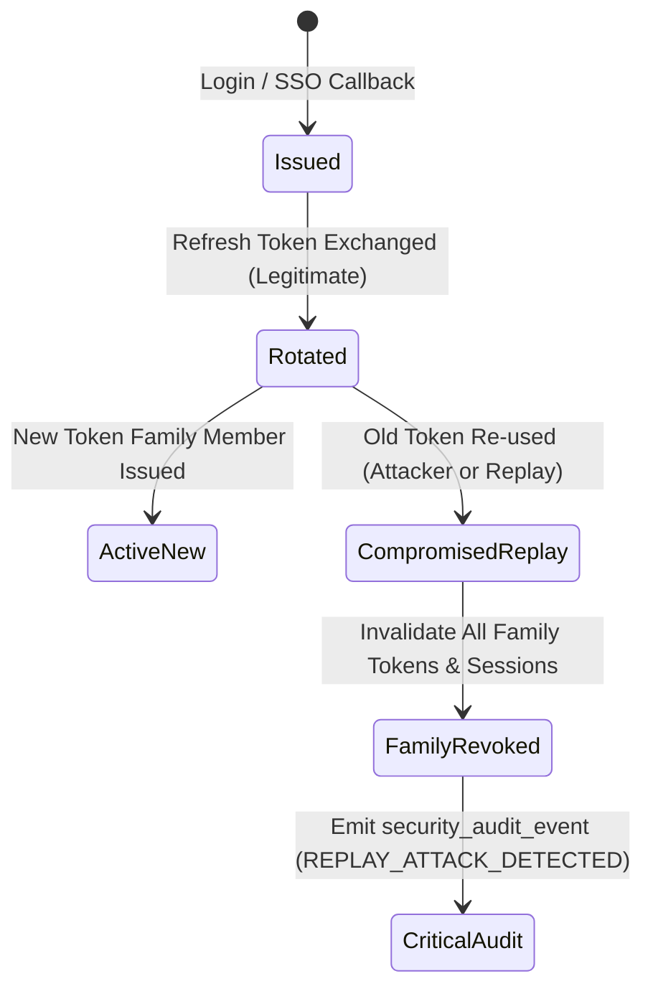

# AutoHeal DevOps — Identity & Session Security Architecture

## 1. Overview

In Phase 10, AutoHeal DevOps SaaS enforces zero-trust identity management and multi-device session governance. Every authenticated request is validated against active, revocable server-side session state, paired with token family rotation to mitigate token theft, credential stuffing, and replay attacks.

---

## 2. Active Session Management

All user sessions are registered in the `user_sessions` database table, capturing device telemetry, origin IP, user agent, expiration timestamps, and revocation state.

### 2.1 Database Schema Reference (`user_sessions`)

```sql
CREATE TABLE user_sessions (
    id UUID PRIMARY KEY,
    organization_id UUID NOT NULL REFERENCES organizations(id) ON DELETE CASCADE,
    user_id UUID NOT NULL REFERENCES users(id) ON DELETE CASCADE,
    session_token_hash VARCHAR(64) NOT NULL UNIQUE,
    refresh_token_hash VARCHAR(64) NOT NULL UNIQUE,
    token_family_id VARCHAR(64) NOT NULL,
    ip_address VARCHAR(45) NOT NULL,
    user_agent VARCHAR(512),
    device_info VARCHAR(256),
    is_active BOOLEAN NOT NULL DEFAULT TRUE,
    created_at TIMESTAMP WITH TIME ZONE NOT NULL DEFAULT NOW(),
    last_activity_at TIMESTAMP WITH TIME ZONE NOT NULL DEFAULT NOW(),
    expires_at TIMESTAMP WITH TIME ZONE NOT NULL,
    revocation_reason VARCHAR(255)
);

CREATE INDEX ix_user_sessions_org_user ON user_sessions(organization_id, user_id);
CREATE INDEX ix_user_sessions_family ON user_sessions(token_family_id);
CREATE INDEX ix_user_sessions_active ON user_sessions(is_active);
```

### 2.2 Session Lifecycle Operations

- **Session Inception**: Upon successful password or SSO verification, a cryptographically random session token (256-bit entropy) and refresh token are created. Only the SHA-256 hashes are stored.
- **Continuous Validation**: Each API request validates `session_token_hash`, checks that `is_active == True`, and verifies `utc_now() < expires_at`. The `last_activity_at` timestamp is updated asynchronously.
- **Individual Session Revocation**: Users or administrators can terminate specific sessions (e.g., "Revoke Chrome on macOS").
- **Bulk Session Revocation (`revoke_all_sessions`)**: On credential change, role modification, or suspected breach, all active sessions for a user across all devices are immediately invalidated.

---

## 3. Token Family Replay Detection (RFC 6749 Section 10.4)

AutoHeal implements strict token family rotation for refresh tokens. When a client requests a new access token using a refresh token:



### 3.1 Attack Mitigation Logic

1. **Generation Tracking**: Each session is assigned a `token_family_id`.
2. **One-Time Use Guarantee**: When a refresh token is used to generate a new session pair, the old refresh token is marked as rotated/inactive.
3. **Replay Trigger**: If an incoming request presents a refresh token that has *already been consumed*:
   - The security service immediately identifies an active replay attempt (either stolen token re-use or man-in-the-middle).
   - **Full Family Purge**: All sessions associated with `token_family_id` are permanently revoked.
   - **Global User Lockdown**: All active sessions for `user_id` are terminated.
   - **Audit Alert**: A severity `CRITICAL` audit event `TOKEN_FAMILY_REPLAY_ATTACK` is recorded, logging the client IP, user agent, and timestamp.

---

## 4. Session Timeouts & Boundaries

| Parameter | Value | Enforcement Description |
|:---|:---|:---|
| **Idle Inactivity Timeout** | 30 minutes | Sessions with no API activity for 30 minutes are automatically marked inactive. |
| **Absolute Session TTL** | 12 hours | Maximum lifespan of any active session; requires re-authentication. |
| **Refresh Token Validity** | 7 days | Lifespan of the refresh token before mandatory full login. |
| **Max Concurrent Sessions** | 5 per user | Oldest inactive sessions are culled when limit is reached. |

---

## 5. Security Audit Trail (`security_audit_events`)

Security audit records are immutable and append-only. No `UPDATE` or `DELETE` operations are permitted on audit tables.

### 5.1 Monitored Security Events

- `auth_login_success`: User authenticated via password or SSO.
- `auth_login_failed`: Bad credentials or lockouts.
- `auth_session_revoked`: Specific session terminated by user or administrator.
- `auth_all_sessions_revoked`: Emergency revocation across all devices.
- `auth_token_replay_detected`: High-priority threat detection.
- `sso_provider_configured`: Tenant SSO parameters altered.
- `agent_cert_issued`: PKI CA issued client certificate for an infrastructure agent.
- `agent_cert_revoked`: Agent certificate explicitly blacklisted.

### 5.2 Real-Time Monitoring & Security Center

The frontend **Security Center** view exposes active sessions with device identification, remote IP, and single-click revocation, alongside the live security audit event stream with category-based filtering and JSON payload inspection.
