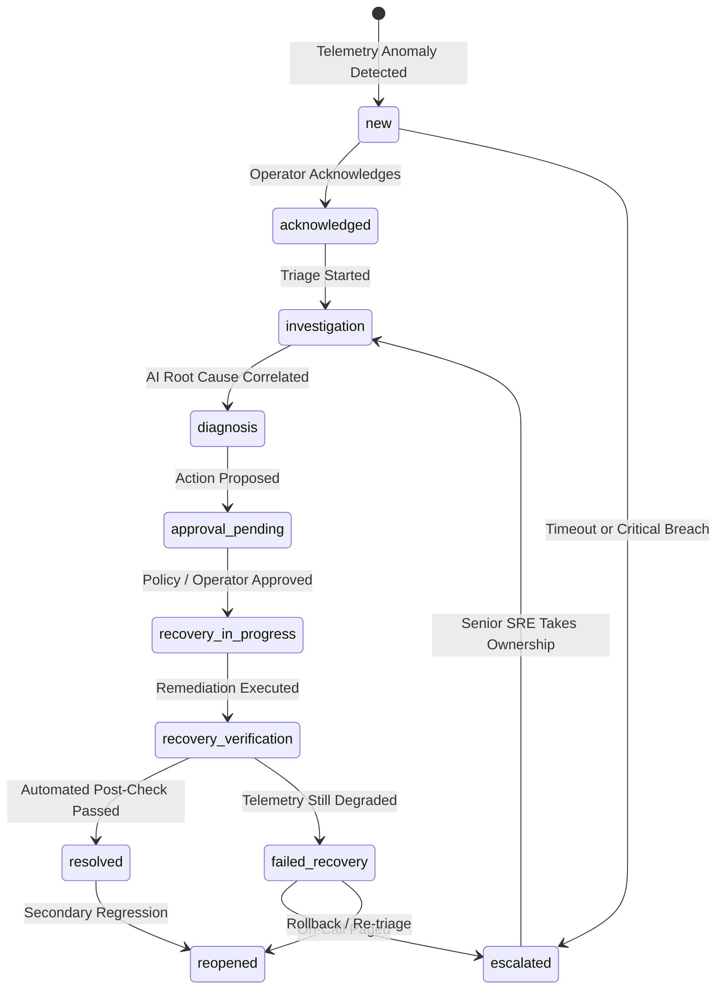

# AutoHeal DevOps — Incident Operations Runbook & State Machine
**Target Audience**: On-Call Engineers, Site Reliability Engineers (SREs), Incident Commanders  
**Scope**: 11-State Incident Lifecycle, Transition Validation, Safety Guards, Operational Procedures

---

## 1. Incident Lifecycle State Machine

AutoHeal enforces a strict, state-machine-governed incident lifecycle to prevent premature closures, unrecorded remediations, and unauthorized actions.



---

## 2. Permitted Transitions & State Transition Guards

| Current State | Permitted Next States | Authorized Roles | Transition Guard / Precondition |
|---|---|---|---|
| `new` | `acknowledged`, `investigation`, `escalated` | Operator, Admin | Transition records acting operator and acknowledgment timestamp. |
| `acknowledged` | `investigation`, `diagnosis`, `escalated` | Operator, Admin | Silences unacknowledged escalation timeouts. |
| `investigation` | `diagnosis`, `approval_pending`, `escalated` | Operator, Admin | Requires triage notes or correlated log telemetry. |
| `diagnosis` | `approval_pending`, `recovery_in_progress`, `escalated` | Operator, Admin | Requires AI or manual diagnosis and proposed recovery action. |
| `approval_pending` | `recovery_in_progress`, `investigation`, `escalated` | Operator, Admin | Human approval required for policy-gated actions. Viewers blocked (HTTP 403). |
| `recovery_in_progress` | `recovery_verification`, `failed_recovery`, `escalated` | Operator, Admin, Engine | Autonomous agent executes action within allowlist boundary. |
| `recovery_verification` | `resolved`, `failed_recovery`, `escalated` | Operator, Admin, Verifier | **Safety Guard**: Cannot transition to `resolved` without verified recovery (`verification == passed`) OR explicit operator sign-off with detailed justification (minimum 8 characters). |
| `failed_recovery` | `escalated`, `reopened`, `investigation` | Operator, Admin | Recovery rollback initiated; alerts dispatched to secondary on-call tier. |
| `escalated` | `investigation`, `diagnosis`, `recovery_in_progress`, `resolved` | Admin, Senior Operator | On-call incident commander assumes incident control. |
| `resolved` | `reopened` | Operator, Admin | Terminal state. Can only be reopened if subsequent breach occurs. |
| `reopened` | `investigation`, `diagnosis`, `approval_pending`, `escalated` | Operator, Admin | Clears resolution timestamp; restarts SLA tracking clock. |

---

## 3. Transition API & Tamper-Evident Audit Records

Every state change creates an immutable `incident_transitions` record in PostgreSQL containing:
- `id`: UUID primary key
- `incident_id`: e.g. `INC-2841`
- `actor_email` & `actor_role`: Identity of acting operator
- `previous_state` & `new_state`: Exact state trajectory
- `reason`: Mandatory text justification
- `evidence_id`: Correlated metric or log evidence reference
- `sign_off`: Boolean flag for manual override closures
- `created_at`: UTC timestamp

#### Transitioning an Incident (Operator Endpoint)
```bash
curl -X POST http://localhost:8000/api/v1/incidents/INC-2841/transition \
  -H "Authorization: Bearer <OPERATOR_JWT_TOKEN>" \
  -H "Content-Type: application/json" \
  -d '{
    "new_status": "resolved",
    "reason": "Post-recovery SLA verification confirmed P95 latency is 24ms and error rate is 0.0%.",
    "sign_off": true
  }'
```

#### Querying State Audit Trail
```bash
curl http://localhost:8000/api/v1/incidents/INC-2841/transitions \
  -H "Authorization: Bearer <OPERATOR_JWT_TOKEN>"
```

---

## 4. Standard Operational Runbooks

### Runbook A: Elevated API Error Rate (`checkout-api`)
1. **Symptoms**: Error rate exceeds 1.0%; Prometheus alerts fire on `http_requests_total{status=~"5.."}`.
2. **Automated Triage**: Inspect `INC-xxxx` diagnosis tab. Check if error is upstream timeout or database pool exhaustion.
3. **Recommended Action**: `restart_service` or `clear_cache`.
4. **Approval**: Click **Approve Recovery** in UI or execute via API.
5. **Post-Recovery Verification**: AutoHeal samples health endpoint for 15 seconds. If error rate drops below 0.5%, status auto-advances to `resolved`.

### Runbook B: High P95 Latency & Database Lock Contention
1. **Symptoms**: P95 latency > 500ms; thread saturation alarms.
2. **Automated Triage**: Correlate recent deployment events (`GET /api/v1/services/{id}/events`).
3. **Recommended Action**: `clear_cache` (Purge Cache & Connection Pool) or `scale_service` (Horizontal Replica Scale-Up).
4. **Escalation**: If latency persists > 300s, state machine triggers `escalated` to Level-2 Database SRE.

### Runbook C: Post-Recovery Verification Failure
1. **Symptoms**: Remediation executed, but `PostRecoveryVerifier` evaluates metric comparison as `normalized == False`.
2. **Behavior**: Status transitions strictly to `failed_recovery` (never prematurely resolved).
3. **Procedure**:
   - Platform automatically dispatches high-priority paging alert to Slack/PagerDuty.
   - Runbook displays failed metric differentials (e.g., *Error rate 2.4% persists above threshold 1.0%*).
   - Incident Commander assesses whether to initiate `rollback_release` or re-triage manually.
