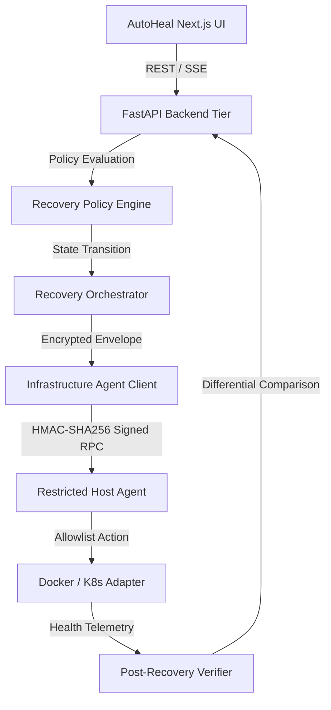
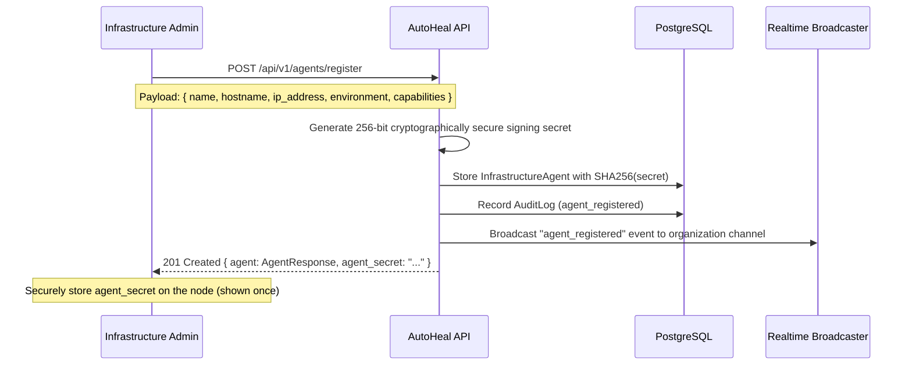

# AutoHeal DevOps — Infrastructure Agent Architecture

## 1. Architectural Overview & Design Philosophy

The AutoHeal DevOps platform incorporates a decoupled, distributed Infrastructure Agent model designed to provide autonomous self-healing capabilities without compromising host or cluster security boundaries. Rather than granting the web or backend API direct root access to compute infrastructure, execution is delegated to restricted, tenant-isolated agent processes.

### Core Tenets
1. **Zero Raw Socket Mounting**: The web application and backend containers do not mount `/var/run/docker.sock`.
2. **Explicit Operation Allowlist**: Only predefined, deterministic operations (`restart_service`, `scale_service`, `clear_cache`, `restore_health`, `rollback_release`) are permitted.
3. **Strict Parameter Validation**: Hostnames, container identifiers, and namespaces must match strict alphanumeric patterns (`^[a-zA-Z0-9_-]+$`). Arbitrary bash/shell execution is strictly disallowed.
4. **Tenant & Environment Scoping**: Every registered agent belongs to an explicit `organization_id` and `environment`. Operations across organization boundaries are rejected with 404 Not Found.
5. **Simulation-First Default**: By default, `RECOVERY_SIMULATION_MODE=true` is enforced across all environments.

---

## 2. Infrastructure Agent Data Model

The agent lifecycle is persisted in PostgreSQL via SQLAlchemy model `InfrastructureAgent`:

| Column | Type | Constraints | Description |
| :--- | :--- | :--- | :--- |
| `id` | `VARCHAR(50)` | Primary Key | Agent identifier (e.g., `agent-a1b2c3d4e5f6`) |
| `organization_id` | `UUID` | ForeignKey, Index | Owning organization for strict multi-tenant isolation |
| `name` | `VARCHAR(100)` | Nullable=False | Logical operator-assigned agent name |
| `hostname` | `VARCHAR(255)` | Nullable=False | Fully qualified domain name or internal hostname |
| `ip_address` | `VARCHAR(50)` | Nullable=False | Primary IP address of the compute node |
| `environment` | `VARCHAR(50)` | Index | Target deployment tier (`production`, `staging`, `test`) |
| `status` | `VARCHAR(50)` | Index | Lifecycle state (`online`, `offline`, `busy`, `revoked`) |
| `version` | `VARCHAR(50)` | Nullable=False | Running agent binary version (e.g., `1.2.0`) |
| `capabilities_json` | `TEXT` | Nullable=False | JSON array of registered allowlisted actions |
| `public_key_fingerprint` | `VARCHAR(128)` | Nullable=False | SHA256 fingerprint of agent public key / mTLS cert |
| `secret_key_hash` | `VARCHAR(255)` | Nullable=True | SHA256 hash of agent signing secret (revoked on revoking) |
| `last_heartbeat` | `TIMESTAMP WITH TIME ZONE` | Index | Real-time timestamp of latest authenticated heartbeat |
| `created_at` | `TIMESTAMP WITH TIME ZONE` | Default UTC | Registration timestamp |

### Composite Indexes
- `ix_agents_org_env`: `(organization_id, environment)` — Optimizes environment-filtered node queries.
- `ix_agents_org_status`: `(organization_id, status)` — Optimizes health monitors detecting stale or offline agents.

---

## 3. Agent Registration Flow

Registration requires an authenticated session with `operator` or `admin` role privileges.

---

## 4. Periodic Heartbeat & Cryptographic Attestation

To maintain `online` status, host agents transmit an authenticated heartbeat every 15–30 seconds.

### Heartbeat Envelope Specification
- Endpoint: `POST /api/v1/agents/{agent_id}/heartbeat`
- Headers:
  - `X-Agent-Timestamp`: Unix epoch integer in seconds (must be within ±300s of server time).
  - `X-Agent-Nonce`: Cryptographically unique UUID or random nonce.
  - `X-Agent-Signature`: Hex-encoded HMAC-SHA256 digest of `{timestamp}:{nonce}:{body}`.

### Anti-Replay & Clock Drift Enforcement
1. Server verifies `abs(current_epoch - X-Agent-Timestamp) <= 300`. Skewed requests return `401 Unauthorized`.
2. Server verifies `X-Agent-Nonce` has not been seen in the trailing replay window. Replayed nonces return `401 Unauthorized`.
3. Server loads agent record. If `status == "revoked"`, returns `403 Forbidden`.
4. Server updates `last_heartbeat` to current UTC timestamp.

---

## 5. Agent Credentials Revocation Flow

When a compute node is decommissioned or suspected compromised, operators can immediately revoke its authorization.

1. Operator sends `POST /api/v1/agents/{agent_id}/revoke`.
2. Server updates `status = "revoked"` and sets `secret_key_hash = NULL`.
3. Audit record `agent_revoked` is persisted with operator identity and timestamp.
4. Any subsequent heartbeat, telemetry submission, or recovery execution returns `403 Forbidden`.
