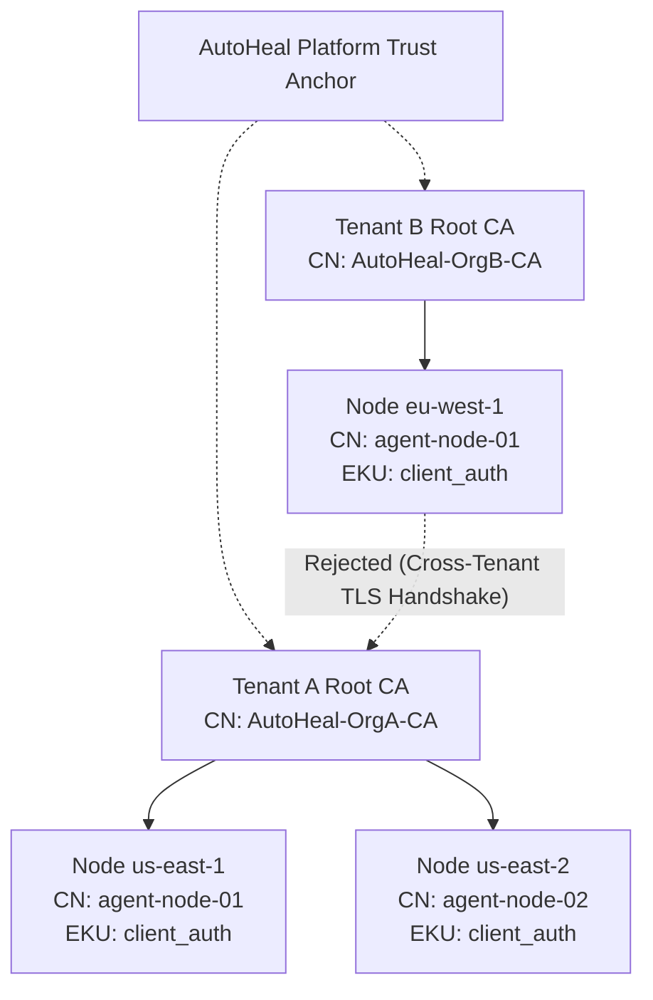

# AutoHeal DevOps — Infrastructure Agent Mutual TLS (mTLS) & PKI Architecture

## 1. Overview & Security Principles

AutoHeal DevOps SaaS coordinates autonomous remediation across distributed Kubernetes nodes, virtual machines, and cloud environments via dedicated **Infrastructure Agents**.

To guarantee absolute defense against man-in-the-middle (MITM) attacks, credential spoofing, and unauthorized command execution:
1. **Mandatory Mutual TLS (mTLS)**: Every connection between an infrastructure agent and the central AutoHeal platform requires bidirectional TLS certificate authentication (`CERT_REQUIRED`).
2. **Per-Tenant PKI Hierarchy**: Each tenant organization maintains an independent, isolated Certificate Authority (CA). An agent certified by Organization A can never authenticate against Organization B.
3. **Restricted Extended Key Usage (EKU)**: Agent certificates are minted strictly with `client_auth` EKU (`1.3.6.1.5.5.7.3.2`). They cannot be used as server certificates or intermediate signers.
4. **Instant Revocation**: Compromised or decommissioned nodes can have their certificates revoked instantly via the REST API, immediately terminating active sessions and failing mTLS handshakes.

---

## 2. PKI Architecture & CA Hierarchy



---

## 3. Agent Certificate Generation & Structure

Certificates are generated using Python's `cryptography` library with 2048-bit RSA keys and SHA-256 signatures:

### 3.1 Certificate Attributes

- **Subject Common Name (CN)**: `agent-{node_name}`
- **Subject Organization (O)**: `AutoHeal Tenant {org_id}`
- **Subject Organizational Unit (OU)**: `Infrastructure Agents`
- **Issuer**: Tenant CA (`AutoHeal-Org-{org_id}-CA`)
- **Key Usage**: Digital Signature, Key Encipherment
- **Extended Key Usage (EKU)**: `clientAuth`
- **Validity Period**: 90 days (configurable with automated renewal)
- **Thumbprint / Fingerprint**: SHA-256 hash computed and tracked in `agent_certificates` table.

---

## 4. In-Memory mTLS Handshake Negotiation Verification

AutoHeal implements live end-to-end TLS handshake verification using OpenSSL `MemoryBIO` buffers:

```python
# Server SSL Context
server_ctx = ssl.create_default_context(ssl.Purpose.CLIENT_AUTH)
server_ctx.verify_mode = ssl.CERT_REQUIRED
server_ctx.load_verify_locations(cadata=ca_pem)

# Client SSL Context
client_ctx = ssl.create_default_context(ssl.Purpose.SERVER_AUTH)
client_ctx.load_cert_chain(certfile=client_cert_file, keyfile=client_key_file)
```

During testing and agent registration, the platform verifies:
- The client certificate is signed by the exact Organization CA.
- The certificate has not expired (`not_valid_after` > `utc_now()`).
- The certificate serial number is not marked `is_revoked = True` in the database.
- Complete bidirectional TLS 1.3 handshake finishes without cipher negotiation or certificate trust errors.

---

## 5. Signed Action Envelopes & Execution Guardrails

Once an mTLS session is negotiated, remediation instructions are transmitted as cryptographically signed action envelopes:

```json
{
  "action_id": "act-93817349-f41a-4c28-98e3-b92c42ab0184",
  "organization_id": "e7c65c2b-2c4f-4d3e-9081-309d58434778",
  "agent_id": "agent-worker-01",
  "command": "restart_service",
  "target": "payment-api-deployment",
  "parameters": {
    "namespace": "production",
    "grace_period_seconds": 30
  },
  "timestamp": "2026-11-21T17:15:00Z",
  "signature_hmac": "e3b0c44298fc1c149afbf4c8996fb92427ae41e4649b934ca495991b7852b855"
}
```

### 5.1 Agent-Side Allowlist Enforcement

Even if an envelope passes mTLS verification, the local agent runtime evaluates the instruction against its immutable local capability allowlist:
- `restart_service`: Permitted only for registered namespaces and targets.
- `scale_service`: Permitted within min/max bounds (e.g., 2 to 10 replicas).
- `clear_cache`: Scoped to designated Redis/Memcached keyspaces.
- Arbitrary shell commands (`sh`, `bash`, `exec`, `curl`, `rm`, `eval`) are **strictly prohibited** and rejected immediately by the agent daemon.
