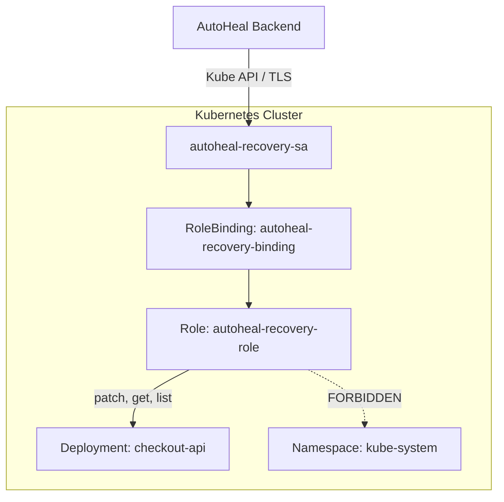

# AutoHeal DevOps — Modular Kubernetes Integration Guide

## 1. Architectural Model & Least-Privilege RBAC

When deployed in Kubernetes environments (EKS, GKE, AKS, or bare-metal k8s), AutoHeal interfaces with cluster workloads using a modular adapter (`ModularKubernetesAdapter`).

To satisfy enterprise security and SOC2 least-privilege standards:
1. **Cluster-Admin Prohibited**: AutoHeal does NOT require or accept `cluster-admin` privileges.
2. **Namespace Isolation**: Access is strictly confined to pre-approved application namespaces. Sensitive system namespaces (`kube-system`, `kube-public`, `kube-node-lease`, `cert-manager`) are blocked.
3. **Dedicated ServiceAccount**: The adapter runs under a dedicated Kubernetes `ServiceAccount` with restricted `Role` and `RoleBinding` bindings.
4. **Default Disabled**: Kubernetes recovery actions are disabled by default (`enabled=False`). Any operation attempted while disabled safely simulates the workflow without modifying cluster state.



---

## 2. Least-Privilege RBAC Manifest

To configure a Kubernetes cluster for AutoHeal integration, apply the following manifest:

```yaml
apiVersion: v1
kind: ServiceAccount
metadata:
  name: autoheal-operator
  namespace: default
---
apiVersion: rbac.authorization.k8s.io/v1
kind: Role
metadata:
  name: autoheal-remediation-role
  namespace: default
rules:
  # Inspect deployments and trigger rollout restarts
  - apiGroups: ["apps"]
    resources: ["deployments"]
    verbs: ["get", "list", "watch", "patch"]
  # Inspect pod status and health
  - apiGroups: [""]
    resources: ["pods", "pods/status"]
    verbs: ["get", "list", "watch"]
  # Read cluster workload events for root cause analysis
  - apiGroups: [""]
    resources: ["events"]
    verbs: ["get", "list"]
---
apiVersion: rbac.authorization.k8s.io/v1
kind: RoleBinding
metadata:
  name: autoheal-remediation-binding
  namespace: default
subjects:
  - kind: ServiceAccount
    name: autoheal-operator
    namespace: default
roleRef:
  kind: Role
  name: autoheal-remediation-role
  apiGroup: rbac.authorization.k8s.io
```

---

## 3. Supported Operations

### `rollout_restart_deployment(namespace: str, deployment_name: str) -> Dict[str, Any]`
Triggers a rolling restart of an approved workload deployment by patching the pod template metadata annotations:
```json
{
  "spec": {
    "template": {
      "metadata": {
        "annotations": {
          "kubectl.kubernetes.io/restartedAt": "<RFC3339 timestamp>"
        }
      }
    }
  }
}
```
- **Namespace Allowlist**: `autoheal`, `default`, `production`, `staging`, `test`. Requests for unapproved namespaces raise `K8sSecurityViolationError`.
- **Workload Allowlist**: `auth-api`, `checkout-api`, `customer-web`, `inventory-api`, `payments-api`.
- **Safety**: Unapproved workload names or shell metacharacters raise `K8sSecurityViolationError`.

### `read_deployment_status(namespace: str, deployment_name: str) -> Dict[str, Any]`
Retrieves replica counts (`replicas`, `ready_replicas`, `available_replicas`, `updated_replicas`) and deployment conditions (`Available`, `Progressing`).

### `read_pod_status(namespace: str, deployment_name: str) -> List[Dict[str, Any]]`
Lists pod instances belonging to the deployment, tracking phase (`Running`, `Pending`, `Failed`), restarts, and container readiness probes.

### `list_workload_events(namespace: str, deployment_name: str) -> List[Dict[str, Any]]`
Fetches structured warning and normal events (e.g. `BackOff`, `CrashLoopBackOff`, `OOMKilled`) to enhance AI diagnostic evidence collection.

### `verify_deployment_readiness(namespace: str, deployment_name: str, timeout_seconds: int = 60) -> bool`
Polls deployment status until `ready_replicas == replicas` and `available_replicas == replicas`. Times out safely if pods fail readiness probes.
