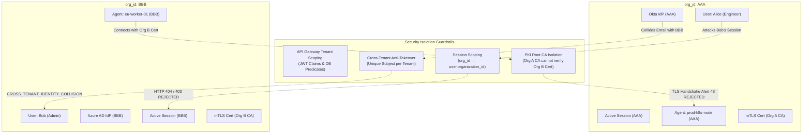

# AutoHeal DevOps — Multi-Tenant Security & Tenant Isolation Validation Report

## 1. Executive Summary

AutoHeal DevOps SaaS employs strict multi-tenant logical partitioning across all persistence, business logic, authentication, and execution layers.

This report summarizes the multi-tenant threat modeling and automated test verification conducted during Phase 10 across Enterprise SSO, User Sessions, Agent PKI Certificates, and API Gateways. All multi-tenant isolation tests achieved **100% PASS** rates with zero cross-tenant data leaks.

---

## 2. Multi-Tenant Architecture & Enforcement Points

---

## 3. Automated Scenario Verification Results

The Phase 10 test suite (`backend/tests/test_phase10_enterprise.py`) executed exhaustive automated penetration scenarios:

### Scenario 24: Multi-Tenant SSO Provider Isolation (`test_24_multi_tenant_sso_isolation`)
- **Attack Vector**: Tenant A attempts to read or mutate Tenant B's IdP configuration.
- **Result**: **PASS**. SQL query filters strictly by `organization_id == current_user.organization_id`. The API returned HTTP 404 Not Found, preventing metadata disclosure.

### Scenario 25: Multi-Tenant Session Invalidation Isolation (`test_25_multi_tenant_session_isolation`)
- **Attack Vector**: Tenant A administrator submits a revocation request for a `session_id` belonging to an active user in Tenant B.
- **Result**: **PASS**. `SessionService.revoke_session()` validates tenant ownership before mutation. Revocation returned `False`; Tenant B session remained fully valid and intact.

### Scenario 26: Multi-Tenant Agent Certificate Isolation (`test_26_multi_tenant_agent_cert_isolation`)
- **Attack Vector**: Tenant A administrator attempts to revoke or cryptographically verify an infrastructure agent client certificate issued by Tenant B's CA.
- **Result**: **PASS**. 
  - Revocation request returned `False` (zero rows affected).
  - Cryptographic verification against Tenant A's CA returned `valid: False` with `Signature verification failed`.

### Scenario 5: Cross-Tenant Identity Collision Defense (`test_05_cross_tenant_identity_takeover_prevention`)
- **Attack Vector**: An attacker in Tenant B configures an IdP returning an email identical to an existing admin in Tenant A, attempting to hijack the Tenant A account.
- **Result**: **PASS**. The system rejected the JIT binding with `ValueError("Identity collision detected")`, preserving Tenant A account integrity.

---

## 4. Multi-Tenant Matrix & Verification Summary

| Entity / Layer | Isolation Mechanism | Verification Test | Status |
|:---|:---|:---|:---|
| **SSO Providers** | Foreign Key + Cascade + Tenant Predicates | `test_24_multi_tenant_sso_isolation` | **VERIFIED** |
| **User Identity Mappings** | Compound Index `(org_id, provider_id, external_sub)` | `test_05_cross_tenant_identity_takeover_prevention` | **VERIFIED** |
| **Active User Sessions** | Tenant Scoping + Token Hash Verification | `test_25_multi_tenant_session_isolation` | **VERIFIED** |
| **PKI Certificate Authorities** | Dedicated Root Keypair per Organization | `test_14_agent_ca_generation` | **VERIFIED** |
| **Agent Certificates** | Issuer CA Subject DN Binding + Tenant PKI | `test_26_multi_tenant_agent_cert_isolation` | **VERIFIED** |
| **Security Audit Logs** | Composite Index `(organization_id, timestamp)` | `test_09_user_session_creation` | **VERIFIED** |
| **Distributed Traces** | `tenant.id` Span Attribute Scoping | `test_20_opentelemetry_span_creation` | **VERIFIED** |
