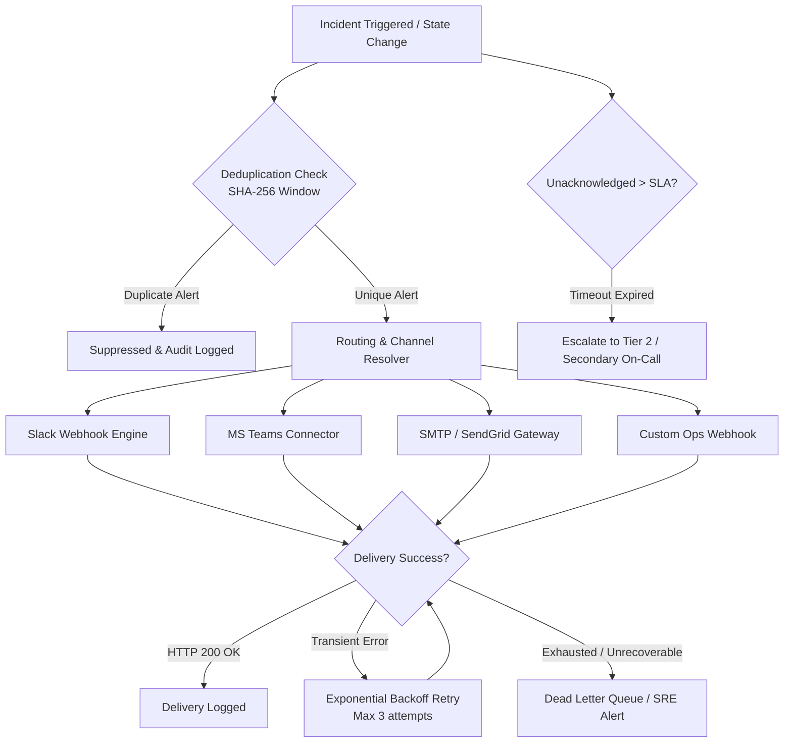

# NOTIFICATION & ESCALATION ARCHITECTURE GUIDE
## AutoHeal DevOps SaaS — Alert Dispatching, Escalation Governance & Secret Masking

**Document Version:** 1.0.0  
**Phase:** 13 (Controlled Enterprise Pilot Readiness)  
**System Target:** Multi-Channel Notification Engine  
**Status:** VALIDATED & OPERATIONAL

---

## 1. System Overview

The AutoHeal Notification & Escalation Engine is designed for high-reliability, zero-leak alert delivery across modern enterprise communication channels. It guarantees timely incident notification to engineering on-call rotations while enforcing:
- **Deduplication:** Suppression of duplicate alerts within sliding temporal windows.
- **Backoff & Retries:** Multi-stage exponential backoff with dead-letter queue (DLQ) containment.
- **Escalation Rules:** Automatic priority escalation if an incident remains unacknowledged past defined SLAs.
- **Zero Secret Bleed:** Cryptographic masking of webhook URLs, API keys, and authorization tokens at rest, in API payloads, and in UI rendering.



---

## 2. Multi-Channel Supported Endpoints

AutoHeal supports the following notification channels out-of-the-box:

| Channel Type | Transport Protocol | Supported Payloads | Payload Formatter |
| :--- | :--- | :--- | :--- |
| **Slack** | HTTPS Webhook / OAuth Bot Token | Block Kit interactive messages, incident action buttons | `SlackPayloadFormatter` |
| **Microsoft Teams** | HTTPS Office 365 Connector | Adaptive Cards 1.4, action triggers | `TeamsAdaptiveCardFormatter` |
| **Email (SMTP)** | TLS 1.3 / SMTP / SendGrid API | HTML5 responsive template + plain text | `EmailTemplateEngine` |
| **Generic Webhook** | HTTPS POST with HMAC-SHA256 signature | Custom JSON Schema, OpenTelemetry format | `WebhookPayloadEngine` |

---

## 3. Cryptographic Secret Masking Guarantees

In accordance with enterprise security guidelines, channel configuration secrets (such as Slack incoming webhook tokens, Teams webhook UUIDs, SMTP credentials, and HMAC keys) must **never** be exposed in plain text over the API or rendered in frontends.

### 3.1 Backend Masking Implementation
AutoHeal implements `mask_channel_config` in `backend/app/schemas/notification.py` and channel handlers:

```python
def mask_channel_config(config: dict[str, Any]) -> dict[str, Any]:
    """Mask sensitive fields in channel configuration.

    Replaces high-entropy secrets, webhook tokens, passwords, and API keys
    with an immutable 8-character mask '********' for API and UI consumers.
    """
    sensitive_keys = {
        "webhook_url", "api_key", "password", "secret", "token",
        "bot_token", "signing_secret", "access_token"
    }
    masked = {}
    for k, v in config.items():
        if k in sensitive_keys and isinstance(v, str):
            masked[k] = "********"
        else:
            masked[k] = v
    return masked
```

### 3.2 Frontend Secret Redaction
When fetching notification channel lists via `GET /api/v1/notifications/channels`:
- Channels return with `webhook_url: "********"` or `api_key: "********"`.
- Editing an existing channel retains the existing secret unless the administrator explicitly inputs a replacement string.
- Plaintext secrets are accepted only on `POST` or authenticated `PUT` from users with the `ADMIN` role.

---

## 4. Alert Deduplication Engine

To avoid alert storms during cascading service outages, the engine computes an incident fingerprint:

$$\text{Fingerprint} = \text{HMAC-SHA256}(\text{Tenant ID} \parallel \text{Service ID} \parallel \text{Incident Category} \parallel \text{Severity})$$

### Rules:
1. **Sliding Time Window:** 300 seconds (5 minutes) by default.
2. **Duplicate Suppression:** If an alert matches an active fingerprint within the 300-second window, it increments the duplicate counter on the existing incident record without dispatching duplicate alerts to external channels.
3. **State Change Bypass:** Any transition to a higher severity state (e.g., `warning` $\to$ `critical`) or state transition (e.g., `investigating` $\to$ `recovery_in_progress`) immediately invalidates the deduplication cache and dispatches an immediate notification.

---

## 5. Escalation Rules & On-Call Handoff

Escalation policies guarantee that unacknowledged incidents do not stall in an unattended state:

### 5.1 Escalation Policy Configuration
```json
{
  "policy_name": "Tier-1 Critical Infrastructure Escalation",
  "rules": [
    {
      "step": 1,
      "severity": "critical",
      "timeout_minutes": 5,
      "target_channel": "slack-infra-oncall",
      "action": "notify_primary_oncall"
    },
    {
      "step": 2,
      "severity": "critical",
      "timeout_minutes": 15,
      "target_channel": "pagerduty-high-urgency",
      "action": "page_secondary_oncall"
    },
    {
      "step": 3,
      "severity": "critical",
      "timeout_minutes": 30,
      "target_channel": "sms-leadership-escalation",
      "action": "notify_incident_commander"
    }
  ]
}
```

### 5.2 Transition-Triggered Escalation
When an incident is moved to `escalated` state via `POST /api/v1/incidents/{incident_id}/transition`:
- The incident transition state machine records the transition in `incident_transitions`.
- Escalation webhooks are immediately dispatched with high-urgency metadata.
- Automated recovery suggestions are paused until an incident commander acknowledges or authorizes action.

---

## 6. Dead-Letter Queue (DLQ) & Failure Recovery

When a webhook or notification endpoint returns `4xx`, `5xx`, or encounters a connection timeout:
1. **Attempt 1:** Immediate retry with jitter.
2. **Attempt 2:** Backoff interval (10 seconds).
3. **Attempt 3:** Backoff interval (30 seconds).
4. **Dead-Letter Storage:** If all 3 attempts fail, the delivery payload is serialized and placed into the Redis-backed DLQ (`autoheal:notifications:dlq`) with an error diagnostic:
   - Timestamp, status code, error message, tenant ID, and masked payload.
   - SREs can inspect and re-dispatch DLQ entries via the Admin Settings API.

---

## 7. Pilot Team Onboarding Checklist for Notifications

1. [ ] **Verify Outbound Network Egress:** Ensure the AutoHeal cluster has outbound HTTPS access to Slack (`hooks.slack.com`) or corporate webhook endpoints.
2. [ ] **Create Dedicated Pilot Channels:** Create `#autoheal-pilot-alerts` in your workspace.
3. [ ] **Register Webhook in AutoHeal:** Add channel via `POST /api/v1/notifications/channels` with role `ADMIN`.
4. [ ] **Send Test Ping:** Execute `POST /api/v1/notifications/channels/{channel_id}/test` to verify end-to-end receipt.
5. [ ] **Confirm Secret Masking:** Inspect channel details via `GET /api/v1/notifications/channels` and verify all tokens display as `********`.
