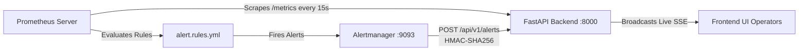

# AutoHeal DevOps — Observability, Metrics & Telemetry Guide

## 1. Observability Architecture Overview

AutoHeal DevOps implements the three pillars of modern cloud observability:
1. **Metrics**: OpenMetrics / Prometheus standard text exposition (`GET /metrics`).
2. **Logs**: Structured, JSON-formatted access and application logs with sensitive credential masking.
3. **Traces**: Distributed request correlation via `X-Request-ID` injected at the ingress and propagated across asynchronous background tasks.



---

## 2. Prometheus Exposition Metrics (`/metrics`)

The application exposes runtime telemetry directly at `GET /metrics`.

### Core Metrics Catalog
| Metric Name | Type | Labels | Description |
| :--- | :--- | :--- | :--- |
| `autoheal_api_up` | Gauge | None | Service operational status (1 = healthy, 0 = degraded/down) |
| `autoheal_database_pool_size` | Gauge | None | Configured primary database connection pool size |
| `autoheal_database_pool_overflow` | Gauge | None | Current active connections exceeding base pool |
| `autoheal_database_pool_checkedout`| Gauge | None | Number of database connections currently checked out by active queries |
| `autoheal_http_requests_total` | Counter | `method`, `endpoint`, `status` | Cumulative total HTTP requests processed |
| `autoheal_http_request_duration_seconds` | Counter | `method`, `endpoint` | Cumulative time spent processing requests (for average latency calculation) |

### Sample Metric Exposition Output
```text
# HELP autoheal_api_up Service operational status gauge
# TYPE autoheal_api_up gauge
autoheal_api_up 1

# HELP autoheal_database_pool_size Configured database connection pool size
# TYPE autoheal_database_pool_size gauge
autoheal_database_pool_size 20

# HELP autoheal_database_pool_overflow Active database connection pool overflow count
# TYPE autoheal_database_pool_overflow gauge
autoheal_database_pool_overflow 0

# HELP autoheal_database_pool_checkedout Number of database connections currently in use
# TYPE autoheal_database_pool_checkedout gauge
autoheal_database_pool_checkedout 2

# HELP autoheal_http_requests_total Total HTTP requests processed by endpoint and status
# TYPE autoheal_http_requests_total counter
autoheal_http_requests_total{endpoint="/api/v1/health",method="GET",status="200"} 452
autoheal_http_requests_total{endpoint="/api/v1/incidents",method="GET",status="200"} 128

# HELP autoheal_http_request_duration_seconds Cumulative request duration in seconds
# TYPE autoheal_http_request_duration_seconds counter
autoheal_http_request_duration_seconds{endpoint="/api/v1/health",method="GET"} 1.496120
autoheal_http_request_duration_seconds{endpoint="/api/v1/incidents",method="GET"} 4.053888
```

---

## 3. Health & Readiness Probes

### 3.1 Public Liveness Probe (`GET /api/v1/health`)
- **Purpose**: Fast liveness probe for load balancers (AWS ALB, Nginx, Kubernetes livenessProbe).
- **Behavior**: Returns `200 OK` in < 5ms without accessing external storage, verifying the ASGI loop is unblocked.
- **Payload**:
  ```json
  {
    "status": "healthy",
    "timestamp": "2026-11-21T07:34:04.595781+00:00",
    "environment": "production",
    "version": "0.1.0"
  }
  ```

### 3.2 Deep Readiness Probe (`GET /api/v1/health/readiness`)
- **Purpose**: Readiness probe ensuring the backend can successfully interact with PostgreSQL and Redis before accepting user traffic.
- **Behavior**: Executes `SELECT 1` on the async database engine and `PING` on Redis. Returns `200 OK` if all dependencies are healthy; returns `503 Service Unavailable` if any dependency fails.
- **Payload**:
  ```json
  {
    "status": "ready",
    "database": {
      "status": "connected",
      "pool_size": 20,
      "checkedout": 0
    },
    "redis": {
      "status": "connected",
      "latency_ms": 1.2
    }
  }
  ```

---

## 4. Prometheus Rules & Alertmanager Routing

### 4.1 Prometheus Alerting Rules (`monitoring/prometheus/alert.rules.yml`)
Key operational rules evaluated every 15 seconds:
- **`HighServiceErrorRate`**: Triggers when a microservice error rate exceeds 1.0% over 2 minutes.
  ```yaml
  alert: HighServiceErrorRate
  expr: (rate(http_requests_total{status=~"5.."}[2m]) / rate(http_requests_total[2m])) * 100 > 1.0
  for: 30s
  labels:
    severity: high
  annotations:
    summary: "Elevated error rate detected on {{ $labels.service }}"
    threshold: "1.0%"
  ```
- **`ServiceLatencySpike`**: Triggers when P95 latency exceeds 500ms.
- **`ServiceDown`**: Triggers when service heartbeat probe fails for > 1 minute.
- **`DatabasePoolSaturation`**: Triggers when `autoheal_database_pool_overflow > 8`.

### 4.2 Alertmanager Webhook Delivery (`monitoring/alertmanager/alertmanager.yml`)
```yaml
route:
  group_by: ['alertname', 'service']
  group_wait: 10s
  group_interval: 30s
  repeat_interval: 1h
  receiver: 'autoheal-backend-webhook'

receivers:
- name: 'autoheal-backend-webhook'
  webhook_configs:
  - url: 'http://backend:8000/api/v1/alerts'
    send_resolved: true
    http_config:
      headers:
        X-Alertmanager-Secret: "${ALERTMANAGER_HMAC_SECRET}"
```

---

## 5. Structured Logging & Distributed Request Tracing

### Request ID Propagation
Every HTTP request is assigned an `X-Request-ID` by `RequestTracingMiddleware`:
1. If the client or reverse proxy supplies `X-Request-ID`, it is preserved.
2. Otherwise, a cryptographically random identifier `req-<hex12>` is generated.
3. The identifier is attached to `request.state.request_id` and mirrored in the HTTP response header.

### Structured Log Format
```json
{
  "timestamp": "2026-11-21T07:34:04.602Z",
  "level": "INFO",
  "logger": "autoheal.access",
  "method": "GET",
  "path": "/api/v1/incidents",
  "status": 200,
  "duration_ms": 31.64,
  "request_id": "req-9b8c7d6e5f4a",
  "client_ip": "10.0.1.42"
}
```
All credential fields (`password`, `token`, `secret`, `authorization`) are masked before log output.
