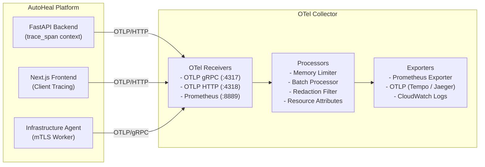

# AutoHeal DevOps — OpenTelemetry Distributed Tracing & Observability Architecture

## 1. Overview & Observability Principles

AutoHeal DevOps SaaS Phase 10 establishes an enterprise OpenTelemetry (OTel) observability pipeline designed to provide end-to-end visibility across:
- Inbound API requests and authentication handshakes
- Real-time Prometheus alert ingestion and deduplication
- AI diagnosis orchestration (Gemini API & LLM reasoning engine)
- Infrastructure remediation dispatch over mTLS
- Background database transactions and cache invalidation

---

## 2. OpenTelemetry Collector Architecture

The OpenTelemetry Collector (`monitoring/otel-collector-config.yaml`) serves as the vendor-agnostic telemetry ingestion layer:



---

## 3. Distributed Tracing & W3C Trace Context

Distributed traces follow the **W3C TraceContext** specification (`traceparent: 00-4bf92f3577b34da6a3ce929d0e0e4736-00f067aa0ba902b7-01`).

### 3.1 Trace Span Lifecycle (`trace_span` Context Manager)

Spans are created using the Python context manager:

```python
with trace_span("ai_diagnosis_engine", attributes={"incident_id": incident.id, "tier": "critical"}) as span:
    diagnosis = await gemini_engine.diagnose(incident)
    span.set_attribute("diagnosis.confidence", diagnosis.confidence)
```

Each span automatically records:
- `trace_id`: 128-bit hex string.
- `span_id`: 64-bit hex string.
- `parent_span_id`: Contextually chained from caller.
- `start_time` and `end_time` with nanosecond precision.
- `status`: `OK` or `ERROR` with exception details.

---

## 4. Zero-Leakage Sensitive Attribute Redaction

To prevent sensitive customer credentials from appearing in log streams or trace backends, the telemetry engine executes deep redaction on all recorded span attributes:

```python
SENSITIVE_KEY_PATTERNS = ["password", "secret", "token", "key", "authorization", "cookie"]

def redact_sensitive_value(key: str, value: Any) -> Any:
    lower_key = key.lower()
    for pattern in SENSITIVE_KEY_PATTERNS:
        if pattern in lower_key:
            return "[REDACTED]"
    return value
```

Test verification confirms that keys such as `auth_token`, `client_secret`, and `api_key` are replaced with `[REDACTED]` prior to storage or egress.

---

## 5. In-Memory Trace Buffer & Observability Center

For self-contained development, local staging, and air-gapped deployments without external Jaeger/Tempo infrastructure, the platform features an `InvertedTraceBuffer`:
- Maintains a thread-safe circular buffer of recent distributed spans (default capacity: 500 spans).
- Exposed via REST endpoint: `GET /api/v1/observability/traces`.
- Integrated directly into the frontend **Observability Center** dashboard, allowing operators to visually inspect span waterfalls, latency breakdowns, and parent-child execution trees without external dependencies.
