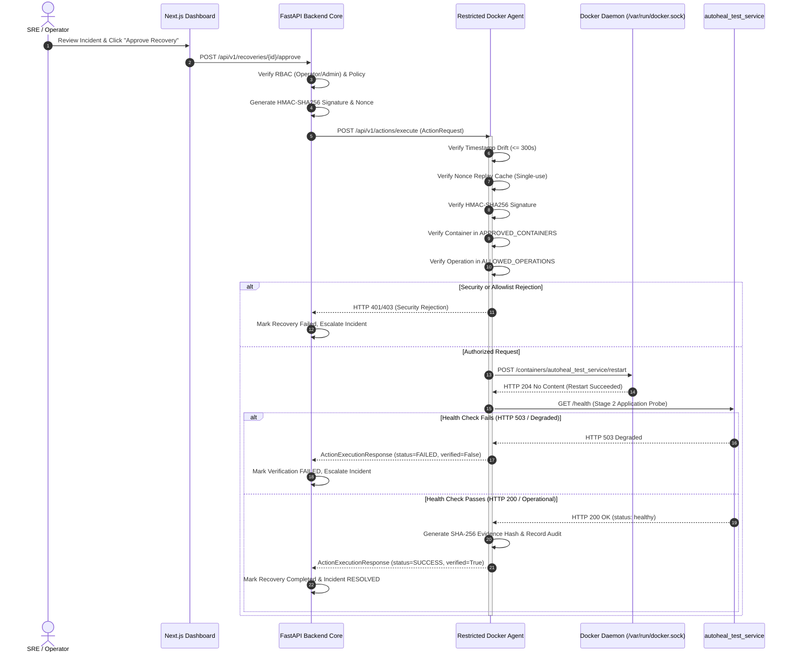

# Phase 16 Architecture — Restricted Docker Recovery Agent & Local Test Mesh

**Document Version:** 1.0.0  
**Phase:** Phase 16 — Controlled Real Infrastructure Integration & Production Readiness  
**Target Repository:** [https://github.com/HMSLBDN/Autoheal.git](https://github.com/HMSLBDN/Autoheal.git)  
**Branch:** `main`  
**Baseline Commit:** `33d58d9ea164e70c5732fce15200f888b477af12`  
**Safety Mandate:** `RECOVERY_SIMULATION_MODE=true` remains the default. Real Docker interactions are isolated exclusively to dedicated test infrastructure.

---

## 1. System Topology & Security Perimeter

The Phase 16 architecture decouples the AutoHeal control plane from the host container runtime. Under no circumstances is the Docker daemon socket (`/var/run/docker.sock`) exposed to the FastAPI application core or Next.js presentation tier.

```
┌────────────────────────────────────────────────────────────────────────┐
│                        AutoHeal Control Plane                          │
│                                                                        │
│   Next.js 16 Web Dashboard (Port 3000)                                 │
│        │                                                               │
│        ▼ REST / SSE                                                    │
│   FastAPI Backend Core (Port 8000)                                     │
│   ┌─────────────────────────────────────────────────────────────────┐  │
│   │ RecoveryExecutor                                                │  │
│   │  ├─► Evaluates RBAC (Operator/Admin required; Viewer blocked)   │  │
│   │  ├─► Evaluates Recovery Policy (cooldown, retries, blast radius)│  │
│   │  ├─► Generates HMAC-SHA256 signed ActionRequest with Nonce      │  │
│   │  └─► Selects Adapter:                                           │  │
│   │        ├─► SimulatedAgentClient (Default: SIMULATION_MODE=true) │  │
│   │        └─► RestrictedDockerAgentClient (Opt-in for test service)│  │
│   └────────────────────────────────┬────────────────────────────────┘  │
└────────────────────────────────────┼───────────────────────────────────┘
                                     │ Authenticated HTTP API (JSON)
                                     │ HMAC-SHA256 / Shared Secret
┌────────────────────────────────────▼───────────────────────────────────┐
│              Dedicated Isolated Test Network Mesh                      │
│                   (autoheal_test_network)                              │
│                                                                        │
│  ┌──────────────────────────────────────────────────────────────────┐  │
│  │ Restricted Docker Recovery Agent (docker_agent, Port 8091)       │  │
│  │                                                                  │  │
│  │  - Isolated container / standalone daemon process                │  │
│  │  - Authenticated REST API (FastAPI)                              │  │
│  │  - Server-Side Container Allowlist:                              │  │
│  │      * Permitted: autoheal_test_service, test-service            │  │
│  │      * Forbidden: db, redis, backend, frontend, prometheus, etc. │  │
│  │  - Server-Side Action Allowlist:                                 │  │
│  │      * restart_container, inspect_container                      │  │
│  │      * get_container_state, get_container_health                 │  │
│  │      * verify_container_health                                   │  │
│  │  - Cryptographic Verifier (HMAC-SHA256, Nonce Cache, 300s TTL)   │  │
│  │  - Docker Engine Socket Client (/var/run/docker.sock)            │  │
│  │  - Independent Application Health Prober (HTTP GET /health)      │  │
│  │  - Structured Audit Buffer (Last 500 events)                     │  │
│  │  - Prometheus Metrics Exporter (GET /metrics)                    │  │
│  └─────────────────────────────────┬────────────────────────────────┘  │
│                                    │ Docker API Socket / HTTP Probe    │
│                                    ▼                                   │
│  ┌──────────────────────────────────────────────────────────────────┐  │
│  │ Dedicated Test Application Container (autoheal_test_service)     │  │
│  │                                                                  │  │
│  │  - Harmless Python microservice (Port 8080 -> Host 8086)         │  │
│  │  - Endpoints: GET /health, GET /status, POST /chaos/degrade      │  │
│  │  - Zero access to AutoHeal databases, credentials, or core stack │  │
│  └──────────────────────────────────────────────────────────────────┘  │
└────────────────────────────────────────────────────────────────────────┘
```

---

## 2. Component Structure

### A. Restricted Docker Agent (`docker_agent/`)
The agent is an autonomous, standalone microservice running independently of the AutoHeal control plane:

1. **`config.py`:** Configuration parameters (`AGENT_PORT=8091`, `APPROVED_CONTAINERS`, `DOCKER_SOCKET_PATH`, `MAX_TIMESTAMP_DRIFT_SECONDS=300`).
2. **`models.py`:** Strongly typed Pydantic models for incoming `ActionExecutionRequest`, outgoing `ActionExecutionResponse`, `ContainerStatus`, and `AgentHealthResponse`.
3. **`security.py`:** Cryptographic subsystem performing canonical payload serialization, HMAC-SHA256 signature verification, TTL-based nonce replay cache tracking, timestamp drift evaluation, and shell metacharacter rejection.
4. **`allowlist.py`:** Server-side policy engine that enforces:
   - Target container allowlist (strictly permits `autoheal_test_service`; explicitly rejects core infrastructure containers like `db`, `redis`, `backend`, `prometheus`).
   - Operation allowlist (permits `inspect_container`, `restart_container`, `verify_container_health`; rejects arbitrary commands, `exec`, `create`, `delete`).
5. **`docker_client.py`:** Interacts with the Docker Engine daemon over the Unix socket (`/var/run/docker.sock`) via HTTP REST. Includes an explicit mock fallback mode with `is_mocked=True` tagging when the socket is absent.
6. **`verifier.py`:** Independent HTTP client that probes the target application's `/health` endpoint directly, ensuring that container restart success is not prematurely declared as SLA restoration.
7. **`audit.py`:** In-memory append-only circular audit log buffer capturing every request, authorization outcome, exit code, duration, and SHA-256 evidence receipt hash.
8. **`metrics.py`:** In-memory Prometheus metric collector exposing request volumes, authorization rejections, replay attempts, execution durations, and verification outcomes at `GET /metrics`.
9. **`server.py`:** FastAPI HTTP router exposing the REST API.
10. **`main.py`:** CLI entry point launching Uvicorn on port 8091.

### B. Control Plane Integration (`backend/app/`)
The backend communicates with the restricted agent via:

1. **`backend/app/config.py`:** Settings additions:
   - `RESTRICTED_DOCKER_AGENT_ENABLED: bool = False` (default False preserves simulation mode).
   - `DOCKER_AGENT_URL: str = "http://localhost:8091"`.
   - `DOCKER_AGENT_SECRET_KEY: str`.
   - `DOCKER_AGENT_APPROVED_CONTAINERS: List[str]`.
2. **`backend/app/services/agent/docker_client.py`:** `RestrictedDockerAgentClient` implements `InfrastructureAgentClient`, constructing signed HMAC envelopes and dispatching requests to the agent daemon.
3. **`backend/app/services/recovery/executor.py`:** `RecoveryExecutor` checks global configuration:
   - If `RECOVERY_SIMULATION_MODE=true` (default): Uses `SimulatedAgentClient`.
   - If `RECOVERY_SIMULATION_MODE=false` AND `RESTRICTED_DOCKER_AGENT_ENABLED=true`:
     Validates that target container is in `DOCKER_AGENT_APPROVED_CONTAINERS`. Dispatches to `RestrictedDockerAgentClient`. Rejects any unapproved target with a security violation.

---

## 3. End-to-End Recovery Flow



---

## 4. Two-Stage Recovery Verification Model

AutoHeal Phase 16 strictly decouples **infrastructure restart** from **service restoration**:

| Verification Stage | Evaluated Component | Success Criterion | Failure Outcome |
| :--- | :--- | :--- | :--- |
| **Stage 1: Container State** | Docker Engine Runtime | Container state transitions to `running`, exit code 0. | Recovery marked `failed`. Incident remains `investigating`. |
| **Stage 2: Application Health** | HTTP `/health` Endpoint | Response code 200, JSON payload reports `status == "healthy"`. | Recovery marked `completed`, but verification marked `failed`. Incident transitions to `escalated`. |

> [!CRITICAL]
> Under no circumstances does a successful Stage 1 container restart mark an incident as `resolved`. The incident is only resolved if Stage 2 application health verification independently passes.
