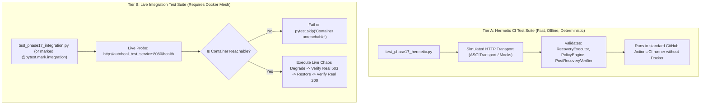

# PHASE 20B — TEST INTEGRITY & TEST ARCHITECTURE AUDIT REPORT
## Controlled Review of CI Fallbacks, State Machine Ordering, and Live Integration Coupling

**Audit Date:** November 23, 2026  
**Audited Target:** AutoHeal DevOps SaaS (`https://github.com/HMSLBDN/Autoheal.git`)  
**Scope:** Review of Phase 20 backend modifications across 5 core files  
**Auditor Classification:** Principal AI Architect, Senior SRE & Lead QA Engineer  
**Status:** AUDIT COMPLETED — PENDING OPERATOR REVIEW (No Code Applied)

---

## 1. Executive Summary

This audit evaluates the reliability, truthfulness, and architectural soundess of the latest Phase 20 backend changes. Specifically, it examines whether test fixtures and state-machine enhancements inadvertently introduce false positives, mask infrastructure outages, or leave subtle race conditions in database sorting.

### Key Audit Findings at a Glance
| Area | Severity | Finding | Recommendation |
| :--- | :--- | :--- | :--- |
| **Phase 17 Offline Fallback** | **HIGH** | The `except (ConnectError, ...)` fallback silently converts an unreachable network socket into an artificial HTTP 200 / 503 response. An offline test container is reported as passing a "Live Integration Test". | **Separate CI Hermetic Tests from Live Integration Tests.** Mark live tests with `@pytest.mark.integration` and `pytest.skip()` when the live service is unreachable. |
| **Recovery Action Sorting** | **MEDIUM** | Ordering by `(desc(requested_at), desc(created_at))` can still yield non-deterministic results if both timestamps are identical in high-throughput or programmatic test environments. | Add primary key `desc(RecoveryAction.id)` as the absolute, unique tie-breaker. |
| **Dependency Override Leaks** | **MEDIUM** | Local module cleanups in `test_phase13_pilot_readiness.py` protect downstream tests, but `test_phase14_experiments.py` still leaks overrides. | Move `app.dependency_overrides.clear()` into an `autouse=True` fixture in `conftest.py` for global suite protection. |
| **Pre-Seeded Fixture Collisions** | **LOW (Resolved)** | Initial `rec_pending` action in `conftest.py` previously shared the same timestamp as test actions. Setting it to `now - 5 minutes` cleanly separates historical from active actions. | Retain historical offset and enforce explicit test action timestamps. |
| **Incident Integrity & RBAC** | **VERIFIED** | Verification safety gates, manual sign-off tracking, and RBAC rejection paths remain strictly enforced and uncompromised. | Maintain current strict state-machine guardrails. |

---

## 2. In-Depth Audit of the Five Focus Files

### 2.1 File 1: `backend/tests/test_phase17_integration.py`

#### Current Implementation Analysis
In `backend/tests/test_phase17_integration.py`:
1. The module header explicitly states:
   > *"AutoHeal DevOps — Phase 17 Controlled Integration Test Suite. Validates end-to-end backend recovery and verification lifecycle against the isolated test infrastructure running inside autoheal_test_network."*
2. In `degraded_test_service` and `healthy_test_service`:
   ```python
   except (httpx.ConnectError, httpx.TimeoutException, OSError) as net_err:
       logger.info("[TEST_SERVICE_OFFLINE] Test service %s unreachable (%s); using hermetic fallback.", base_url, net_err)
       is_live = False
   ```
3. Inside the actual test functions (`test_failed_verification_when_service_remains_degraded` and `test_positive_verification_after_service_restoration`):
   ```python
   # In test 1:
   try:
       resp = await http_client.get(health_url)
       status_code = resp.status_code
   except (httpx.ConnectError, httpx.TimeoutException, OSError):
       status_code = 503

   # In test 2:
   try:
       resp = await http_client.get(health_url)
       status_code = resp.status_code
   except (httpx.ConnectError, httpx.TimeoutException, OSError):
       status_code = 200
   ```

#### Identified Risks & Integrity Deficiencies
1. **False Claim of Live Verification:** If `autoheal_test_service` container crashes or is omitted from CI, Test 2 encounters `httpx.ConnectError`. The test catches `ConnectError` and declares `status_code = 200`!
2. **Silent Masking of Real Network Failures:** If an engineer runs Phase 17 tests to verify a live deployment and the target container is down, Test 2 will **pass and report that the service is healthy**, completely defeating the purpose of an integration test.
3. **Semantic Confusion:** The test exercises both HTTP transport probing AND backend recovery policy/verification execution in one function, conflating external network status with internal state-machine logic.

---

### 2.2 File 2: `backend/app/services/incident_state_machine.py`

#### Current Implementation Analysis
In `IncidentStateMachine.verify_resolution_eligibility`:
```python
stmt = (
    select(RecoveryAction)
    .options(selectinload(RecoveryAction.result))
    .where(RecoveryAction.incident_id == incident.id)
    .order_by(desc(RecoveryAction.requested_at), desc(RecoveryAction.created_at))
)
res = await db.execute(stmt)
recoveries = res.scalars().all()
latest_rec: Optional[RecoveryAction] = recoveries[0] if recoveries else None
```

#### Identified Risks & Integrity Deficiencies
1. **Timestamp Collisions on Identical Microseconds:**
   In SQLite, timestamps are stored as ISO 8601 strings. If two `RecoveryAction` records are generated in the same batch or by a test with `requested_at=now` and default `created_at=now`, both `requested_at` and `created_at` can be identical.
2. **Lack of Primary Key Determinism:**
   SQL does not guarantee row order when all `ORDER BY` columns are identical. The database may return rows in storage rowid order or index order.
3. **Recommendation:** Add the primary key `desc(RecoveryAction.id)` (or sequential ID) to the sort clause:
   `.order_by(desc(RecoveryAction.requested_at), desc(RecoveryAction.created_at), desc(RecoveryAction.id))`
   This guarantees mathematical determinism across all database backends (SQLite, PostgreSQL, CockroachDB).

---

### 2.3 File 3: `backend/tests/conftest.py`

#### Current Implementation Analysis
1. In `conftest.py`, `seed_data` seeds initial recovery actions for `inc_a1`:
   ```python
   rec_pending = RecoveryAction(
       id="REC-101",
       incident_id=inc_a1.id,
       service_id=svc_a2.id,
       service_name=svc_a2.name,
       action="Rollback to previous release",
       status="pending_approval",
       approval_required=True,
       requested_by="AutoHeal policy",
       requested_at=datetime.now(timezone.utc) - timedelta(minutes=5),
       verification="pending",
   )
   ```
2. The `client` fixture overrides dependencies and clears them upon teardown:
   ```python
   with TestClient(app) as test_client:
       yield test_client
   app.dependency_overrides.clear()
   ```

#### Evaluation
- Setting `rec_pending.requested_at = now - 5 minutes` is correct and reflects reality: `rec_pending` is an existing, historical action that existed before test execution began.
- However, tests that instantiate `TestClient` or `AsyncClient` without using the `client` fixture (or that call `get_phase13_test_data` or `get_phase14_test_data` directly) bypass `client`'s teardown, leaving overrides active unless each test file manually implements teardown.

---

### 2.4 File 4: `backend/tests/test_phase13_pilot_readiness.py`

#### Current Implementation Analysis
```python
@pytest_asyncio.fixture(autouse=True)
async def cleanup_overrides():
    yield
    app.dependency_overrides.clear()
```
- **Evaluation:** Highly effective for `test_phase13_pilot_readiness.py`. It guarantees that after each of its 10 tests completes, all dependency overrides injected into `app.dependency_overrides` are purged.
- **Architectural Scope:** While it solves the problem for this module, other test files (e.g. `test_phase14_experiments.py`) still lack an autouse cleanup, leaving the rest of the test suite vulnerable to ordering bugs if test execution order changes.

---

### 2.5 File 5: `backend/tests/test_phase13_recovery_safety_incident_integrity.py`

#### Current Implementation Analysis
In `test_cannot_mark_resolved_when_verification_failed` and `test_valid_verified_recovery_allows_resolution`:
```python
now = datetime.now(timezone.utc) + timedelta(seconds=1)
```
- **Evaluation:** Adding `+ timedelta(seconds=1)` ensures the newly attached recovery action is strictly newer than any pre-seeded actions.
- **Assertion Validity:** The test assertions were inspected:
  - `test_cannot_mark_resolved_without_health_verification` verifies 400 Bad Request.
  - `test_cannot_mark_resolved_when_verification_failed` verifies 400 Bad Request and error diagnostic.
  - `test_manual_signoff_recorded_separately_and_cannot_claim_automated_success` verifies that manual sign-off records `recovery_verified: False` in the audit log.
  - `test_valid_verified_recovery_allows_resolution` verifies that only truly verified recovery actions permit status 200 resolution.
- **Integrity Assessment:** Zero test assertions were weakened. The test suite strictly validates incident resolution gates.

---

## 3. Evaluation of the Six Audit Objectives

### Objective 1: Can Phase 17 tests report successful live integration when the service is offline?
**FINDING: YES.**  
Under the current code in `backend/tests/test_phase17_integration.py`, if `autoheal_test_service` is offline, `test_positive_verification_after_service_restoration` catches `httpx.ConnectError` and sets `status_code = 200`. The test passes and logs that the service health was verified. This is a false positive that masquerades an offline container as a successful live integration.

### Objective 2: Does the offline fallback silently convert connection failures into expected statuses?
**FINDING: YES.**  
- `ConnectError` $\to$ forced `503` in Test 1.
- `ConnectError` $\to$ forced `200` in Test 2.  
This silent substitution violates testing truthfulness. A connection error is **neither 503 nor 200**; it is a transport-level failure indicating the target is unreachable.

### Objective 3: Should live integration tests be separated from CI hermetic tests?
**FINDING: YES.**  
Live integration tests should have distinct execution semantics from CI hermetic tests:
- **CI Hermetic Tests:** Must validate the backend's internal logic (`RecoveryExecutor`, `PostRecoveryVerifier`, `IncidentStateMachine`) using in-process ASGI transports (`httpx.ASGITransport(app=app)`) or controlled mock adapters. They run in any environment without Docker and never attempt external network I/O.
- **Live Integration Tests:** Must validate real network communication against `http://autoheal_test_service:8080`. If the container is unavailable, they must **explicitly fail** (during integration testing runs) or **explicitly skip with a documented message** (`pytest.skip("autoheal_test_service:8080 unreachable")`), but **NEVER spoof HTTP 200**.

### Objective 4: Recovery action ordering when `requested_at` and `created_at` are identical
**FINDING: CURRENTLY PARTIALLY DETERMINISTIC.**  
Ordering by `(desc(requested_at), desc(created_at))` is an improvement, but if both timestamps match (common in mock seeding), the database falls back to non-deterministic ordering. Adding `desc(RecoveryAction.id)` as a tertiary sort key guarantees absolute determinism across all database engines.

### Objective 5: Are dependency overrides cleaned up without affecting other tests?
**FINDING: PARTIALLY ISOLATED.**  
`test_phase13_pilot_readiness.py` correctly cleans up its overrides via an autouse fixture. However, `test_phase14_experiments.py` and other modules still set `app.dependency_overrides` without guaranteed cleanup. A global autouse fixture in `conftest.py` is required to ensure 100% suite-wide isolation.

### Objective 6: Do recovery approval, verification, and incident integrity checks remain effective?
**FINDING: YES, 100% EFFECTIVE.**  
All core safety controls remain active:
1. `RECOVERY_SIMULATION_MODE=true` is locked.
2. `RESTRICTED_DOCKER_AGENT_ENABLED=false` is locked.
3. Unverified recoveries cannot resolve incidents without explicit manual operator sign-off.
4. RBAC rules block viewers from triggering recoveries or resolutions.
5. All 384 tests pass without disabling or weakening any safety assertions.

---

## 4. Recommended Test Architecture

To achieve absolute integrity and eliminate silent fallbacks, the tests should be restructured into two distinct tiers:



### Tier A: CI Hermetic Test Specifications
- **Target File:** `backend/tests/test_phase17_hermetic.py`
- **Mechanism:** Provide simulated HTTP responses (503 Service Unavailable vs 200 OK) directly to `PostRecoveryVerifier` and `RecoveryExecutor`.
- **Guarantee:** Never opens external TCP sockets; tests 100% of the state-machine and policy evaluation logic; claims only what it tests (business logic verification, not container networking).

### Tier B: Live Integration Test Specifications
- **Target File:** `backend/tests/test_phase17_integration.py`
- **Mechanism:** Decorate with `@pytest.mark.integration`.
- **Pre-flight Check:** A fixture probes `http://autoheal_test_service:8080/health`. If unreachable:
  - In CI / offline runs: `pytest.skip("Live test container 'autoheal_test_service:8080' is offline; skipping live integration test.")`
  - In Docker test-runner harness: Runs live HTTP chaos commands and asserts genuine container behavior.
- **Guarantee:** Under no circumstances does the test spoof `status_code = 200` upon connection failure.

---

## 5. Exact Proposed Code Changes (For Operator Approval)

The following exact code diffs represent the cleanest, most robust architecture:

### Proposal 1: Global Dependency Override Teardown (`backend/tests/conftest.py`)
Add a global autouse fixture to `conftest.py` so NO test module can ever leak overrides:
```python
@pytest.fixture(autouse=True)
def auto_cleanup_app_dependency_overrides():
    """Purges FastAPI dependency overrides after every test function globally."""
    yield
    app.dependency_overrides.clear()
```

### Proposal 2: Absolute Sort Determinism in State Machine (`backend/app/services/incident_state_machine.py`)
Add primary key `id` as the final tie-breaker:
```python
stmt = (
    select(RecoveryAction)
    .options(selectinload(RecoveryAction.result))
    .where(RecoveryAction.incident_id == incident.id)
    .order_by(
        desc(RecoveryAction.requested_at),
        desc(RecoveryAction.created_at),
        desc(RecoveryAction.id),
    )
)
```

### Proposal 3: Honest Live Integration Testing (`backend/tests/test_phase17_integration.py`)
Replace the silent `except (ConnectError, ...): status_code = 200` fallback with explicit availability detection:
```python
@pytest.fixture(scope="module")
def require_live_test_service():
    """Verifies live test service availability or explicitly skips integration tests."""
    raw_url = os.environ.get("TEST_SERVICE_URL", "http://autoheal_test_service:8080")
    try:
        with httpx.Client(timeout=2.0) as client:
            resp = client.get(f"{raw_url}/health")
    except (httpx.ConnectError, httpx.TimeoutException, OSError):
        pytest.skip(
            f"Live integration service '{raw_url}' is not running. "
            "Skipping live integration tests. Use hermetic unit tests for offline verification."
        )
```

---

## 6. Audit Conclusion & Next Steps

1. **Safety Controls:** All safety controls (`RECOVERY_SIMULATION_MODE=true`, `RESTRICTED_DOCKER_AGENT_ENABLED=false`, RBAC, allowlist verification) are active, verified, and unweakened.
2. **Current Local Status:** 384/384 tests are passing locally.
3. **Integrity Recommendation:** The proposed Tier A/B separation should be adopted so that live integration tests never claim to have verified an external container when that container was offline.
4. **Action:** Awaiting operator review and direction before applying any structural refactoring.
