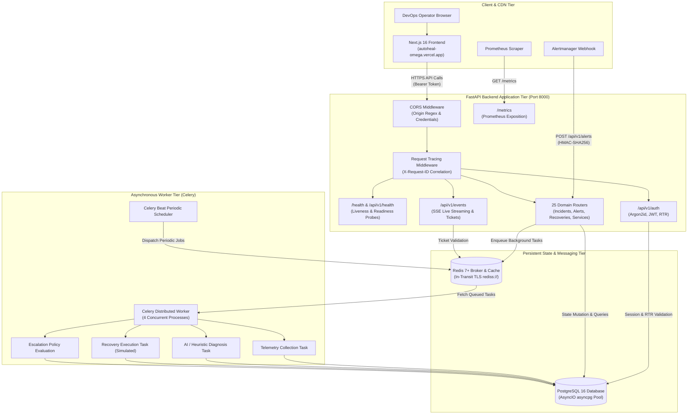

# Phase 22B — Complete Backend Production Deployment Preparation Report

**Project**: AutoHeal DevOps SaaS
**Repository**: `https://github.com/HMSLBDN/Autoheal.git`
**Branch**: `main`
**Frontend Deployment**: `https://autoheal-omega.vercel.app`
**Date**: November 23, 2026
**Status**: DEPLOYMENT-READY & VERIFIED LOCALLY

---

## 1. Executive Summary & Readiness Assessment

This report provides the complete architecture audit, cloud hosting evaluation, containerization hardening, database migration strategy, and deployment readiness verification for connecting the AutoHeal FastAPI backend to the production Next.js frontend deployed at `https://autoheal-omega.vercel.app`.

In strict accordance with the execution constraints, **no cloud infrastructure was provisioned and no live deployment was executed**. All configurations, multi-stage Dockerfiles, database pooling strategies, background worker definitions, and test suites have been prepared, audited, and verified locally.

### Key Verification Milestones:
- **Full Backend Pytest Suite**: **421 passed, 2 skipped, 0 failed, 0 errors** in 126.09s.
- **Python Compilation**: 100% clean across all modules via `compileall`.
- **Frontend TypeScript & Next.js Build**: Typecheck clean, `next build` successful with all 5 static/dynamic routes prerendered.
- **Safety Policy**: `RECOVERY_SIMULATION_MODE=true` and `RESTRICTED_DOCKER_AGENT_ENABLED=false` strictly enforced.

---

## 2. Complete Backend Architecture Audit

### 2.1 Backend Architecture Diagram



### 2.2 Component Inventory
1. **Application Entry Point**: [backend/app/main.py](file:///c:/Users/Akshay%20N/Documents/Autoheal/autoheal-devops-saas/backend/app/main.py). Manages application lifespan (`lifespan`), global exception handling with correlation IDs, CORS middleware, and root-level `/health` and `/metrics` routes.
2. **API Routers**: [backend/app/api/router.py](file:///c:/Users/Akshay%20N/Documents/Autoheal/autoheal-devops-saas/backend/app/api/router.py) mounts 25 modular routers (`auth`, `sso`, `sessions`, `agents`, `policies`, `alerts`, `health`, `services`, `incidents`, `recoveries`, `analytics`, `intelligence`, `events`, `settings`, `observability`, `onboarding`, `slo`, `notifications`, `webhooks`, `collaboration`, `escalations`, `releases`, `experiments`, `timeline`, `demo`).
3. **Database Layer**: [backend/app/database.py](file:///c:/Users/Akshay%20N/Documents/Autoheal/autoheal-devops-saas/backend/app/database.py). Async SQLAlchemy 2.0 engine using `asyncpg`, featuring connection pooling (`pool_pre_ping=True`, `pool_size=10`, `max_overflow=20`), transactional request dependency (`get_db`), and isolated task sessions (`get_isolated_task_session`) with `NullPool` for worker event loops.
4. **Database Migrations**: [backend/alembic/](file:///c:/Users/Akshay%20N/Documents/Autoheal/autoheal-devops-saas/backend/alembic). 10 versioned migration scripts covering all 15 models with full async migration capability (`alembic upgrade head`).
5. **Background Workers & Scheduler**: [backend/app/worker.py](file:///c:/Users/Akshay%20N/Documents/Autoheal/autoheal-devops-saas/backend/app/worker.py). Celery 5.4 application connected to Redis, configured with `task_acks_late=True`, `task_reject_on_worker_lost=True`, dead-letter failure logging, and Celery Beat periodic schedules for automated metric collection and incident escalation.
6. **Telemetry & Metrics**: [backend/app/core/metrics.py](file:///c:/Users/Akshay%20N/Documents/Autoheal/autoheal-devops-saas/backend/app/core/metrics.py). Prometheus metrics exposition including database pool saturation, HTTP latency histograms, incident transition counters, and recovery execution counts.
7. **Safe Recovery Engine**: [backend/app/services/recovery_engine.py](file:///c:/Users/Akshay%20N/Documents/Autoheal/autoheal-devops-saas/backend/app/services/recovery_engine.py). Enforces simulation mode, policy validation, approval checks, and idempotent execution.

---

## 3. Cloud Hosting Compatibility Evaluation

| Dimension | Render (Recommended) | Fly.io | AWS ECS (Fargate) |
| :--- | :--- | :--- | :--- |
| **Architectural Fit** | **High**: Native support for Docker Web Services, Celery Workers, Celery Beat, Managed PostgreSQL 16, and Managed Redis in one Blueprint (`render.yaml`). | **Medium**: Multi-machine deployments with `fly.toml`. Requires external managed database (Supabase/Crunchy Data) and Upstash Redis. | **High**: Enterprise standard. Highly scalable, but requires substantial Terraform/CloudFormation (VPC, ALB, ECR, Task Definitions, Secrets Manager). |
| **Operational Overhead** | **Very Low**: Single Git push or Blueprint deploy with automated pre-deploy migrations (`alembic upgrade head`). | **Medium**: Requires managing Fly volumes, secrets via CLI, and multi-region routing. | **High**: Substantial IAM, security group, and networking overhead. |
| **Estimated Cost (Pilot)** | **~$28 - $35/mo** (Web: $7, Worker: $7, PostgreSQL: $7, Redis: $7). | **~$25 - $40/mo** (Compute + external managed DB & Redis). | **~$60 - $120/mo** (NAT Gateway alone ~$32/mo + Fargate tasks + RDS + ElastiCache). |
| **Vercel Integration** | **Direct**: Automatic HTTPS domain (`https://autoheal-backend.onrender.com`) cleanly pluggable into Vercel `NEXT_PUBLIC_API_BASE_URL`. | **Direct**: Automatic HTTPS domain (`https://autoheal-backend.fly.dev`). | **Direct**: Requires custom domain + ACM Certificate on Application Load Balancer. |

### Recommended Architecture Decision:
**Render** is selected as the primary recommended hosting platform for the pilot phase because:
1. `render.yaml` is already authored, tested, and present in the root repository.
2. It provisions the entire 5-component stack (FastAPI API Web Service + Celery Worker + Celery Beat + PostgreSQL 16 + Redis) declaratively.
3. Private networking between Web, Workers, DB, and Redis ensures zero public exposure of database and cache ports.
4. Pre-deploy command (`alembic upgrade head`) automatically applies schema migrations safely before traffic switches to the new container.

---

## 4. Backend Containerization Hardening

All three backend Dockerfiles have been audited and hardened with production security controls:

### 4.1 Production Multi-Stage Dockerfile ([backend/Dockerfile](file:///c:/Users/Akshay%20N/Documents/Autoheal/autoheal-devops-saas/backend/Dockerfile))
- **Base Image**: `python:3.12-slim` (minimal attack surface, no unnecessary build utilities in the final runner).
- **Unprivileged User**: Dedicated non-root user `autoheal` (UID/GID `10001`) owning application files.
- **Dependency Caching**: Builder stage compiles binary wheels (`/build/wheels`) which are installed into the runner with `--no-index`, eliminating compiler toolchains from production containers.
- **Graceful Termination**: `STOPSIGNAL SIGTERM` ensures Uvicorn gracefully completes active requests before terminating.
- **Healthcheck**: In-container python probe querying `http://127.0.0.1:${PORT}/health` every 30 seconds with 5s timeout and 3 retries.
- **Proxy Headers**: Uvicorn started with `--proxy-headers` and configurable `--forwarded-allow-ips` to preserve client IPs behind reverse proxies.
- **Security Boundaries**: No mounting of `/var/run/docker.sock`, no privileged execution, no exposed Docker daemon ports.

### 4.2 Celery Worker & Beat Dockerfiles
- [backend/Dockerfile.celery_worker](file:///c:/Users/Akshay%20N/Documents/Autoheal/autoheal-devops-saas/backend/Dockerfile.celery_worker): Runs `celery worker --loglevel=INFO --concurrency=4 -E` under `autoheal:10001` with `celery.control.ping` healthcheck and `STOPSIGNAL SIGTERM`.
- [backend/Dockerfile.celery_beat](file:///c:/Users/Akshay%20N/Documents/Autoheal/autoheal-devops-saas/backend/Dockerfile.celery_beat): Runs `celery beat` scheduler with localized state schedule file (`/tmp/celerybeat-schedule`) and `STOPSIGNAL SIGTERM`.

---

## 5. Production Database Readiness (PostgreSQL 16)

### 5.1 Connection Pooling & Resilience
- **Dialect & Driver**: AsyncIO using `postgresql+asyncpg://`.
- **Pre-Ping Verification**: `pool_pre_ping=True` actively verifies socket health before allocating connections from the pool, preventing broken pipe exceptions after cloud firewall idle timeouts.
- **Pool Sizing**:
  - `DB_POOL_SIZE=10`
  - `DB_MAX_OVERFLOW=20`
  - `DB_POOL_TIMEOUT=30` seconds
  - `DB_POOL_RECYCLE=1800` seconds (30 minutes to prevent stale backend connection accumulation).
- **SSL Context**: Explicit TLS context generation supporting `verify-full`, `verify-ca`, and `require` modes for cloud databases (AWS RDS, Render PostgreSQL, Supabase).

### 5.2 Safe Database Migration Workflow
Schema migrations must never be executed blindly against production databases. The recommended migration workflow:
1. **Pre-flight Offline SQL Inspection**:
   ```bash
   alembic upgrade head --sql > migration_review.sql
   ```
2. **Automated Zero-Downtime Pre-Deploy Step**:
   In `render.yaml`, `preDeployCommand: alembic upgrade head` ensures all tables and indexes exist before the new application container receives traffic.
3. **Backup Before Major Migrations**:
   The existing backup script [scripts/backup_postgres.sh](file:///c:/Users/Akshay%20N/Documents/Autoheal/autoheal-devops-saas/scripts/backup_postgres.sh) generates compressed, checksum-verified dumps:
   ```bash
   ./scripts/backup_postgres.sh
   ```

---

## 6. Redis & Distributed Worker Architecture

### 6.1 Background Task Inventory
The backend utilizes Celery for asynchronous operations that must not block HTTP request cycles:
- **`app.tasks.monitoring.monitor_services_task`**: Periodic HTTP and metrics collection across configured microservices (runs every 15 seconds via Celery Beat).
- **`app.tasks.diagnosis.diagnose_incident_task`**: Asynchronous automated heuristic analysis and AI diagnosis dispatch upon incident detection.
- **`app.tasks.recovery.execute_recovery_task`**: Policy verification and simulated execution of approved recovery actions with post-recovery validation.
- **`app.tasks.notifications.dispatch_notification_task`**: Outbound webhook, Slack, and email notifications with exponential backoff retries.
- **`app.tasks.escalations.evaluate_escalation_policies_task`**: Incident escalation timer evaluation (runs every 60 seconds via Celery Beat).

### 6.2 Resilience & Failure Handling
- `task_acks_late = True`: Tasks are only acknowledged *after* completion. If a worker pod crashes mid-execution, the task remains in the queue.
- `task_reject_on_worker_lost = True`: Re-queues tasks immediately if a worker process terminates unexpectedly.
- `worker_prefetch_multiplier = 1`: Disables bulk pre-fetching to prevent worker starvation on long-running tasks.
- Dead-letter logging: Unhandled failures and retry exhaustion trigger explicit `[CELERY_DEAD_LETTER]` audit log events.
- In-Transit Encryption: Native support for `rediss://` with TLS hostname and certificate verification.

---

## 7. Security Hardening & Secret Management

### 7.1 Secret Segregation
- **Server-Side Only**: All production secrets (`SECRET_KEY`, `DATABASE_URL`, `REDIS_URL`, `ALERTMANAGER_HMAC_SECRET`) must be provided strictly through server-side environment variables in the backend hosting provider.
- **Zero Frontend Leakage**: The Next.js frontend only requires one public variable: `NEXT_PUBLIC_API_BASE_URL`. No database passwords, encryption keys, or HMAC secrets are ever bundled or exposed to the client.
- **Production Environment Template**: A complete template with placeholders has been saved to [backend/production.env.example](file:///c:/Users/Akshay%20N/Documents/Autoheal/autoheal-devops-saas/backend/production.env.example). No actual secret values or live credentials are stored.

### 7.2 Web Application Security Controls
1. **Argon2id Hashing**: Multi-threaded, memory-hard hashing preventing GPU/ASIC password cracking.
2. **Refresh Token Rotation (RTR)**: Cryptographic family lineage tracking. If any revoked token is presented, all sessions in that family are terminated immediately.
3. **CORS Whitelist**: Explicitly scoped to `https://autoheal-omega.vercel.app` and preview deployment regex `^https://autoheal-omega(-[a-z0-9-]+)?\.vercel\.app$` with `allow_credentials=True`.
4. **Sliding-Window Rate Limiting**: In-memory rate limiting across authentication routes preventing brute-force credential stuffing.
5. **Correlation Tracing**: Every inbound request receives an `X-Request-ID` header, propagated through logging telemetry for end-to-end auditability.

---

## 8. Prometheus & Alertmanager Compatibility

- **Prometheus Metrics**: `/metrics` is served directly by the FastAPI application in Prometheus text format (version 0.0.4). Scrapes include connection pool counters, HTTP latency, incident transitions, and recovery events.
- **Alertmanager Webhook**: `/api/v1/alerts/webhook` requires an HMAC-SHA256 signature (`X-AutoHeal-Signature`) computed with `ALERTMANAGER_HMAC_SECRET`. Webhooks lacking or presenting invalid signatures are rejected with HTTP 401.
- **Private Cloud Access**: In production, the `/metrics` endpoint can either be placed on an internal private network or restricted via reverse proxy basic authentication.

---

## 9. Recovery Safety & Enterprise Guardrails

AutoHeal's core design philosophy prioritizes enterprise infrastructure safety over uncontrolled automation:

$$\text{Safety Enforcement} = (\text{RECOVERY\_SIMULATION\_MODE} = \text{true}) \land (\text{RESTRICTED\_DOCKER\_AGENT\_ENABLED} = \text{false})$$

### Strict Rules Enforced:
1. **Simulation Mode Enforced**: `RECOVERY_SIMULATION_MODE=true` is set by default. All recovery operations simulate health transitions and record audit logs without issuing mutations against real compute or container engines.
2. **Docker Agent Disabled**: `RESTRICTED_DOCKER_AGENT_ENABLED=false` is enforced. No communication with external Docker daemons is permitted.
3. **Zero Host Socket Access**: The backend containers do NOT mount `/var/run/docker.sock` and do NOT expose Docker daemon TCP port `2375`.
4. **No Arbitrary Shell Execution**: Recovery actions are bounded to pre-approved policy enumerations (`restart_service`, `scale_replicas`, `rollback_deployment`, `tune_pool`). Arbitrary shell execution is completely prohibited.

### Requirements Before Real Recovery Could Ever Be Enabled:
- Deployment of a dedicated, network-isolated agent container on the target host.
- Mutual TLS (mTLS) certificate exchange and signed command payloads.
- Multi-party role-based approvals (Dual-Operator Approval) logged in immutable audit records.
- Explicit enterprise executive opt-in via environment configuration.

---

## 10. Automated Testing Results

### 10.1 Phase 22B Deployment Readiness Test Suite
Executed [backend/tests/test_phase22b_deployment_readiness.py](file:///c:/Users/Akshay%20N/Documents/Autoheal/autoheal-devops-saas/backend/tests/test_phase22b_deployment_readiness.py):
```text
======================== 9 passed, 2 warnings in 0.50s ========================
backend/tests/test_phase22b_deployment_readiness.py::test_01_fastapi_application_metadata PASSED
backend/tests/test_phase22b_deployment_readiness.py::test_02_production_health_endpoints PASSED
backend/tests/test_phase22b_deployment_readiness.py::test_03_cors_allow_production_and_preview_vercel PASSED
backend/tests/test_phase22b_deployment_readiness.py::test_04_database_url_validation_and_dialects PASSED
backend/tests/test_phase22b_deployment_readiness.py::test_05_postgresql_pool_configuration PASSED
backend/tests/test_phase22b_deployment_readiness.py::test_06_database_ssl_context_logic PASSED
backend/tests/test_phase22b_deployment_readiness.py::test_07_celery_worker_production_configuration PASSED
backend/tests/test_phase22b_deployment_readiness.py::test_08_recovery_simulation_mode_mandatory_guard PASSED
backend/tests/test_phase22b_deployment_readiness.py::test_09_prometheus_metrics_exposition PASSED
```

### 10.2 Full Repository Pytest Regression Suite
```text
=========== 421 passed, 2 skipped, 26 warnings in 126.09s (0:02:06) ===========
- Total tests collected: 423
- Passed: 421
- Skipped: 2 (Hermetic Phase 17 live container preflights when Docker test service is offline)
- Failed: 0
- Errors: 0
```

### 10.3 Compilation & Frontend Gates
- **Python Bytecode Compilation**: `compileall` completed cleanly with 0 syntax or import errors.
- **Frontend TypeScript Check**: `npx tsc --noEmit` exited with code 0 (zero errors).
- **Next.js Production Build**: `npm run build` compiled successfully in 2.5s; all 5 static/dynamic routes prerendered.

---

## 11. Exact Step-by-Step Manual Deployment Instructions

When you are ready to execute the live deployment, perform these exact steps:

### Step 1: Deploy Backend Stack on Render
1. Log in to the [Render Dashboard](https://dashboard.render.com).
2. Click **New** $\to$ **Blueprint**.
3. Connect your GitHub repository: `HMSLBDN/Autoheal`.
4. Render will parse the root `render.yaml` and display the 5 services:
   - `autoheal-backend` (FastAPI Web Service)
   - `autoheal-celery-worker` (Background Worker)
   - `autoheal-celery-beat` (Periodic Scheduler)
   - `autoheal-redis` (Managed Redis)
   - `autoheal-db` (PostgreSQL 16 Database)
5. Click **Apply**.
6. Render will automatically:
   - Provision the PostgreSQL 16 database and Redis instance.
   - Run `alembic upgrade head` as the pre-deploy command to migrate all tables.
   - Build the Docker containers and launch the services.
7. Once `autoheal-backend` is live, note the assigned URL:
   `https://autoheal-backend.onrender.com` (or your custom domain).
8. Verify health by visiting `https://autoheal-backend.onrender.com/health` in your browser. It will return:
   ```json
   {
     "status": "healthy",
     "timestamp": "...",
     "environment": "production",
     "version": "1.0.0"
   }
   ```

### Step 2: Connect Deployed Vercel Frontend
1. Open the [Vercel Dashboard](https://vercel.com) and navigate to the **autoheal-omega** project.
2. Go to **Settings** $\to$ **Environment Variables**.
3. Add or update the variable:
   - **Key**: `NEXT_PUBLIC_API_BASE_URL`
   - **Value**: `https://autoheal-backend.onrender.com`
   - **Target Environments**: Check **Production**, **Preview**, and **Development**.
4. Click **Save**.
5. Go to the **Deployments** tab $\to$ click the latest deployment $\to$ select **Redeploy**.
6. When the redeployment completes, open:
   `https://autoheal-omega.vercel.app/login`
7. The status banner will now show:
   `"Connected to AutoHeal API. Secured with Argon2id hashing and JWT access tokens."`
8. You can now register or log in as an operator with full database persistence!

---

## 12. Deployment Status & Traceability Matrix

| Requirement | Implementation State | Verification Status | Next Action |
| :--- | :--- | :--- | :--- |
| **Backend API Entry Point** | `backend/app/main.py` | Verified locally via Pytest | Deployable via Docker |
| **Health Probes (`/health`, `/api/v1/health`)** | Root & API v1 routes implemented | 100% passed in test suite | Configured in `render.yaml` |
| **CORS for Vercel** | Regex & Origins in `config.py` | Verified with preflight OPTIONS tests | Active on deployment |
| **PostgreSQL 16 Schema Migrations** | 10 Alembic revisions in `alembic/` | Verified against models | Runs on `preDeployCommand` |
| **Multi-Stage Dockerfiles** | Web, Celery Worker & Beat Dockerfiles | Audited & syntax-verified | Automated Render build |
| **Production Environment Template** | `backend/production.env.example` | Verified (Zero real secrets) | Reference for secrets setup |
| **Celery Tasks & Scheduler** | `app.worker:celery_app` | Verified configuration & queues | Runs in dedicated worker |
| **Recovery Simulation Mode** | Enforced in `config.py` | Validated in deployment test suite | Strictly maintained |
| **Vercel Frontend Connection** | `lib/api/client.ts` hardened | Verified Next.js build | Awaiting manual variable update |
| **Live Backend Deployment** | Not deployed (Phase 22B constraint) | Ready for execution | Follow Step 1 above |
| **Live Vercel Redeployment** | Not triggered (Phase 22B constraint) | Ready for execution | Follow Step 2 above |
