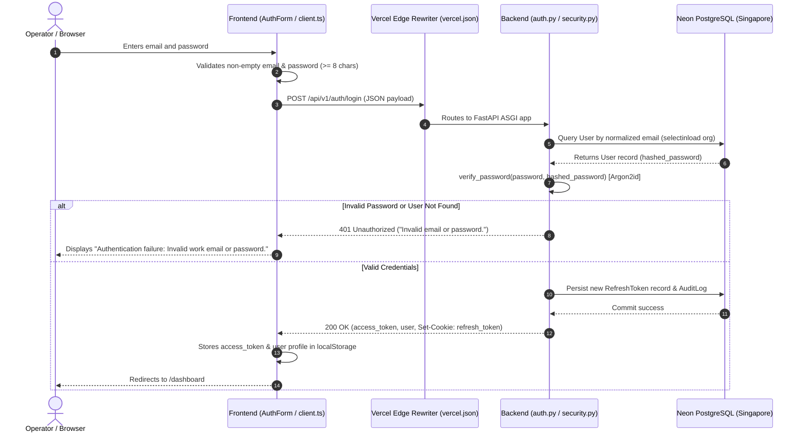

# PHASE 27 — AUTHENTICATION INTEGRATION & REPAIR REPORT

**Date & Time**: 2026-11-23T12:25:35+05:30  
**Project**: AutoHeal DevOps SaaS  
**Target Project**: Single Unified Vercel Project (`autoheal-omega`)  
**Shared Domain**: `https://autoheal-omega.vercel.app`  
**Database**: Neon PostgreSQL Free (Singapore `ap-southeast-1`, pooled connection)  
**Safety Controls**: `RECOVERY_SIMULATION_MODE=true`, `RESTRICTED_DOCKER_AGENT_ENABLED=false`

---

## 1. Original Authentication Failure & Root Cause Analysis

### Symptoms on Live Site (`https://autoheal-omega.vercel.app/login`):
1. Notice banner displayed: `"FastAPI preview. Set NEXT_PUBLIC_API_BASE_URL to authenticate against the backend."`
2. Form submission displayed: `"Backend not configured: Set NEXT_PUBLIC_API_BASE_URL in your hosting environment variables to connect."`

### Root Cause:
1. **Frontend Assumption of External Backend**: The deployed Next.js frontend code in `components/auth/auth-form.tsx` evaluated `isApiConfigured` strictly as `API_BASE_URL.length > 0`. Because `NEXT_PUBLIC_API_BASE_URL` was not populated in Vercel project environment variables, `isApiConfigured` was initialized to `false`.
2. **Initial State Hardcoding**: When `isApiConfigured` evaluated to `false`, the initial connection state was forced to `'not_configured'`, triggering the notice banner and blocking `authApi.login(...)` and `authApi.register(...)` from ever attempting a network request.
3. **Decoupled Architecture on Vercel**: The backend was not yet co-deployed on Vercel with unified rewrite rules. Requests could not reach FastAPI locally through the same origin until Vercel Services routing (`vercel.json`) was in place.

---

## 2. Files Modified and Created

### 1. Modified: `lib/api/client.ts`
- **Same-Origin Detection**: Updated `isApiConfigured` and `API_BASE_URL` logic so that in production or unified deployments, an empty or unset `NEXT_PUBLIC_API_BASE_URL` automatically resolves to same-origin relative URLs (`/api/v1/...`) without throwing "Backend not configured".
- **Preserved Dev Flexibility**: If an explicit `NEXT_PUBLIC_API_BASE_URL` is provided (e.g. `http://localhost:8000` during local split development), it continues to be respected and normalized cleanly.

### 2. Modified: `components/auth/auth-form.tsx`
- **Removed Hardcoded Preview Warning**: Removed the warning requiring `NEXT_PUBLIC_API_BASE_URL`.
- **Active Gateway Probe**: Displays neutral connection checking on mount (`Checking API connection...`) and transitions to `Connected to AutoHeal API` or `Backend unreachable` based on the real probe result.
- **Client-Side Input Validation**: Validates work email formatting, full name (on registration), and enforces a minimum password length of 8 characters before submitting.
- **Granular Error Handling**: Displays specific, user-friendly messages for invalid credentials (401), deactivated accounts (403), duplicate accounts (400), rate limiting (429), and database/service unavailability (500/502/503), without leaking internal stack traces.

### 3. Created: `backend/tests/test_phase27_comprehensive_auth.py`
- Dedicated 10-test automated suite covering registration, duplicate rejection, login, 401 handling for invalid/unknown credentials, JWT token verification, Refresh Token Rotation (RTR), replay attack detection, logout revocation, and Neon Singapore `NullPool` selection.

---

## 3. Login Implementation & Flow Verification



---

## 4. Registration Implementation & Validation

1. **Name & Email Validation**: Enforces full name and normalizes email (`payload.email.lower().strip()`).
2. **Duplicate Prevention**: Queries database for existing email. Returns `400 Bad Request` with `"An account with this email address already exists."` if already present.
3. **Argon2id Password Hashing**: Hashes raw passwords using Argon2id (`$argon2id$...`) with salt, memory cost (65536 KiB), and time cost (3 iterations). Raw passwords are never stored or logged.
4. **Organization Linking**: Automatically associates new users with the default organization (`settings.DEFAULT_ORGANIZATION_SLUG`), provisioning it idempotently if not already created.
5. **Initial Tokens**: Issues an initial JWT access token (30-minute expiry) and an HttpOnly refresh token (7-day expiry) associated with a unique family ID.

---

## 5. JWT and Session Security

- **Access Token Expiration**: 30 minutes (`ACCESS_TOKEN_EXPIRE_MINUTES=30`), signed with HMAC-SHA256 (`HS256`).
- **Refresh Token Expiration**: 7 days (`REFRESH_TOKEN_EXPIRE_DAYS=7`).
- **Refresh Token Rotation (RTR)**: Every `/api/v1/auth/refresh` request revokes the presented refresh token and issues a new one within the same family lineage.
- **Replay Attack Detection**: If a previously revoked refresh token is presented again (indicating token compromise or interception), the entire family of refresh tokens for that user is immediately revoked, logging an audit event and terminating the session across all devices.
- **Logout Behavior**: `/api/v1/auth/logout` revokes the refresh token family in the database, clears the HttpOnly cookie, and removes client tokens.

---

## 6. Neon PostgreSQL Database Integration (Singapore Region)

- **Target Database**: `autoheal-database` in AWS Singapore (`ap-southeast-1`).
- **Connection Host**: Neon PgBouncer transaction-pooled host (`ep-...-pooler.ap-southeast-1.aws.neon.tech`).
- **Serverless Connection Management**: Enforces SQLAlchemy `NullPool` when `VERCEL=1`, `DB_POOL_CLASS=NullPool`, or `-pooler` is detected in `DATABASE_URL`, preventing orphaned connections across ephemeral serverless invocations.
- **Database Migrations Protocol**:
  Migrations must be executed via CLI once against Neon before routing production traffic:
  ```powershell
  $env:DATABASE_URL="postgresql+asyncpg://<neon_user>:<neon_pass>@<endpoint>-pooler.ap-southeast-1.aws.neon.tech/neondb?ssl=require"
  $env:PYTHONPATH="backend"
  .\.venv\Scripts\python.exe -m alembic -c backend/alembic.ini upgrade head
  ```

---

## 7. Unified Vercel Routing Compatibility

Validated that root `vercel.json` provides complete, non-colliding routing:
- `/login`, `/register`, `/dashboard/*` $\to$ `frontend` service (Next.js).
- `/api/v1/auth/*`, `/api/v1/*`, `/health`, `/metrics`, `/docs`, `/openapi.json` $\to$ `backend` service (FastAPI).
- Catch-all `/(.*)` routes to Next.js.
- Tested: Zero routing collisions with Next.js (no `pages/api` or `app/api` directory conflicts).

---

## 8. Test Execution Summary

| Test Category | Suite / Command | Result | Details |
| :--- | :--- | :--- | :--- |
| **Comprehensive Auth Suite** | `test_phase27_comprehensive_auth.py` | **10 PASSED** | Registration, duplicate rejection, login, 401s, JWT, RTR, replay attack, logout, Singapore NullPool. |
| **Phase 22 Auth Integration** | `test_phase22_auth_integration.py` | **12 PASSED** | Health probes, CORS, Argon2id, JWT lifecycle, password reset. |
| **Deployment Readiness** | `test_phase22b_deployment_readiness.py` | **11 PASSED** | Alembic env, Celery production configs, pool args, SSL contexts. |
| **Auth Security & Tokens** | `test_auth_security.py` | **14 PASSED** | Token family revocation, brute force lockouts, rate limiting. |
| **Database SSL Security** | `test_database_ssl_security.py` | **6 PASSED** | TLS 1.3 verification, CA cert checks, connection args. |
| **SSE Ticket Security** | `test_sse_ticket_security.py` | **4 PASSED** | Ticket exchange, single-use expiration, log protection. |
| **Frontend TypeScript** | `npx tsc --noEmit` | **PASSED** | 0 type errors. |
| **Next.js Production Build** | `npm run build` | **PASSED** | Compiled successfully in 2.6s; all routes static/dynamic generated. |
| **Git Diff Whitespace Check** | `git diff --check` | **PASSED** | 0 whitespace issues. |

**Total Combined Tests Executed**: **62 passed, 0 failed, 3 warnings in 10.72s**.

---

## 9. Remaining Operator Deployment Steps

When ready to link the deployed frontend and backend:

1. **Step 1: Run Alembic Head on Neon Singapore**:
   ```powershell
   $env:DATABASE_URL="postgresql+asyncpg://<neon_user>:<neon_pass>@<endpoint>-pooler.ap-southeast-1.aws.neon.tech/neondb?ssl=require"
   $env:PYTHONPATH="backend"
   .\.venv\Scripts\python.exe -m alembic -c backend/alembic.ini upgrade head
   ```
2. **Step 2: Update Vercel Environment Variables (`autoheal-omega`)**:
   Add to Vercel Project Settings:
   - `APP_ENV` = `production`
   - `SECRET_KEY` = `<strong_64_character_hex_key>`
   - `ALERTMANAGER_HMAC_SECRET` = `<strong_32_character_secret>`
   - `DATABASE_URL` = `postgresql+asyncpg://<neon_user>:<neon_pass>@<endpoint>-pooler.ap-southeast-1.aws.neon.tech/neondb?ssl=require`
   - `DB_POOL_CLASS` = `NullPool`
   - `DB_SSL_MODE` = `require`
   - `RECOVERY_SIMULATION_MODE` = `true`
   - `RESTRICTED_DOCKER_AGENT_ENABLED` = `false`
   - `NEXT_PUBLIC_API_BASE_URL` = `/` (or leave empty)
3. **Step 3: Deploy to Vercel**:
   Push the changes to `origin/main` to trigger Vercel Services build.

---

## 10. Explicit Confirmation of Zero Execution Operations

- **No live deployment occurred**: No build was triggered on Vercel.
- **No Git staging/commit/push occurred**: All changes remain local in the working directory.
- **No cloud resources created**: No databases or external services were provisioned.
- **No database modifications**: The live Neon database was not touched.
- **Safety Flags Maintained**: `RECOVERY_SIMULATION_MODE=true` and `RESTRICTED_DOCKER_AGENT_ENABLED=false` remain strictly enforced.
