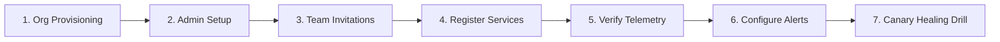

# AutoHeal DevOps — Pilot User Onboarding Guide
**Target Audience**: Engineering Leaders, DevOps Team Leads, SREs, and Platform Engineers  
**Scope**: Step-by-Step Pilot Onboarding, Role Delegation, and Monitored Service Setup

---

## 1. Overview

AutoHeal DevOps SaaS is engineered for frictionless onboarding while strictly enforcing multi-tenant isolation and role-based access control (RBAC). This guide walks a newly provisioned engineering team from organization creation to their first verified autonomous healing drill.

---

## 2. Seven-Step Onboarding Workflow



### Step 1: Organization Provisioning
Each engineering team operates within an isolated tenant (`Organization`). Tenant slug and enterprise quota are assigned during initial provisioning.
- **Endpoint**: Default workspace or `POST /api/v1/auth/register`
- **Isolation**: Services, incidents, recoveries, and audit logs are partitioned by `organization_id`.

### Step 2: Primary Administrator Setup
The first administrator creates credentials.
- Passwords are encrypted using **Argon2id**.
- Administrators receive short-lived (15-minute) signed JWT access tokens and HTTP-only rotating refresh tokens (`SameSite=Strict`).
- **Endpoint**: `POST /api/v1/auth/login`

### Step 3: Team Member Invitations & Role Delegation
Administrators invite team members by designating roles:
- **Viewer**: Read-only access to dashboards, service health, incidents, and audit logs.
- **Operator**: Can acknowledge incidents, request recoveries, approve and execute permitted remediations.
- **Admin**: Full administrative authority, including team invitations, identity provider configuration, and policy editing.

> [!CAUTION]
> Standard users cannot self-elevate to `admin`. Only active administrators can issue invitations with the `admin` role.

#### Inviting a Member (API Call)
```bash
curl -X POST http://localhost:8000/api/v1/onboarding/invite \
  -H "Authorization: Bearer <ADMIN_JWT_TOKEN>" \
  -H "Content-Type: application/json" \
  -d '{
    "email": "lead-sre@company.com",
    "role": "operator"
  }'
```
**Response**:
```json
{
  "id": "c1f8e219-...",
  "email": "lead-sre@company.com",
  "role": "operator",
  "organization_id": "24b0c732-...",
  "invitation_token": "qW8v1...",
  "invite_url": "/auth/accept-invite?token=qW8v1...",
  "expires_at": "2026-11-28T14:35:00Z",
  "is_accepted": false
}
```

#### Accepting an Invitation (Recipient Call)
```bash
curl -X POST http://localhost:8000/api/v1/onboarding/accept-invite \
  -H "Content-Type: application/json" \
  -d '{
    "token": "qW8v1...",
    "full_name": "Jordan Vance",
    "password": "SecurePassword123!"
  }'
```

---

### Step 4: Register Monitored Microservices
Register backend services to track availability, error rates, and P95 latency.
```bash
curl -X POST http://localhost:8000/api/v1/services \
  -H "Authorization: Bearer <OPERATOR_JWT_TOKEN>" \
  -H "Content-Type: application/json" \
  -d '{
    "name": "checkout-api",
    "environment": "production",
    "availability": 99.98,
    "error_rate": 0.0,
    "latency_ms": 22
  }'
```

### Step 5: Verify Live Telemetry Reception
Confirm telemetry signals are streaming from the service into Prometheus and AutoHeal:
- **API Check**: `GET /api/v1/services`
- **Metrics Check**: `GET /api/v1/observability/stats`
- **Dashboard View**: Navigate to `/dashboard/services` to inspect real-time sparklines.

### Step 6: Configure Alerting & Notification Destinations
Configure notification channels (Slack, Email, Microsoft Teams, or Webhook):
```bash
curl -X POST http://localhost:8000/api/v1/notifications/channels \
  -H "Authorization: Bearer <ADMIN_JWT_TOKEN>" \
  -H "Content-Type: application/json" \
  -d '{
    "name": "SRE Paging Slack",
    "channel_type": "slack",
    "is_enabled": true,
    "config_json": "{\"webhook_url\": \"https://hooks.slack.com/services/T00/B00/SECRET\"}",
    "rate_limit_per_minute": 30
  }'
```
*Note: Tokens and webhook secrets are automatically redacted to `********` in all API responses.*

### Step 7: Canary Incident Walkthrough & Self-Healing Drill
Verify end-to-end incident handling using the sample test microservice:
1. Inject failure: `curl -X POST http://localhost:8080/chaos/fail`
2. AutoHeal detects error rate spike (`503 Service Unavailable`, error rate 1.0).
3. Review AI root-cause diagnosis on the incident page.
4. Operator clicks **Approve Recovery** (`restart_service`).
5. Autonomous agent cycles container and verifies recovery.
6. Incident automatically closes with **Verified** status.

---

## 3. Onboarding Readiness Checklist API

Teams can verify their readiness status at any time via:
```bash
curl http://localhost:8000/api/v1/onboarding/checklist \
  -H "Authorization: Bearer <OPERATOR_JWT_TOKEN>"
```

**Output**:
```json
{
  "organization_name": "AutoHeal Workspace",
  "completion_percentage": 71.4,
  "is_ready_for_pilot": true,
  "steps": [
    { "id": "org_setup", "title": "Tenant & Organization Provisioning", "completed": true },
    { "id": "admin_setup", "title": "Security Administrator Provisioned", "completed": true },
    { "id": "team_invites", "title": "Team Member Onboarding", "completed": true },
    { "id": "services_connected", "title": "Register Monitored Services", "completed": true },
    { "id": "telemetry_active", "title": "Live Telemetry Ingestion", "completed": true },
    { "id": "alert_channels", "title": "Notification & Alert Destinations", "completed": false },
    { "id": "test_incident", "title": "Self-Healing Drill Walkthrough", "completed": true }
  ]
}
```
Teams reaching `>= 70%` completion are certified ready for controlled operational pilots.
