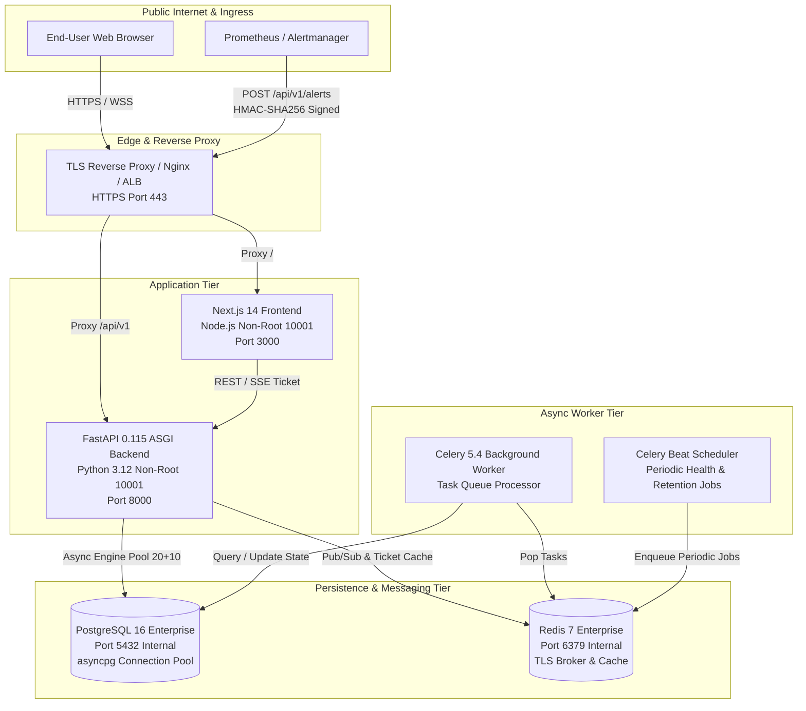
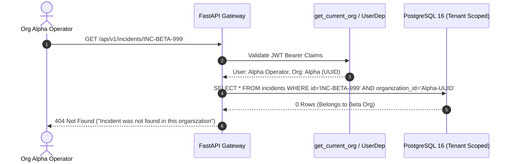

# AutoHeal DevOps — Production Architecture Specification

## 1. Executive Summary & Design Principles

AutoHeal DevOps is an autonomous self-healing DevOps operations and incident remediation platform engineered as a multi-tenant Software-as-a-Service (SaaS). The system continuously monitors microservice health, ingests Prometheus/Alertmanager alert payloads, correlates monitoring telemetry into structured incidents, diagnoses root causes via Gemini 2.5 Flash / deterministic heuristic fallback, and executes controlled, policy-gated recovery actions with post-recovery health verification.

### Core Architectural Principles
- **Defense in Depth**: Layered security across network isolation, reverse proxy headers, cryptographic authentication, RBAC authorization, and database query scoping.
- **Strict Multi-Tenant Isolation**: Cryptographic tenant binding via JWT and single-use SSE tickets. Every persistent record is scoped by `organization_id` (UUIDv4).
- **Asynchronous & Decoupled Execution**: Fast ASGI request/response loop decoupled from heavy AI inference, PDF rendering, and recovery execution via Redis and Celery workers.
- **Fail-Safe & Anti-Flapping Operation**: Cooldown timers, max-retry guards, simulation enforcement (`RECOVERY_SIMULATION_MODE=true`), and operator approval gates prevent cascading remediation failures.
- **Zero-Trust Network Topology**: Web, database, and cache tiers operate on segregated Docker bridge networks with no external exposure of persistence ports.

---

## 2. Production Topology & Component Architecture



---

## 3. Subsystem Breakdown & Communication Contracts

### 3.1 Ingress & Reverse Proxy Tier
- **TLS Termination**: Handles modern TLS (TLSv1.2, TLSv1.3) with HSTS (`max-age=63072000; includeSubDomains; preload`).
- **Security Headers**:
  - `Content-Security-Policy`: Restricts scripts, styles, frames, and connect origins.
  - `X-Frame-Options: DENY` (Clickjacking mitigation).
  - `X-Content-Type-Options: nosniff` (MIME-sniffing mitigation).
  - `Referrer-Policy: strict-origin-when-cross-origin`.
  - `Permissions-Policy: camera=(), microphone=(), geolocation=()`.
- **Request Tracing**: Generates or forwards `X-Request-ID` across reverse proxy, FastAPI middleware, and structured access logs.

### 3.2 Next.js Frontend Application
- **Framework**: Next.js 14 with TypeScript and Tailwind CSS.
- **Design & Palette**: Enterprise dark theme palette (`#080B12`, `#0D1220`, `#111827`, `#35D6C5`, `#7C6CFF`, `#F8FAFC`).
- **Authentication Handling**: Stores short-lived JWT access tokens in memory; browser stores refresh tokens exclusively in HttpOnly, SameSite, Secure cookies.
- **Real-Time Streaming**: Exchanges access token for a single-use 60-second SSE ticket (`POST /api/v1/events/ticket`), then connects to `/api/v1/events/stream?ticket=<ticket>`, preventing token leakage in URL logs.

### 3.3 FastAPI ASGI Application
- **Runtime**: Python 3.12 with Uvicorn ASGI server.
- **Authentication**: Argon2id password hashing, Refresh Token Rotation (RTR) with family revocation on replay attack detection.
- **API Registry (`/api/v1`)**:
  - `/auth`: Registration, login, token refresh, logout, profile, password reset.
  - `/services`: Microservice catalog, health status, error rates, and metric time series.
  - `/incidents`: Incidents listing, details, recovery request, post-mortem PDF download.
  - `/recoveries`: Human-in-the-loop approval, execution, and rejection.
  - `/alerts`: Prometheus Alertmanager webhook receiver with dual authentication (Secret Header or HMAC-SHA256 signature).
  - `/analytics`: MTTR, recovery success rate, false-positive classification, and availability history.
  - `/events`: Real-time SSE ticket issuance and event broadcast streams.
  - `/health`: Public liveness (`/health`) and comprehensive database/redis readiness (`/health/readiness`).

### 3.4 Persistence & Connection Pool Architecture
- **PostgreSQL 16**: Primary relational storage for tenant accounts, credentials, services, incidents, recovery actions, and audit logs.
- **Connection Pool Configuration**:
  ```python
  engine = create_async_engine(
      settings.DATABASE_URL,
      pool_size=20,          # Standard concurrent connection allocation
      max_overflow=10,       # Burst headroom for traffic spikes
      pool_timeout=30,       # Fail-fast timeout in seconds
      pool_recycle=1800,     # Periodic reconnection preventing stale TCP sockets
      pool_pre_ping=True,    # Liveness validation prior to checkout
  )
  ```
- **Composite Production Indexes**:
  - `ix_incidents_org_detected_at` on `incidents (organization_id, detected_at)`
  - `ix_incidents_org_status` on `incidents (organization_id, status)`
  - `ix_services_org_env` on `services (organization_id, environment)`
  - `ix_service_metrics_svc_sampled` on `service_metrics (service_id, sampled_at)`
  - `ix_audit_logs_org_created` on `audit_logs (organization_id, created_at)`
  - `ix_refresh_tokens_user_revoked` on `refresh_tokens (user_id, is_revoked)`

---

## 4. Multi-Tenant Security & Isolation Model



Every query, mutation, recovery approval, report download, and SSE subscription is scoped to `user.organization_id`. Direct lookups across tenant boundaries fail closed with `404 Not Found` to prevent resource enumeration.

---

## 5. Security & Isolation Hardening Summary

| Protection Layer | Mechanism Implemented | Security Benefit |
| :--- | :--- | :--- |
| **Password Storage** | Argon2id (`time_cost=3, memory_cost=65536, parallelism=4`) | State-of-the-art resistance to GPU/ASIC cracking |
| **Session Security** | Refresh Token Rotation (RTR) + Family Revocation | Replay attack detection revokes all tokens in family |
| **Brute-Force Shield** | Sliding-window IP rate limiter (`15 req/60s`) on auth routes | Throttles automated credential stuffing and dictionary attacks |
| **SSE Credentials** | Cryptographic single-use ticket (`expires_in=60s`) | Eliminates long-lived access tokens from URL/proxy logs |
| **Webhook Security** | HMAC-SHA256 body signature verification with timing-safe comparison | Prevents alert spoofing and replay tampering |
| **Container Hardening** | Non-root users (`UID 10001`), read-only rootfs, `no-new-privileges` | Eliminates host privilege escalation risks |
| **Recovery Boundary** | Strict allowlist + `RECOVERY_SIMULATION_MODE=true` | Zero shell execution; prevents unauthorized infrastructure commands |
| **Docker Socket** | Zero `/var/run/docker.sock` mount in web containers | Blocks container escape and host daemon manipulation |
