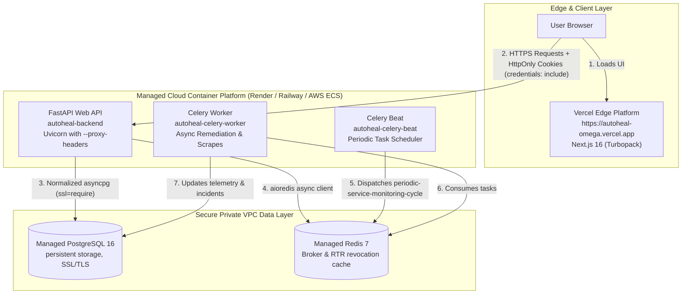

# AutoHeal DevOps — Production Cloud Deployment Architecture & Runbook

This guide covers the end-to-end cloud deployment architecture for AutoHeal DevOps, decoupling the serverless Next.js edge frontend on Vercel from the containerized FastAPI backend, asynchronous Celery worker/beat, and managed cloud data services.

---

## 1. Production Architecture Overview



---

## 2. Infrastructure Components

### A. Next.js Frontend (`https://autoheal-omega.vercel.app`)
- **Hosting**: Vercel Edge Network
- **Build Output**: Static HTML + Client Hydration + Serverless Route Handlers
- **Cross-Origin Auth**: Sends `credentials: "include"` on all API calls; reads short-lived JWT access tokens and receives rotated HttpOnly refresh cookies.
- **Connection Diagnostics**: Dynamically tests `GET /api/v1/health` to distinguish between "Backend not configured", "Backend unreachable", "Backend connected", and "Authentication failure".

### B. FastAPI Backend API (`autoheal-backend`)
- **Container**: `backend/Dockerfile` (`python:3.12-slim`, non-root user `autoheal` [UID 10001]).
- **Runtime Command**: `sh -c 'uvicorn app.main:app --host ${HOST:-0.0.0.0} --port ${PORT:-8000} --proxy-headers --forwarded-allow-ips="*"'`
- **Reverse Proxy Support**: `--proxy-headers` ensures proper TLS and client IP resolution behind Render/Cloudflare/AWS load balancers.
- **Database Connection Pool**: `pool_size=20`, `max_overflow=10`, `pool_recycle=1800`, `pool_pre_ping=True`.
- **Graceful Shutdown**: Lifespan context manager cleanly disposes of the SQLAlchemy connection pool upon receiving `SIGTERM`.

### C. Celery Worker (`autoheal-celery-worker`)
- **Container**: `backend/Dockerfile.celery_worker`.
- **Concurrency**: `--concurrency=4` with `--loglevel=INFO`.
- **Resilience**: Late acknowledgment (`task_acks_late=True`), rejection on worker death (`task_reject_on_worker_lost=True`), broker connection retry on startup, dead-letter logging on unhandled exceptions.
- **TLS Support**: Automatically enables `broker_use_ssl` when `REDIS_URL` begins with `rediss://`.

### D. Celery Beat Scheduler (`autoheal-celery-beat`)
- **Container**: `backend/Dockerfile.celery_beat`.
- **Schedule**: Enqueues `app.tasks.monitoring.monitor_services_task` every 15 seconds.

### E. Managed PostgreSQL 16
- **Driver**: `asyncpg` via SQLAlchemy 2.0.
- **SSL Auto-Negotiation**: `DATABASE_URL` validator auto-converts `postgres://` and `postgresql://` to `postgresql+asyncpg://` and translates `sslmode=require` to `ssl=require`.

### F. Managed Redis 7
- **Usage**: Celery task message broker and session revocation cache store.
- **Persistence**: Append-Only File (AOF) enabled.

---

## 3. Database Migration & Release Phase Strategy

In cloud container platforms, database migrations must execute automatically before new application code receives live user traffic.

### Automated Migration via `preDeployCommand`
On Render, the blueprint defines:
```yaml
preDeployCommand: alembic upgrade head
```
This runs inside the newly built Docker container. If migration fails (e.g., database network partition or schema conflict), the deployment immediately halts and existing traffic continues routing to the previous healthy container.

### Manual Shell Migration Fallback
If deploying on platforms without pre-deploy hooks:
```bash
# Connect to container shell
alembic upgrade head
python seed.py
```
*(Note: `seed.py` is idempotent and safe for production bootstrapping; it uses `select()` existence guards and skips existing records).*

---

## 4. Zero Downtime Deployments & Health Probes

1. **Liveness Probe** (`GET /api/v1/health/liveness`): Confirms ASGI event loop responsiveness.
2. **Readiness Probe** (`GET /api/v1/health/readiness`): Deeply tests live database connectivity (`SELECT 1`) and Redis availability (`aioredis.ping()`). Returns HTTP 200 when ready, HTTP 503 if degraded.
3. **Rolling Updates**: Cloud load balancers only route traffic to containers reporting HTTP 200 on `/api/v1/health`.
