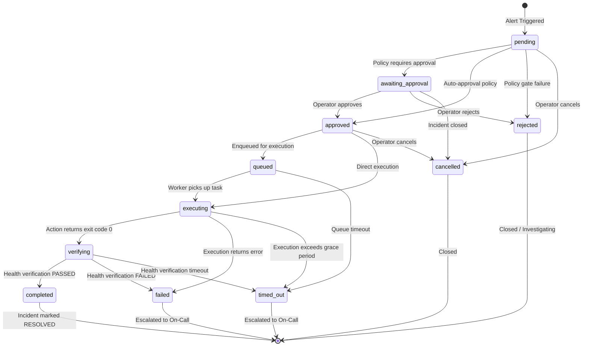

# AutoHeal DevOps — Recovery State Machine & Orchestration

## 1. Lifecycle State Machine Overview

The recovery engine manages remediation workflows using a strict, auditable state machine (`RecoveryState`). State transitions are deterministic, enforced by `RecoveryOrchestrator`, and emit real-time Server-Sent Events (SSE) to update the operator dashboard.

---

## 2. Canonical States vs. Frontend Contract Aliases

To maintain backward compatibility with existing Next.js frontend interfaces while supporting granular infrastructure execution tracking, `FRONTEND_STATUS_MAP` bridges the models:

| Canonical Enum (`RecoveryState`) | Frontend Status Alias | UI Representation | Description |
| :--- | :--- | :--- | :--- |
| `pending` | `pending_approval` | Pending review | Initial evaluation state |
| `awaiting_approval` | `pending_approval` | Pending review | Awaiting human approval |
| `approved` | `approved` | Approved | Authorized by operator |
| `rejected` | `rejected` | Rejected | Denied by policy or operator |
| `queued` | `running` | Executing | In background task queue |
| `executing` | `running` | Running action | Active container / node operation |
| `verifying` | `running` | Verifying health | Running SLA differential probes |
| `completed` | `completed` | Completed | Action succeeded & health verified |
| `failed` | `failed` | Failed | Execution or SLA probe failed |
| `timed_out` | `failed` | Timed out | Exceeded duration bounds |
| `cancelled` | `rejected` | Cancelled | Revoked by operator |

---

## 3. Permitted Transition Matrix

State transitions are evaluated against `VALID_TRANSITIONS`. Attempting an illegal transition (e.g. moving directly from `rejected` to `executing` or from `completed` to `approved`) raises `InvalidStateTransitionError` and is rejected.

| Current State | Permitted Target States |
| :--- | :--- |
| `pending` | `awaiting_approval`, `approved`, `rejected`, `cancelled` |
| `awaiting_approval` | `approved`, `executing`, `rejected`, `cancelled` |
| `approved` | `queued`, `executing`, `cancelled` |
| `queued` | `executing`, `timed_out`, `cancelled` |
| `executing` | `verifying`, `completed`, `failed`, `timed_out` |
| `verifying` | `completed`, `failed`, `timed_out` |
| `completed` | *Terminal State* |
| `failed` | *Terminal State* |
| `rejected` | *Terminal State* |
| `timed_out` | *Terminal State* |
| `cancelled` | *Terminal State* |

---

## 4. Audit Logging & Timeline Persistence

Every validated state transition performs two transactional side effects:

1. **AuditLog Record**:
   - `action`: `recovery_state_{target_state}`
   - `resource_type`: `recovery_action`
   - `resource_id`: Recovery UUID
   - `details`: Human-readable justification and triggering actor identity
2. **IncidentTimeline Event**:
   - Updates the associated incident event history with visual tone (`success`, `warning`, `neutral`).
3. **SSE Event Emission**:
   - Broadcasts `recovery_updated` and `incident_updated` payloads to the organization channel.
