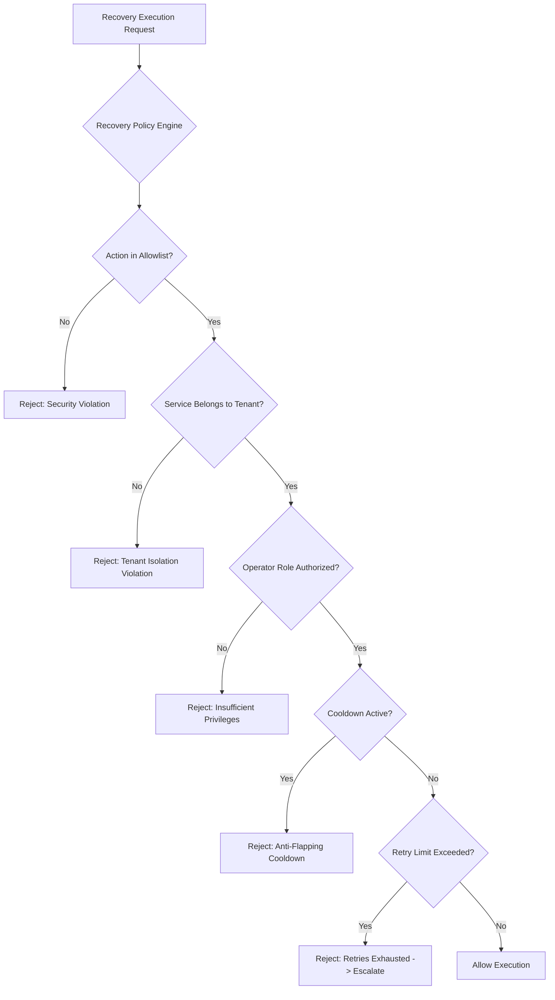

# AutoHeal DevOps — Recovery Policy Governance & Enforcement Engine

## 1. Governance Architecture

The `RecoveryPolicyEngine` serves as the authoritative gatekeeper for all autonomous and human-triggered remediation workflows. Even if an AI diagnosis model proposes a recovery action with high confidence, the policy engine independently evaluates security, environment, flapping prevention, and role-based permissions before execution is authorized.



---

## 2. Multi-Factor Evaluation Rules

### Rule 1: Action Allowlist Validation
Only operations defined in `APPROVED_RECOVERY_ACTIONS` are permitted:
- `restart_service`
- `scale_service`
- `clear_cache`
- `restore_health`
- `rollback_release`
Arbitrary commands or unknown action strings are immediately rejected.

### Rule 2: Multi-Tenant Boundary Enforcement
The service and the target compute agent must both belong to the caller's `organization_id`. Any request referencing a cross-tenant resource returns an authorization failure.

### Rule 3: Operator Role Verification
Only users with `operator` or `admin` roles may approve or trigger recovery actions. Requests from users with the `viewer` role are rejected with `403 Forbidden`.

### Rule 4: Anti-Flapping Cooldown Guards
To prevent infinite flapping and thrashing during cascading upstream failures, each service and action pair enforces a cooldown window:
- Default Cooldown: **900 seconds** (15 minutes).
- Service-Specific Override: Defined in the `recovery_policies` table.
- If a prior recovery action on the service completed within the cooldown period, subsequent requests are held or rejected.

### Rule 5: Incident Retry Bounds
To prevent endless restart loops on permanently broken workloads:
- Maximum Retries: **3 attempts per incident**.
- If 3 prior recovery attempts have already been executed for the same incident, the engine halts automation and flags the incident: `"Retry limit exceeded: Requiring human escalation"`.

---

## 3. Configuration & REST API Endpoints

Organizations can customize policy rules on a per-service basis via the Policies API:

### Endpoints
- `GET /api/v1/policies`: List all configured recovery policies for the organization.
- `GET /api/v1/policies/{service_id}`: Retrieve policies bound to a specific service.
- `POST /api/v1/policies/{service_id}`: Upsert policy parameters (`action`, `approval_required`, `cooldown_seconds`, `max_retries`, `is_active`).
- `POST /api/v1/policies/evaluate/check`: Dry-run pre-execution evaluation returning `PolicyEvaluationResult`.

### Example Policy Upsert Payload
```json
{
  "action": "restart_service",
  "approval_required": true,
  "cooldown_seconds": 300,
  "max_retries": 2,
  "is_active": true
}
```
