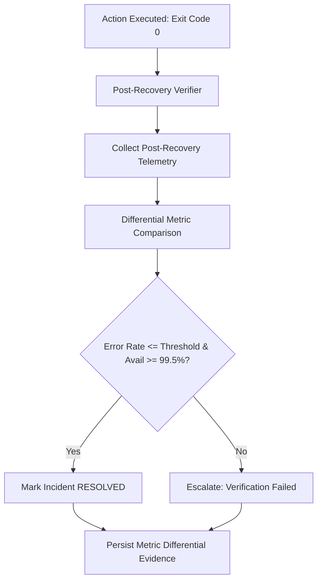

# AutoHeal DevOps — Post-Recovery Health Verification Guide

## 1. Verification Philosophy & The False-Resolution Fallacy

In traditional automation scripts, a recovery action returning exit code 0 is often prematurely declared a "success". In distributed systems, this creates the dangerous **false-resolution fallacy**: cycling a container or restarting a pod does not guarantee that user-facing traffic is restored, latency has normalized, or the root bottleneck is resolved.

AutoHeal enforces a strict post-recovery verification boundary:
> **An incident is NOT resolved when a recovery command exits. It is ONLY resolved when post-recovery telemetry confirms SLA compliance.**



---

## 2. Metric Differential Evaluation

The verification engine (`PostRecoveryVerifier`) performs quantitative delta comparisons across core golden signals:

```python
class MetricComparison(BaseModel):
    metric_name: str           # e.g., "error_rate", "availability", "latency_ms"
    pre_recovery_value: float  # Baseline telemetry at time of alert
    post_recovery_value: float # Observed telemetry post-remediation
    threshold: float           # SLA threshold configured on the incident
    unit: str                  # "%", "ms"
    normalized: bool           # True if post-recovery value is within SLO
```

### Verification Evaluation Rules
1. **Error Rate Evaluation**: `post_recovery_error_rate <= threshold` (e.g. 0.02% <= 1.0%).
2. **Availability Evaluation**: `post_recovery_availability >= 99.5%`.
3. **P95 Latency Evaluation**: `post_recovery_latency_ms <= 300ms`.
4. **Readiness Probe**: Service HTTP `/health` or Kubernetes readiness probe returns 200 OK.

---

## 3. Evidence Persistence & Audit Trail

When verification completes, the outcome is recorded transactionally in three locations:

1. **`recovery_results` Table**:
   - `verified`: Boolean (`True` or `False`).
   - `summary`: Detailed quantitative summary:
     `"Verified: customer-web returned to healthy state. Error rate dropped from 2.4% to 0.02% (threshold: 1.0%), P95 latency normalized to 115ms."`
   - `diagnostic_output`: Full agent receipt and stdout logs.
2. **`incident_evidence` Table**:
   - `kind`: `"health_check"`
   - `title`: `"Post-Recovery SLA Check"`
   - `detail`: Quantitative SLA observations preserved for historical post-mortem reporting.
3. **`incident_events` Timeline**:
   - Successful: `"Recovery Verified"` with visual tone `success`.
   - Failed: `"Verification Failed"` with visual tone `warning`, triggering on-call escalation.

---

## 4. Failure Escalation Workflow

If post-recovery telemetry fails to normalize:
1. `recovery.verification` is marked `"failed"`.
2. `incident.status` remains `"investigating"`.
3. `incident.recovery_status` is updated to `"Verification failed / Escalation required"`.
4. An audit log and timeline alert are generated for on-call personnel.
5. The system safely halts further automated retries to prevent thrashing.
