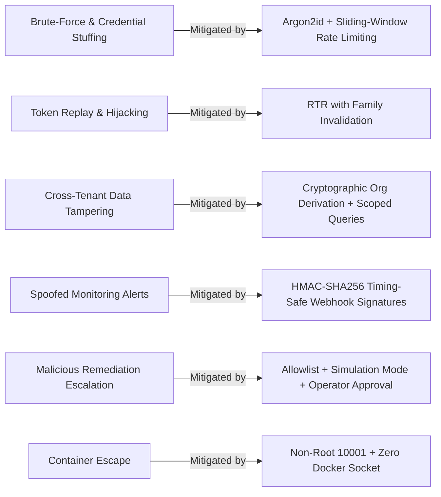

# AutoHeal DevOps — Security Architecture & Hardening Guide

## 1. Threat Model & Attack Surface Analysis

AutoHeal DevOps operates as a high-trust automated operations system with remediation capabilities. It must be resilient against external attackers, malicious tenants, compromised monitoring endpoints, and supply-chain vulnerabilities.

### Primary Threat Vectors & Implemented Defenses


---

## 2. Implemented Cryptographic & Authentication Controls

### 2.1 Password Security (Argon2id)
- **Algorithm**: Argon2id (`time_cost=3`, `memory_cost=65536 KB` (64 MB), `parallelism=4`).
- **Benefit**: Provides memory-hardness that invalidates GPU/ASIC parallel password cracking attacks.
- **Implementation**: Located in `backend/app/core/security.py`.

### 2.2 Refresh Token Rotation (RTR) & Replay Attack Invalidation
- **Lineage Tracking**: Each active session belongs to a unique `family_id` (UUIDv4).
- **Rotation**: Presenting an active refresh token issues a single new access token and a single new refresh token, while immediately marking the old token `is_revoked = True`.
- **Replay Detection**: If an attacker attempts to replay a previously rotated token, the backend detects the reuse, flags a `token_replay_detected` audit event, and **immediately revokes the entire token family**, terminating active sessions across all devices for that user.

### 2.3 Authentication Rate Limiting & Abuse Prevention
- **Algorithm**: Sliding-window in-memory rate limiter (`SlidingWindowRateLimiter`).
- **Policy**: 15 requests per 60 seconds per client IP on `/register`, `/login`, `/forgot-password`, and `/reset-password`.
- **Response**: Returns `429 Too Many Requests` with a dynamic `Retry-After` header.

### 2.4 Single-Use SSE Connection Tickets
- **Mechanism**: Eliminates the transmission of persistent JWT access tokens in EventSource URL query strings (`?token=...`).
- **Lifecycle**: User exchanges Bearer token via `POST /api/v1/events/ticket` for a cryptographic single-use ticket valid for 60 seconds. Upon connection to `/api/v1/events/stream?ticket=<ticket>`, the ticket is permanently consumed and burned from cache.

---

## 3. Webhook Authentication & Integrity Verification

Alert payloads received from Prometheus Alertmanager at `POST /api/v1/alerts` are verified before any alert processing:

1. **HMAC-SHA256 Cryptographic Signature**:
   - Alertmanager computes HMAC-SHA256 of the raw request payload using a shared 32+ byte secret (`ALERTMANAGER_HMAC_SECRET`).
   - Signature is transmitted via `X-Alertmanager-Signature: sha256=<hex_digest>`.
2. **Timing-Safe Digest Verification**:
   - The backend validates the signature using `hmac.compare_digest` to prevent side-channel timing attacks.
3. **Fail-Closed Enforcement**:
   - In production (`APP_ENV=production`), missing, weak, or unconfigured webhook secrets raise an immediate startup error, preventing unauthenticated alert injection.

---

## 4. Multi-Tenant Isolation & Least Privilege

1. **Zero Client-Supplied Tenant IDs**:
   - Endpoints do NOT accept tenant or organization IDs as request query parameters or request bodies.
   - The organization is derived strictly from the cryptographically verified JWT claims (`user.organization_id`).
2. **Database Query Scoping**:
   - Every SELECT, UPDATE, DELETE query enforces `WHERE organization_id = org.id`.
   - Direct ID lookups on resources belonging to other tenants return `404 Not Found`, eliminating cross-tenant enumeration.
3. **Role-Based Access Control (RBAC)**:
   - Three hierarchical tiers: `viewer` (read-only), `operator` (recovery request and approval), and `admin` (user management, settings).

---

## 5. Container & Infrastructure Hardening

### 5.1 Non-Root User Execution
All containers run under a dedicated, unprivileged user and group:
```dockerfile
# Dockerfile
RUN groupadd -g 10001 autoheal && \
    useradd -u 10001 -g autoheal -s /bin/sh autoheal
USER 10001:10001
```

### 5.2 Zero Docker Socket Access
- The application backend and worker containers do NOT mount `/var/run/docker.sock`.
- Eliminates any risk of container breakout compromising the host Docker daemon.

### 5.3 Read-Only Root Filesystem with Ephemeral Storage
```yaml
# docker-compose.prod.yml
security_opt:
  - no-new-privileges:true
read_only: true
tmpfs:
  - /tmp:rw,noexec,nosuid,size=128m
```

### 5.4 Autonomous Remediation Boundary
- **`RECOVERY_SIMULATION_MODE=true`**: Enabled by default to ensure all recovery actions simulate target infrastructure operations without touching real production clusters.
- **Strict Allowlist**:
  - `restart_service`
  - `scale_replicas`
  - `rollback_release`
  - `clear_cache`
  - `run_canary_probe`
- **Shell Prevention**: Zero arbitrary shell or bash commands are accepted or executed by the recovery engine.

---

## 6. Sensitive Data Sanitization & Log Masking

- **Credential Scrubbing**: `app.core.logging.mask_sensitive_data` recursively masks keys matching `password`, `token`, `secret`, `api_key`, `authorization`.
- **Sanitized Global 500 Handler**: Unhandled server exceptions never leak stack traces, database schema details, or query parameters. The response returns:
  ```json
  {
    "detail": "An unexpected internal error occurred. Please quote request ID req-7f9a12b4 to support.",
    "request_id": "req-7f9a12b4"
  }
  ```
  The full stack trace is correlated in server logs strictly by `request_id`.
