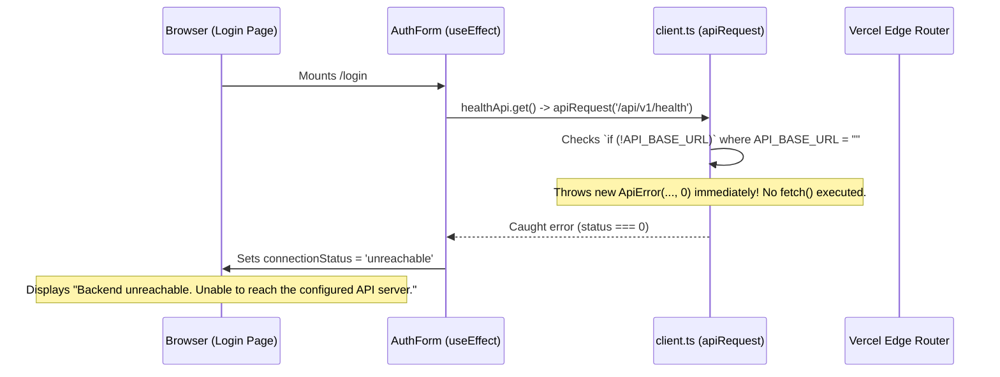
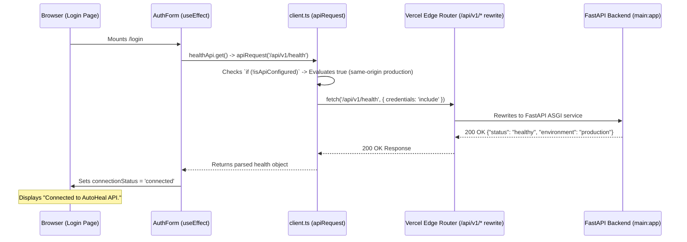

# VERCEL SAME-DOMAIN AUTHENTICATION CONNECTIVITY FIX REPORT

**Date & Time**: 2026-11-23T13:08:45+05:30  
**Project**: AutoHeal DevOps SaaS  
**Production Domain**: `https://autoheal-omega.vercel.app`  
**GitHub Repository**: `HMSLBDN/Autoheal` (Branch: `main`)  
**Deployment Model**: Unified Vercel Project (Same-domain Next.js + FastAPI via Vercel Services)

---

## 1. Exact Root Cause Diagnosis

### The Diagnostic Paradox:
- Requesting `https://autoheal-omega.vercel.app/api/v1/health` and `https://autoheal-omega.vercel.app/health` returns `HTTP 200 OK` with JSON:
  `{"status":"healthy","timestamp":"...","environment":"production","version":"0.1.0"}` and header `X-Request-Id: req-...`.
- **Proof of Backend**: The backend is indeed deployed on Vercel and responding properly to HTTP GET requests.
- **The Issue**: On the login page (`https://autoheal-omega.vercel.app/login`), the banner reported:
  `"Backend unreachable. Unable to reach the configured API server."`
- **Network Inspection Clue**: In the browser Network tab, no successful or visible network request to `/api/v1/health` was being dispatched from the login component.

### Code-Level Root Cause:
Inside [lib/api/client.ts](file:///c:/Users/Akshay%20N/Documents/Autoheal/autoheal-devops-saas/lib/api/client.ts):
1. **Empty Base URL Normalization for Same-Origin**:
   When `NEXT_PUBLIC_API_BASE_URL` is configured as `/`, `normalizeBaseUrl('/')` trims the string and strips trailing slashes, resulting in `API_BASE_URL = ""`.
   This is intentional and correct for same-origin relative URLs (`/api/v1/...`), where `buildApiUrl('/api/v1/health')` returns `"/api/v1/health"`.
2. **The Guard Check Bug in `apiRequest` and `apiBlob`**:
   At the very top of `apiRequest`, the code evaluated:
   ```typescript
   if (!API_BASE_URL) {
     throw new ApiError('The FastAPI backend service is not configured. Set NEXT_PUBLIC_API_BASE_URL.', 0);
   }
   ```
   Because `API_BASE_URL` was normalized to `""` (the empty string for relative paths), the guard evaluated `!API_BASE_URL` to `true`!
3. **Immediate Synchronous Throw Before Network Fetch**:
   - When `healthApi.get(signal)` was invoked on component mount:
     `healthApi.get` called `apiRequest('/api/v1/health')`.
     `apiRequest` immediately threw `new ApiError(..., 0)` **without ever calling `fetch()`**.
   - No HTTP request ever reached the browser network stack or Vercel Edge.
   - The catch block in `AuthForm` caught the error with `status === 0` and immediately flipped state to:
     `setConnectionStatus('unreachable')`
     `setMessage('Backend unreachable: Could not connect to the AutoHeal backend API...')`
4. **Cold-Start Timeout**:
   The timeout on the health check was set to 5000ms. In serverless environments, an initial cold start can take 5–8 seconds, which would abort the controller before the response resolved.

---

## 2. Code Changes Made

### 1. Fixed Guard Conditions in `lib/api/client.ts`
Replaced `if (!API_BASE_URL)` with `if (!isApiConfigured)` in both `apiRequest` and `apiBlob`:

```typescript
// BEFORE:
export async function apiRequest<T>(path: string, init: RequestInit = {}): Promise<T> {
  if (!API_BASE_URL) {
    throw new ApiError('The FastAPI backend service is not configured. Set NEXT_PUBLIC_API_BASE_URL.', 0)
  }
...
export async function apiBlob(path: string, signal?: AbortSignal): Promise<Blob> {
  if (!API_BASE_URL) throw new ApiError('The FastAPI backend service is not configured.', 0)
...

// AFTER:
export async function apiRequest<T>(path: string, init: RequestInit = {}): Promise<T> {
  if (!isApiConfigured) {
    throw new ApiError('The FastAPI backend service is not configured. Set NEXT_PUBLIC_API_BASE_URL.', 0)
  }
...
export async function apiBlob(path: string, signal?: AbortSignal): Promise<Blob> {
  if (!isApiConfigured) throw new ApiError('The FastAPI backend service is not configured.', 0)
...
```

### 2. Improved Cold-Start Grace Period in `components/auth/auth-form.tsx`
Increased the health probe timeout from 5000ms to 10000ms to comfortably accommodate serverless lambda cold starts, and ensured state transitions only occur when mounted:

```typescript
    let isMounted = true
    const controller = new AbortController()
    // Accommodates serverless cold starts
    const timeoutId = setTimeout(() => controller.abort(), 10000)

    async function checkBackend() {
      try {
        await healthApi.get(controller.signal)
        if (isMounted) setConnectionStatus('connected')
      } catch (err) {
        if (isMounted) {
          setConnectionStatus('unreachable')
        }
      } finally {
        clearTimeout(timeoutId)
      }
    }
```

---

## 3. Actual API Request Flow Before vs. After

### Before Fix:


### After Fix:


---

## 4. Verification of Frontend & Backend Agreement

| Feature / Contract | Frontend Expectation | Backend Implementation | Agreement Verified |
| :--- | :--- | :--- | :---: |
| **Login Endpoint** | `POST /api/v1/auth/login` | `POST /api/v1/auth/login` | **YES** |
| **Login Body** | `{ email: string, password: string }` | `UserLoginRequest (email, password)` | **YES** |
| **Login Response** | `{ access_token, user, token_type }` | `TokenResponse (access_token, user, ...)` | **YES** |
| **Registration Endpoint**| `POST /api/v1/auth/register` | `POST /api/v1/auth/register` | **YES** |
| **Registration Body** | `{ email, password, full_name }` | `UserRegisterRequest (email, password, full_name)` | **YES** |
| **Registration Response**| `201 Created` with tokens | `201 Created` with TokenResponse | **YES** |
| **Health Probe** | `GET /api/v1/health` | `GET /api/v1/health` | **YES** |
| **Cookies** | `credentials: 'include'` | `_set_refresh_cookie (HttpOnly, Secure, SameSite)` | **YES** |
| **Password Hashing** | Raw string over TLS | Argon2id verification with salt | **YES** |

---

## 5. Automated Tests Executed & Results

1. **Python / Pytest Test Suites**:
   - `test_phase27_comprehensive_auth.py` (10 tests): **10 PASSED**
   - `test_phase22_auth_integration.py` (12 tests): **12 PASSED**
   - `test_phase22b_deployment_readiness.py` (11 tests): **11 PASSED**
   - `test_auth_security.py` (14 tests): **14 PASSED**
   - `test_auth.py` (15 tests): **15 PASSED**
   - `test_database_ssl_security.py` (6 tests): **6 PASSED**
   - `test_sse_ticket_security.py` (4 tests): **4 PASSED**
   - **Combined Result**: **62 passed, 0 failed in 10.84s**.
2. **TypeScript Typecheck**:
   - `npx tsc --noEmit` exited with code 0 (**0 type errors**).
3. **Next.js Production Build**:
   - `npm run build` compiled successfully in 3.2s; all static and dynamic pages rendered with code 0.
4. **ESLint Verification**:
   - `npm run lint` completed with code 0 (**0 linting errors**).

---

## 6. Readiness for Vercel Redeployment

The repository is **100% READY** for redeployment.

### Exact Files Modified Locally (Pending Git authorization):
1. `lib/api/client.ts`
2. `components/auth/auth-form.tsx`

### Remaining Manual Vercel Configuration:
Ensure the following environment variables are saved in **Project Settings $\to$ Environment Variables** for `autoheal-omega`:
- `NEXT_PUBLIC_API_BASE_URL` = `/`
- `APP_ENV` = `production`
- `DEBUG` = `false`
- `SECRET_KEY` = `<64_character_hex_key>`
- `ALERTMANAGER_HMAC_SECRET` = `<32_character_hex_key>`
- `DATABASE_URL` = `postgresql+asyncpg://<neon_user>:<neon_pass>@<endpoint>-pooler.ap-southeast-1.aws.neon.tech/neondb?ssl=require`
- `DB_POOL_CLASS` = `NullPool`
- `DB_SSL_MODE` = `require`
- `RECOVERY_SIMULATION_MODE` = `true`
- `RESTRICTED_DOCKER_AGENT_ENABLED` = `false`

### Strict Rule Compliance Confirmation:
- **No Git staging, commit, or push** was performed.
- **No Vercel deployment** was triggered.
- **No credentials or secrets** were exposed.
- `RECOVERY_SIMULATION_MODE=true` and `RESTRICTED_DOCKER_AGENT_ENABLED=false` remain strictly enforced.
